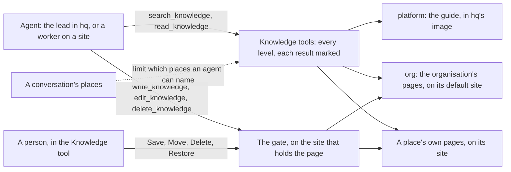

# Knowledge

**Knowledge** is what a place has written down so that everyone and every agent working there can find it: how it
releases, why it chose a design, how a client likes to be treated, how Agenthix itself works. It is kept as **pages in
sections**, searched by words, and changed through one gate that keeps the earlier version. Anything a place shares
across its workspaces can live in it: processes, decisions, conventions, reference.

What an agent learns on its own, a preference or a fact about a person, is not knowledge but
[memory](../memory/memory.md#3-knowledge-and-memory).



## Four levels

Every page belongs to one level, and a page's name starts with it, so a result always says where it came from.

| Level | Name starts with | Holds | Read by | Changed by |
|---|---|---|---|---|
| **Platform guide** | `platform:` | How Agenthix works: the user guide and its glossary, built into hq's image so it matches the running version | Every agent; anyone, as the published guide | The maintainers, in the product's own repository |
| **Organisation** | `org:` | How the whole organisation works: processes, policies, brand, clients | Every member, and every agent in every place | Organisation admins, and agents acting for one |
| **A project** | its key, such as `website-rebuild:` | The project's own workflows, decisions, conventions and reference | Its members, and agents working in it | Anyone who may change the project's files, and agents when asked |
| **Your space** | `personal:` | The person's own | The person, and agents in their space | The person, and agents when asked |

Your space works as a project does. Any other [personal project](../projects/personal-projects.md) is a project like
any other: its own place, its own knowledge at the level named after it. Only Your space is `personal:`.

Where pages differ, the most specific wins: a place's, then the organisation's, then the platform guide's.

## Pages, sections and properties

A **page** is one Markdown file with front matter; a **section** is a folder of pages, up to 8 deep. The platform
fixes only what it needs to list and search pages. How a team lays out its sections, names its pages and which
properties it records is its own, and a team that wants agents to follow its layout says so in its `AGENTS.md`.

```markdown
decisions/0002-monorepo.md
---
title: One repository for web and API
description: Why web and API share a repository.
tags: [decision, architecture]
status: accepted
date: 2026-10-20
---
```

| | Rule |
|---|---|
| Names | Letters, digits, hyphens, underscores and dots; no hidden names and no links |
| `title` | Required, up to 120 characters |
| `description` | One sentence, up to 300 characters |
| `tags` | Up to 8, lower-case words or hyphens |
| **Properties** | Any other front-matter field is a property of the team's own (`status`, `date`): kept as written, shown, searchable; text, numbers, dates or lists of them, up to 20 a page |
| Size | A page is at most 64 KB; a place holds up to 2,000 pages |
| Links | Relative Markdown links between pages; an organisation page from a project is `org:how-we-work/code-review.md`. A link to a missing page is listed as a problem but does not stop a save, so pages can be written in any order |

There is no index file: each page's front matter is its entry in the listing.

One set of rules, in `@agenthix/core` (`core/src/knowledge/`), is used by the gate, the listing and hq's editor, so
the limit a person is told is the one applied.

### What belongs elsewhere

| Kept in | What |
|---|---|
| The place's `AGENTS.md` | What every run must read |
| [Memory](../memory/memory.md) | Preferences, and what an agent learned along the way |
| A repository, in a workspace | Code and what belongs with it |
| Files and artefacts | Files made or uploaded, linked from a page |

## How agents find, read and change it

Five tools, shaped like the Grep, Read, Write and Edit that agents already know, for every agent and every level:

| Tool | Works like | Does |
|---|---|---|
| `search_knowledge` | Grep | Searches every level the agent may see with a word pattern; front matter is searched too (`status:\s*proposed` finds open decisions). Each hit is marked with its page's name. An empty pattern lists each level's sections and tags |
| `read_knowledge` | Read | Reads one page with line numbers, front matter included, and gives its version |
| `write_knowledge` | Write | Writes a whole page. A page that exists must have been read first, and the write carries the version read |
| `edit_knowledge` | Edit | Replaces one passage, which must appear exactly once |
| `delete_knowledge` | | Deletes a page, and says how to restore it |

The agent never picks a level: a search covers the conversation's places (or a run's one place), the organisation and
the platform guide, and `scope` only narrows it. The tools hold only the levels their caller holds, so a call cannot
name a place outside them. They share one set of file tools, `@agenthix/core/file-tools`, which run ripgrep for
search and take care that a pattern or a page name cannot reach outside its folder, run a shell, or hang
([the architecture](../../architecture/mcp/tools.md#what-the-knowledge-tools-do)). An agent's searches are limited to
30 a minute for each run or conversation; a person's own search in the Knowledge tool allows 120 a minute, as a person
types and the screen searches as they do.

**Agents change knowledge only when a person asks or corrects it.** "The release process is wrong: staging deploys need
Mia's approval now" makes the agent find the page and edit that one passage; the conversation shows *Updated page*
with Undo. "I prefer short answers" is memory, not knowledge. A correction to what a page says is kept in the page and
not remembered as well, because a memory beside the page would only go stale. Change tools are offered to the lead
only in a turn that answers a person, and to a worker only in a run that has write tools. `platform:` pages are never
changed from a conversation, and an `org:` change is refused unless the person the agent acts for is an organisation
admin.

Nothing of knowledge is in an agent's prompt beyond a few lines saying that it exists.

## The gate

Every change goes through the same steps, on the site that holds the page: an agent's write, edit or delete, and a
person's Save, Move or Restore in hq.

1. The change arrives as one finished change; there are no drafts.
2. It is applied to the current page. A write carries the version it started from, and a page changed since is
   refused with its current text. An edit that does not find its passage exactly once is refused, saying how many
   times it was found.
3. The result is checked against the rules above. Anything wrong refuses the change in words ("description is
   missing") and stores nothing.
4. The current page moves into the page's versions and the new one is renamed into place, so a reader never sees half
   a change.
5. hq records the change: the place, the page, whether it was created, edited, moved, deleted or restored, and who made
   it: a person, or an agent with the person it was answering and the conversation or run.

A person's editor checks the same rules while they type, and a page that only got onto the disk by hand, outside the
gate, is still listed, with its problems, under *Needs fixing*. Reading is never refused.

### Versions and Recently deleted

- A **version** is the whole earlier page. **Restore** saves one back through the gate, as a new version.
- **Delete** moves the page into its versions, marked deleted: it stays in **Recently deleted** for 30 days.
- A daily job on the site prunes: a page's versions are kept 30 days and its last 20 always; a deleted page 30 days;
  each place's versions together are capped at 200 MB, oldest first. The cap is the one limit that overrides the
  last 20: a place over it loses its oldest versions, even a page's last 20.
- A page, or one version of it, can be **deleted permanently** at once, for a pasted password or a person's details.

## Who reaches what

| | Platform guide | Organisation | A project | Your space |
|---|---|---|---|---|
| **Read** | Anyone | Every member; every agent | Its members; agents working in it | The person; agents in their space |
| **Change** | Maintainers only | Organisation admins; agents acting for one | Anyone who may change the project's files; agents asked to | The person; agents asked to |

What a **conversation** reaches is its own place, plus the places its person added, plus the organisation and the
platform guide ([places](../projects/places.md#the-places-a-conversation-reaches)). A worker, or a task's run, has the
one place it works in. Knowledge is not mounted into any run, so there is no way to read or change a page except the
tools.

## Where it is held

Pages are files on a site, outside the folder a run mounts:

```
<site root>/knowledge/projects/<project id>/   a project's: pages/ and versions/
<site root>/knowledge/users/<person id>/       a person's: the same
<site root>/knowledge/org/                     the organisation's, on its default site
```

The organisation's knowledge is placed on the organisation's default site the first time it is used, and hq records
where. Nothing of a page is copied into hq, except the record of who changed it; a site that cannot be reached makes
its pages unavailable, and a search says so rather than reporting nothing. The platform guide is the exception:
hq holds it in its own image and answers from it
([storage and placement](../../architecture/storage-and-placement.md#where-knowledge-lives)).

## What people see

The **Knowledge** tool of a project and of Your space shows a tree of sections beside the pages of the one selected,
with tags and properties as filters, *Needs fixing*, a page with **On this page** and **Linked from**, an editor with
fields for title, description, tags and properties, **History** with Restore, and **Recently deleted**. The
organisation has its own Knowledge entry in its area. A conflict (an agent saved the page a minute ago) keeps the
person's text and lets them see the change or save over it.

## What must not break

- A page changes only through the gate; no run mounts knowledge.
- A tool call can name only the levels its caller holds.
- A conversation reaches only its own place and the places its person added.
- A change always records who made it, and its previous version is kept until pruned.
- Nothing is left out of a failed call silently: every refusal says what is wrong and ends "Nothing was changed."

## Where in the code

| What | Where |
|---|---|
| Page rules, names, front matter, limits | `core/src/knowledge/` |
| The file tools: grep, read, write, edit, with their guards | `core/src/fileTools/` (`@agenthix/core/file-tools`) |
| The tools, levels, search across levels, the platform guide | `hq/src/knowledge/` |
| The tools as an agent sees them | `hq/src/server/controlplane/knowledgeToolSchemas.ts`; for a worker `site/src/server/mcp/forwardedKnowledgeSchemas.ts` |
| The gate, versions, pruning, the listing | `site/src/server/knowledge/` |
| The guide's build | `hq/src/knowledge/guideBuild/` |
| The record of changes | `hq/schema.prisma` (`KnowledgeChange`, `OrgKnowledgePlacement`) |
| The Knowledge tool's screens | `hq/src/storage/pages/knowledge/`, `hq/src/org/` |
| The lead's instructions about knowledge | `hq/src/conversations/lead/instructions.ts`; for a worker `site/src/agents/promptSectionText.ts` |

## Decisions behind this

[ADR-0149](../../adr/adr-0149-platform-knowledge-is-the-user-guide.md) (platform knowledge is the user guide) ·
[ADR-0150](../../adr/adr-0150-agents-reach-knowledge-only-through-tools-shaped-like-the-native-ones.md) (agents reach
knowledge only through tools shaped like the native ones) ·
[ADR-0151](../../adr/adr-0151-every-change-to-knowledge-goes-through-one-gate.md) (every change goes through one gate) ·
[ADR-0152](../../adr/adr-0152-a-conversation-reaches-only-its-own-place-and-the-places-its-person-added.md) (a
conversation reaches only its own place and the places its person added)
