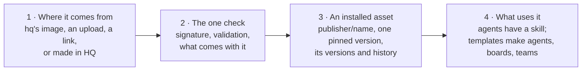

# Library

The Library is everything the organisation has **installed** for its agents: skills, and agent, board and team templates. Each of these is an **asset**. An asset is checked when it comes in, held by hq at one version, and changes only when someone publishes or updates it ([ADR-0157](../../adr/adr-0157-every-library-item-is-a-versioned-asset-pinned-once-per-organisation.md)).

1. **Sources.** Agenthix's own assets ship in hq's image. Others are uploaded as a package or fetched from a link. Others are made in HQ's editor.
2. **The check** is the same for every source and every kind ([installing](./installing.md)).
3. **An installed asset** has an identity, a version in use, and every version it has had.
4. **Use.** An agent *has* a skill ([library skills](./skills.md)). An agent, a board or a team is *made from* a template, and from then on is its own ([agent templates](./agent-templates.md), [board templates](./board-templates.md), [team templates](./workforce-templates.md)).

---

## The four kinds

| Kind | What it is | Made into |
|---|---|---|
| **Skill** | A folder with a `SKILL.md`: a routine agents follow | Nothing: agents have it |
| **Agent template** | A complete role: settings, instructions and the skills the role needs | An agent |
| **Board template** | A set of columns | A board in a project |
| **Team template** | Agents, teams, projects and boards | All of them, after a review page |

## Identity

Every asset is `publisher/name` plus a version, such as `agenthix/code-review` `1.3.0`. A template's role skill is named under its template (`agenthix/project-manager/read-context`).

**The publisher is whoever verifiably signed the package, as this organisation named them**, never what the package claims for itself. Three publishers are fixed:

| Publisher | What it means |
|---|---|
| `agenthix` | Agenthix's own: from hq's image, or signed by Agenthix's release identity. Nothing else can use it |
| `unsigned` | Installed with no signature. It never matches, updates or replaces a signed asset |
| The organisation's own name | What was made in HQ. It is written once from the organisation's name and never changes when the organisation is renamed |

A signer the organisation trusts gets a name the administrator chose (`acme`). The same name from a different signer is a **different asset**, never an update. Every asset inside a package, an embedded skill included, takes the package's publisher.

## Self-contained packages

An asset is one ZIP **package** with a manifest, `package.json`, and the kind's own files. **A package carries every skill it needs**; packages never refer to one another, so nothing can go missing and hq needs no resolver. Agenthix's build copies each shared skill into every template that uses it from one source. The manifest holds the asset's kind, name, description, version, its "based on" list, its licence and, for an offered skill, a hint about which agents suit it. Its `publisher` field is a claim, covered by the signature and checked against the signer.

A package is content, held by hq by its digest. It is never on a site's disk until a run needs it.

## Versions and the pin

hq records, for each asset, the **version in use**: the pin. Installing pins the version; everything that has the asset uses it. The rules:

- **One version at a time** per asset in the organisation. Different versions side by side are not offered.
- **Versions are SemVer** (major.minor.patch) and compare as such.
- **An update is explicit.** A newer version from the same signer is stored and offered as *Update available*, with what changed. It is never applied by itself, and *Skip this version* hides an offer until a later version is held.
- **Roll back** goes to any earlier version hq holds.
- **Any version can be installed on purpose**, newer or older, by administrators and Library maintainers, after a confirmation that says plainly when it goes back. It asks for a reason.
- **A released version never changes**: the same version with other content is refused.
- **A withdrawn version**, one its publisher took back, is installed only after a warning that names why. Agenthix's withdrawn versions ship in hq's image, so the warning works offline.
- **History.** Every move of the pin records who, when and why, and the version's note.

An asset made in HQ is published with *Publish*, which makes the next version ([drafts and proposals](../skills/drafts-and-proposals.md)).

## Editing makes your own copy

Another publisher's asset is not edited in place. *Edit* on `agenthix/code-review` makes **the organisation's own copy**, `acme/code-review`, from the version in use. When the copy is first published it takes the original's place for the agents that had it. The original stays installed, **set aside**, and *Use the original again* switches back in one click. In the Library the two are one entry: the copy's, with the original shown on its page as what it replaced. A newer original shows on the copy as news, with what changed, and is never merged by itself. An asset the organisation made is edited in place, with history.

An agent, board or team already made from a template is its own definition, edited in place, and never follows the template's later versions ([ADR-0072](../../adr/adr-0072-an-agent-is-defined-once-in-hq-and-overridden-per-boundary.md)).

## Based on

A copy carries a dated **based on** list, written once, when the copy is made: it inherits the original's list and adds the original as one line. Nothing rewrites it afterwards. A line shows as **verified** only when hq wrote it in this organisation and can match the original's fingerprint; a line from an imported package shows as **stated** by that package's signer, whatever the file says. People can add stated credits for sources hq never saw. The licence travels with the asset and is shown. Credit is recorded and shown, never required or certified.

## Which agents have a skill

A skill is had by **every agent** or by **chosen agents** (*Add to agents…*, *Remove from Ada*). Built-in skills are on for every agent unless an administrator switches one off. A template's role skills go to the agent made from it. There are no per-agent exceptions to a skill every agent has. Removing an asset names the agents that have it and asks first; the asset and its history stay, so their pages show it as missing with *Install*, and it can be installed again.

## Who may do what

Beside administrators there is one organisation role, the **Library maintainer**, named by administrators in the settings. Maintainers create, edit and publish every Library asset, accept updates, roll back and review proposals. They install from outside only if the organisation lets them. Removing, choosing which agents have an asset, trusting publishers, naming maintainers and the settings stay with administrators. When a member leaves their role is dropped, and the history still names them.

Everyone in the organisation reads the Library. One policy decides every action, by role and level; [drafts and proposals](../skills/drafts-and-proposals.md#who-approves) has the table.

## On screen

**Library** is in everyone's sidebar. Its rows list what is installed, with search and filters by kind and by state, and each row's actions in its menu. Its header leads to the proposals waiting for review, **Settings** (administrators), **New skill** and **Add skill**.

- **An asset's page** shows its versions and history, who has it, its signer or *Unsigned*, what it is based on, an *Update available* offer, and the actions its person may take.
- **Add** takes an upload or a link, or one of the shelf's skills, and shows the check's result before anything is installed ([installing](./installing.md)).
- **Export** makes the asset's package, unsigned, to share. **Import** installs a package only when nothing needs a person's look: Agenthix's own or one a trusted publisher signed. Anything else goes through *Add*.
- **Manage organisation › Settings › Library and skills** (administrators): trusted publishers, whether unsigned assets are allowed, who may install from outside, Library maintainers, built-in skills' switches, the default for skills found in files, and personal skills outside Your space.
- **Marketplace** is a *Coming soon* page until a marketplace opens. hq sends nothing from it.

A new organisation's agents carry only the built-in skills and what their templates bring.

## Related docs

- [installing.md](./installing.md): the check, signed and unsigned, trusted publishers
- [skills.md](./skills.md): built-in, offered and role skills
- [agent-templates.md](./agent-templates.md), [board-templates.md](./board-templates.md), [workforce-templates.md](./workforce-templates.md)
- [skills](../skills/skills.md): where skills live and how a turn receives them
- [architecture/skills-and-assets.md](../../architecture/skills-and-assets.md): the records and the pipeline
