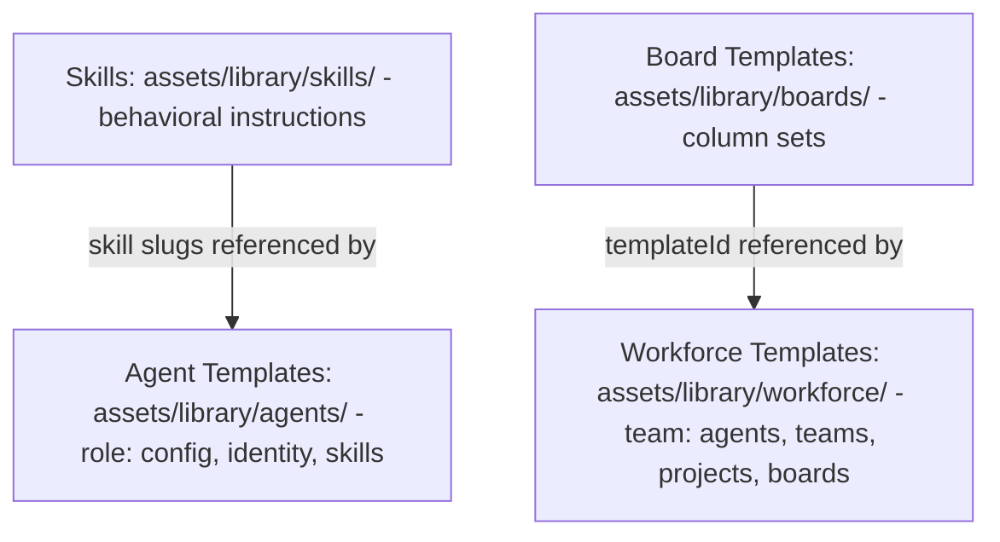

# Library

The Library is the platform's reusable-asset layer. It provides four types of pre-built content — skills, board templates, agent templates, and workforce templates (the Library's ready-made teams, or team templates) — that any org can use without authoring from scratch.

All library assets follow the same pattern: **the DB record is the index, files are the content**. At startup, asset files are scanned and their metadata (name, version, slug) is seeded into DB records. The DB stores an `assetPath` pointer — never raw content. File content is read from hq's own assets or hq's own storage when needed (on apply, on install, on export); an Execution Site never holds it.

Two roots determine where files are resolved:

| Root | Function | Dev path | Docker path |
|---|---|---|---|
| **assets root** | Platform-owned, read-only (`HQ_ASSETS_ROOT`) | `hq/assets` | bundled in hq's image |
| **hq storage root** | Org-created, writable (`HQ_STORAGE_ROOT`) | `<hq-storage-root>` | mounted volume |

Platform assets (`assetPath = library/…`) resolve under hq's assets root. Org assets (`assetPath = org/…`) resolve under hq's storage root. Neither is on a site's disk.

---

## Asset types

| Type | Source files | DB table | `assetPath` prefix | What it defines |
|---|---|---|---|---|
| **Skills** | `assets/library/skills/<slug>/SKILL.md` | `Skill` | `library/skills/<slug>` | Behavioral instructions staged for each agent turn |
| **Board templates** | `assets/library/boards/<id>.json` | `BoardTemplate` | `library/boards/<id>.json` | Column sets for project boards |
| **Agent templates** | `assets/library/agents/<slug>/` | `AgentTemplate` | `library/agents/<slug>` | Complete role: config, identity files, skill references |
| **Workforce templates** | `assets/library/workforce/<id>/` (a directory holding `template.json`; e.g. `wft-solo-dev/`) | `WorkforceTemplate` | `library/workforce/<file>` | Team compositions: agents, teams, projects, boards |

Org-created skills and board templates use `org/skills/<slug>` and `org/boards/<id>.json`, resolved under hq's storage root.

---

## How they relate



Agent templates reference skills by slug. Workforce templates reference board templates by ID and nothing else: each workforce bundle defines its own agents and holds its own skills, so it never refers to an agent template ([workforce-templates.md](./workforce-templates.md)).

---

## File → DB seeding pattern

Every asset type is seeded at startup using the same version-gated upsert:

```
if DB record missing  → insert with assetPath
if DB version < file  → update assetPath (and metadata)
if DB version ≥ file  → skip
```

Bump `version` in the source file to force an update on next startup. The DB record stores only queryable metadata — `name`, `slug`, `version`, `assetPath`. Content (markdown, JSON) is read from disk at runtime when the asset is applied, installed, or exported.

---

## On screen

Organisation › Library (`hq/src/library/pages/LibraryPage.tsx`) has the tabs **Agents · Boards · Skills · Teams ·
Marketplace**. Each of the first four lists its items as rows marked **Built in**, **Made here** or **Marketplace ·
v2.1** (with the publisher for anything not built in), with search, a filter by source, and for each item an action
and ⋯ (Export). Agents are added to the organisation's agents under a handle; a board is opened to see its columns;
a skill opens with its content, and for admins Install, Edit and Delete; a team opens its review page. Admins also
have **Import** (a package ZIP) and **＋ New**. Using an item makes the organisation's own copy.

**Marketplace** is on every hq. Until the marketplace opens with Agenthix Cloud it is a *Coming soon* page: what the
marketplace will be, **Get notified on agenthix.com ↗** (the website's sign-up, in a new tab; hq sends nothing),
**About Agenthix Cloud ↗**, and one example card for each kind of item. An hq updated to a release with the
marketplace shows it there. `/skills` opens the Skills tab (`/library?tab=skills`).

---

## Installed form vs bundled form

Assets that reference other assets by slug need two forms:

**Installed form** — what lives in the DB. References are slug-only. Lean, normalised, no content duplication.

**Bundled form** — what travels in an export/import payload. All referenced content is embedded inline so the package is self-contained and portable across orgs and instances.

An agent export from Organisation › Agents is the agent's current definition, as the package of kind agent; importing it there replaces that agent's content and settings in place, keyed by handle, and writes nothing into the library. Importing a package into the Library instead makes a library item (see Packages, below).

| Type | Bundled form? | Reason |
|---|---|---|
| Skills | No | The source is a `SKILL.md` file under hq's assets or hq's storage; the `Skill` row only indexes it |
| Board templates | No | Self-contained — no external references; always seeded on every instance |
| Agent templates | Yes | References skills that may not exist on the target |
| Workforce templates | Yes | References agents and skills that may not exist on the target |

---

## Packages: source, version and publisher

Every library item — an agent, a board, a skill or a team template — exports and imports as one **package**, so
a marketplace can later deliver the same packages. A package is a ZIP with one folder holding `package.json`
beside the kind's own files:

| Kind | Its files |
|---|---|
| `agent` | `agent.json`, `instructions.md`, `skills/<slug>/…` — the agent archive Organisation › Agents exports |
| `board` | `board.json`: its name, description and columns |
| `skill` | `SKILL.md` and the skill's other files; the folder's name is the skill's slug |
| `team` | `template.json`, `agents/<handle>/agent.json`, `skills/<slug>/SKILL.md` — a team template's bundle |

`package.json` records the package `format`, its `kind`, `name` and `description`, its `source` (`built_in`,
`made_here` or `marketplace`), its `version` as its publisher numbers it (`2.1`), and its `publisher`.

Each library row records the same: `source`, `packageVersion` and `publisher`. Built-in items are seeded as
Built in, published by Agenthix; anything shipped in hq's assets reads as Built in whatever its row says.
**Importing** makes the organisation's own item, its files in hq's storage (`org/agents/<slug>`,
`org/boards/<id>.json`, `org/skills/<slug>`, `org/teams/<id>`), keeping the version and publisher. An import is
never Built in: an item another hq built in arrives as made by its publisher, and a marketplace item stays one.
Importing over an item made here or installed replaces it; an item with a built-in one's name or id is refused.

A **team template holds agents only**, with their boards; people are added after it is used. A template that
names people is refused.

Exporting and importing are for organisation admins. The code is `hq/src/library/packages/`.

## Related docs

- [skills.md](./skills.md) — skills as a library asset: DB schema, seeding, slug prefixing, full catalogue
- [board-templates.md](./board-templates.md) — board template format, DB schema, system templates
- [agent-templates.md](./agent-templates.md) — agent template format, DB schema, canonical roles
- [workforce-templates.md](./workforce-templates.md) — workforce template format, DB schema, apply paths
- [skills.md](../skills/skills.md) — skill sources and how they are staged for each turn
