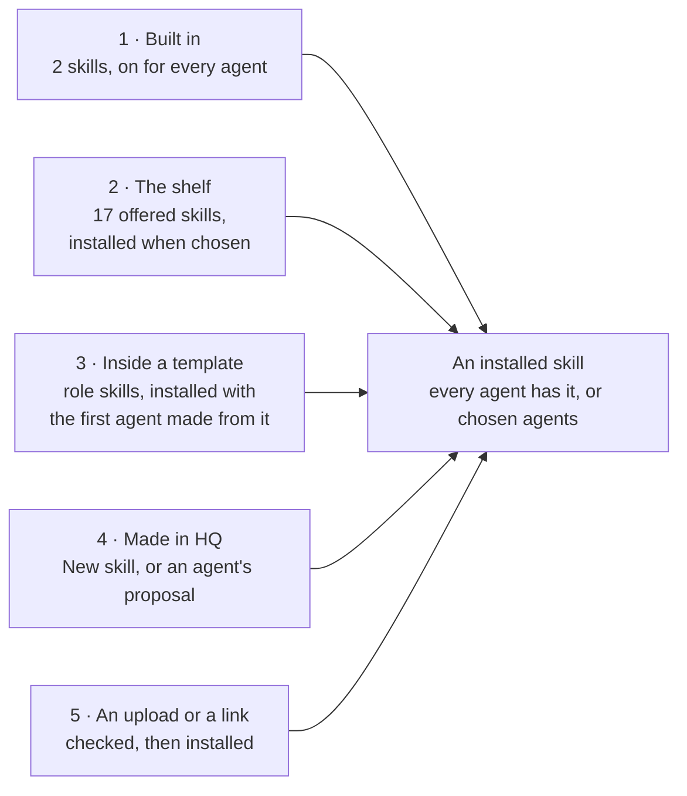

# Skills in the Library

A skill is one kind of asset ([library.md](./library.md)). This page is the skills Agenthix ships and what the Library does with a skill that other assets do not. Where skills live and how a turn receives them is [skills](../skills/skills.md).

1. **Built in** skills ship with hq and are on for every agent. An administrator can switch one off, and nobody can edit or remove one ([ADR-0156](../../adr/adr-0156-built-in-skills-sit-beside-platform-knowledge.md)).
2. **The shelf** is Agenthix's offered skills. Nobody has one until someone installs it.
3. **A role skill** belongs to its template, is named under it, and goes with the agent made from it.
4. **Made in HQ**: the organisation's own, published under its own publisher name.
5. **From outside**: signed or unsigned ([installing](./installing.md)).

---

## Built-in skills

A built-in skill is written for the agent: it says what to do. The user guide, which agents search as the platform's knowledge, says what things are. A built-in gives the steps and points to guide pages rather than describing the product again, and it ships with hq so it cannot go stale. Two ship today:

| Skill | For |
|---|---|
| `working-with-git` | Working in a git repository through the place's approved push, pull and pull-request workflows, never a plain `git push`. Given to a run only when it works in a git repository |
| `skill-creator` | Writing a good skill, and proposing it instead of writing it into files. Teaches whether something belongs in a skill, in instructions or in knowledge |

Built-ins are the `agenthix/…` skills in the Library marked built in, with a switch in Manage organisation › Settings › Library and skills. A switch survives releases.

## The shelf

17 skills, each carrying a *suited to* hint that the Add page can filter by: a hint, never a lock.

| For | Skills |
|---|---|
| Developers | `dev-api-development`, `dev-code-quality`, `dev-code-review`, `dev-ui-development` |
| Product | `pm-backlog-management`, `pm-sprint-planning`, `pm-stakeholder-comms` |
| QA | `qa-bug-reporting`, `qa-test-planning` |
| Content | `content-writing`, `content-review`, `editorial-planning`, `seo-research`, `technical-writing` |
| Research | `research-methodology`, `research-reporting`, `data-analysis` |

Installing one makes `agenthix/<name>` and pins its version. Because it is an asset, it can be updated when a newer one ships, rolled back, edited into the organisation's own copy, and removed. A skill an agent has costs listing space on every request, which is why a new organisation has none of these by default.

## Role skills

An agent template carries the skills its role needs, such as `write-brief` for the product manager. They are not on the shelf and cannot be installed on their own; they are installed when the first agent is made from the template, and the agent is *given* them. Removing one the agent needs leaves the agent made without it, and its page shows it as missing.

## What the Library keeps about a skill

- **Versions and history**, as for every asset.
- **Who has it** and, for a skill hq has seen used, **when it was last used**, by which agent and in which project or personal space.
- **A draft**, one at a time, shared by everyone who may edit.
- **The agent's cost**: an agent's page estimates what its skill listing costs per request and warns above about 20 skills or 4,000 tokens.

An agent's page lists everything it has, in groups: built in, those every agent has, those it has, where it works, its own, and any set aside.

## Related

- [library.md](./library.md)
- [skills](../skills/skills.md), [authoring](../skills/authoring-skills.md), [drafts and proposals](../skills/drafts-and-proposals.md)
