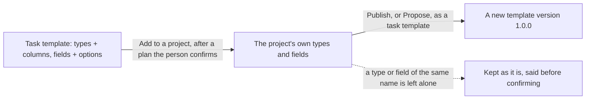

# Task Templates

A task template is a Library item that holds a project's **task types** with their columns, its **custom fields** with their options, or both. Installing one into a project **adds** them: the person gets, say, a Bug type with Reported, Triaged, Fixing and Verified columns and a Severity field, without building them by hand. It replaces the board template of the model before types and views: a board is now a saved view of a project's tasks, so it is not shared; what is worth sharing is how a kind of work is arranged ([board.md](../tasks/board.md), [task.md](../tasks/task.md#type-column-and-state)).



---

## What a task template contains

A task template is an asset of kind `task-template` ([the Library](./library.md)): a package holding one file, `task-template.json`, beside its manifest.

```
task-template.json
  ├── types[]
  │     ├── name
  │     ├── icon          - a name from the icon set; unknown ones draw as the task icon
  │     └── columns[]
  │           ├── name
  │           ├── state   - BACKLOG | TODO | IN_PROGRESS | DONE
  │           ├── colour? - neutral | accent | success | warning | danger
  │           └── default? - the state's default column
  └── fields[]
        ├── name
        ├── type          - SINGLE_SELECT
        └── options[]     - name, colour?
```

Every field is checked and bounded when the file is read, since packages come from outside (`core/src/tasks/taskTemplate.ts`). A type has at most 20 columns, each of the four states has at least one column and exactly one default (a state with one column needs no `default`), names are unique ignoring case, and a project has at most 30 types and 30 fields. Task and Epic are in every project, so a template never carries them. A task template carries no tasks, boards or skills.

---

## Adding one to a project

Adding **extends** the project (`hq/src/library/taskTemplates/templateInstall.ts`):

- Each type and field the template holds is added, unless the project already has a type or field of that name, ignoring case. That one is **left alone**, never changed or merged, and the person is told so before they confirm ("already in Website relaunch", with the options it keeps for a field).
- The person sees the plan first. The install names the version and the names it expects to add, and is refused if either moved on, so nothing is added that the person was not shown. The button says what it adds ("Add 1 type and 1 field"), and is greyed with why when there is nothing to add.
- What is added is **the project's own**. It keeps a read-only note of the version it came from, and later versions of the template never reach it ([ADR-0072](../../adr/adr-0072-an-agent-is-defined-once-in-hq-and-overridden-per-boundary.md)).

Anyone who may work in the project may add a template to it, as they may define types and fields.

---

## Sharing a project's types and fields

A project's own types and fields can be shared, from the project's Settings, as a new task template (`templatePublish.ts`). The rules are the skills' ([ADR-0157](../../adr/adr-0157-every-library-item-is-a-versioned-asset-pinned-once-per-organisation.md), [ADR-0159](../../adr/adr-0159-agents-draft-skills-people-publish-them.md)):

- **Library maintainers and administrators publish** it to the organisation's Library, as version 1.0.0 of an asset under the organisation's name.
- **Anyone else who may work in the project proposes** it, and a maintainer reviews the proposal (`templateReview.ts`): accepting publishes it, rejecting needs a note. Only the reviewers and the person who proposed it see it.
- **An agent only drafts or proposes**, and a person publishes; its request is an approval card.
- The project's types and fields stay as they are and do not start following the template.

Organisation-wide task types are later work.

---

## Agenthix's templates

Two ship in hq's image and are installed as `agenthix/<name>` when hq starts. They are read-only in the Library, and a copy can be made to change one ([editing makes your own copy](./library.md#editing-makes-your-own-copy)).

| Identity | Name | Holds |
|---|---|---|
| `agenthix/issues` | Issues | Bug (Reported, Triaged, Fixing, Verified) and Feature request (Submitted, Accepted, Building, Testing, Shipped), and a Severity field |
| `agenthix/product-roadmap` | Product Roadmap | The types and steps of a product roadmap |

---

## Where task templates appear

- **Library** (`/library`), filtered to task templates
- A project's **Settings**, in its task types and custom fields, to add one or to publish or propose its own

---

## Agent integration

When an agent reads a task or a board, the response names the task's type and its type's columns, each with its name and the state it sits in; `list_boards` lists every type with its columns and every field with its options. The agent uses them to choose the right column for `update_task` (a `columnId`, or a `state` for the type's default column). The same columns are put into the prompt of a task run.

---

## Related

- [library.md](./library.md): assets, versions and the pin
- [workforce-templates.md](./workforce-templates.md): team templates
- [board.md](../tasks/board.md): boards as saved views, columns, sprints, custom fields
