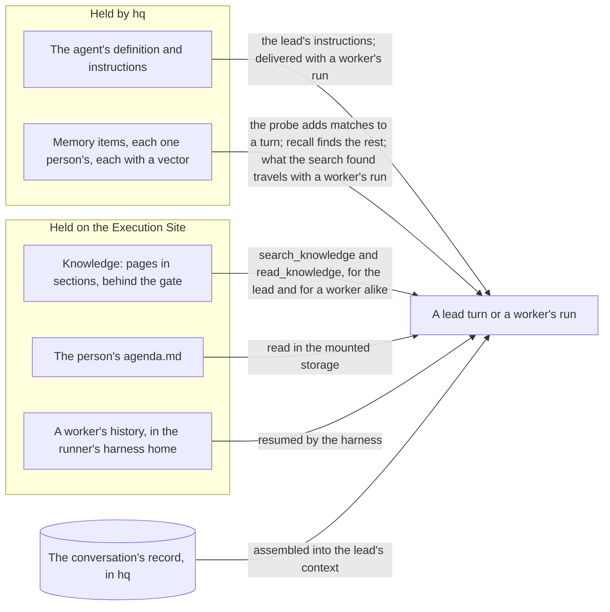

# Memory: What an Agent Knows

Agenthix has no single "memory". What an agent knows comes from six places, held in different systems and visible
to different people; a seventh, Claude Code's own automatic memory, is switched off.

Memory by meaning is part of the conversation layer ([conversations](../conversations/conversations.md)).

---

## 1. The agent's definition and instructions

An agent is **one current definition held by hq**: its name, role, instructions and
settings, with the installed skills it has. Edit it and the next run uses it; there is no version number
([ADR-0072](../../adr/adr-0072-an-agent-is-defined-once-in-hq-and-overridden-per-boundary.md)). Its instructions are
held as packages (`Package` and `PackageContent` in `hq/schema.prisma`; kinds agent, organisation,
platform and skill) and a run is told the fingerprint of what it should use; a site fetches and caches it. A project,
or a person in their own storage, can add instructions or skills on top without changing the agent
itself (`hq/src/agents/overrides/`). The **lead** of a conversation, which runs in hq, reads the agent's own
instructions and the organisation's, after rules for how it talks; the overrides and the place's `AGENTS.md` are files on
a site, so a worker reads them and the lead does not. See also
[ADR-0059](../../adr/adr-0059-an-agent-is-a-versioned-package.md), whose version numbers ADR-0072 removed.

## 2. Memory: what it has learned

hq holds **memory items**: short records of what an agent learned, kept so a later conversation or run can use them.
An item is a **Fact** (anything true about the person) or a **Rule** (how the person wants things done) (`MemoryItem`,
`hq/schema.prisma`; [ADR-0188](../../adr/adr-0188-memory-is-a-persons-saved-by-an-agent-where-it-works.md)).

**Every item belongs to one person**, and may name one agent and one place. That is its scope, and it is checked
before the meaning search (`hq/src/memory/scopes.ts`): the person must be the one the turn or run is for, and an agent
or place the item names must be the turn's or run's. An agent saves for the person, itself and the place it works in, so
a new item names all three; it takes no scope from the agent. Only the person widens it, by **promoting** it, with two
switches: from the agent that saved it to every agent, and from the place it was saved in to everywhere. An item
with no person does not exist: what an agent learns about a place, for everyone working there, belongs in that place's
[knowledge](../knowledge/knowledge.md), which stays the team's alone.

| An item names | Reached by | Leaves its place? |
|---|---|---|
| Person, agent and place (as saved) | That agent, working for that person, in that place | No |
| Person and place, no agent (promoted to every agent) | Any agent working for that person in that place | No |
| Person and agent, no place (promoted to everywhere) | That agent, working for that person, in any place | Goes with the person |
| Person only (promoted both ways) | Any agent working for that person, anywhere | Goes with the person |

**One rule says whose memory a call reaches** (`hq/src/memory/principal.ts`). The person a run or turn is for is the
author of the message that commissioned it: a conversation's person, the person who pressed Run, the sender of a message
into a task's session. A run nobody commissioned, such as a Run at… time's, is for no person and reaches no memory; a
`remember`, `recall` or `forget` there is refused, with the reason. Nothing about who is asking is read from the call's
arguments.

**An item** has a title (at most 120 characters), a body (at most 1,500) and up to 8 tags, a kind, and a key hq assigns
from the scope and the title unless the writer names one; writing to an existing key replaces it. It must **stand alone**:
`remember` refuses one that cannot be understood without its conversation ("do that"). There are at most 2,000 per scope.
It records the agent that saved it and the place it was saved in (kept when it is promoted, so a switch can flip back),
how often it was recalled and used, when it was last recalled, and what it replaced. A memory a person did not ask for
is saved quietly; one they did ask for ("remember this", or a correction) is marked `requested`, and only that one
gets a line in the conversation.

**Recall is by meaning.** Each item's title, body and tags are embedded once when written. The model is a small open
sentence model hq bundles (`all-MiniLM-L6-v2`, 384 dimensions), so every install embeds the same way with no key. An
organisation may switch to a provider's embedding model, and everything is re-embedded in the background, the old
vectors serving until it is done. The vectors are a column on the item and hq searches them exactly, with no separate
store. A result is ranked by **similarity times warmth**, where warmth rises with use and decays with time since last
recalled (a half-life of 90 days, floored so a year-old item is still reachable), cut at the top 8 and about 2,000
tokens, each with its key and provenance. `recall` may be narrowed by kind and by tag.

**What decides a recall** (in a conversation) has three tiers. Before each turn hq runs a **probe**: it embeds a composed
query, the conversation's running topic, the last two exchanges and the new message, and compares it with the items the
turn may read.

- **Certain**: similarity above a high bar. Up to three items are written into the turn, marked as memory.
- **Probable**: between the bars. A one-line hint names up to three by title and key; the lead decides, and `recall` by key
  reads one. A **Rule** found by meaning between the bars is not hinted but included in full, as if it were certain: a
  rule such as "use a table when comparing options" is missed when the person's words do not sound like it.
- Within a tier, Rules come before Facts, each by similarity times warmth, under the same caps: three included and three
  hinted, with what passes the first cap moving down to the hint.
- **Silent**: nothing is added. The lead may still recall on its own judgement, guided by its instructions (the person
  asks what they prefer, refers to the past, names something not yet seen, or corrects the lead).

Nothing is carried into every turn: no item is present unless meaning found it.

The probe is given 2 seconds; if it is late the turn goes on without it. The bars start at the model's calibration
(0.62 and 0.45) and move a small step a day for each organisation from what happened: the lead marks the items it
relied on, and an item it needed that the probe scored too low counts as missed. A Rule included only because of its
kind is marked, and the bars do not learn from it. The organisation's memory page shows these figures.

**Keeping memory small.** `remember` compares the new item with the nearest in its scope; at 0.92 similarity or above it
does not add: a newer Rule replaces an older one, a Fact is joined onto a Fact, and an item the old one already says
all of changes nothing. Once a day hq merges near-duplicates and **archives** items nobody has recalled
for 120 days: kept, and reached by key or a direct question, but not searched by default.

**The person owns their memory, and cannot write it.** **Settings › Memory** is one flat list of everything agents
remember about them, newest first, each with badges for its kind, its agent (or *Every agent*) and its place (or
*Everywhere*), filtered by kind, agent, place, tag and words (`hq/src/memory/screen/`). Opening an item shows the one
memory dialog: the two switches that promote it, each press saved at once, and **Forget**, which deletes it. The words
of an item are read only; to change one, the person tells the agent. An agent's own page shows what that agent
remembers about them, then what every agent knows, with the same dialog; a project has no memory section. A line
in a conversation, **Show**, opens the dialog too. Nobody else reads a person's memory, an administrator included.

**The agent's tools** are `remember`, `forget` and `recall`. A lead's turn calls them in process; a worker through its
site's endpoint under its run's capability, and its helpers inherit them. `remember` takes a kind (`fact` or `rule`),
not a scope. A worker also starts with **what memory found for its work**: at the run's start hq runs the same search a
turn does, with the run's brief as the query (`hq/src/memory/runMemory.ts`), and the site writes the result as a
read-only file in the run's staging (`pinned.md`, in a folder still named `pinned-memory/`), refreshed at every run
start, which its prompt points to. A run that is not given a person never sees a person's items. Nor does a run in a
home other people's runs share — a project's own task runs, which share the project's home and container: it gets no
memory at all, and a person's memory is reached only from a run in that person's own home
(`hq/src/memory/principal.ts`).

**Why in hq, and not a site**: a person's storage and a project's may be on different sites, and one site cannot read
another's disk. Held in hq, an agent knows the same things wherever it works, and the lead, which lives in hq, can read
it directly.

## 3. Knowledge and memory

[Knowledge](../knowledge/knowledge.md) is the other thing an agent can look up. It is **the team's**: pages in sections
that the organisation, a project or a person keeps for everyone to use, found with `search_knowledge` and
`read_knowledge` by the lead and by a worker alike, and changed only through one gate. It is held on the sites, never in
hq (except the platform guide, which is hq's own), and no run mounts it.

The two differ in who writes them and what for:

| | Memory | Knowledge |
|---|---|---|
| **What it holds** | Short records of what an agent learned: a preference, a decision, a fact about a person or a place | Pages a place keeps on purpose: processes, workflows, decisions, conventions, reference |
| **Who writes it** | The agent, as it learns; nobody by hand | A person; an agent only when a person asks or corrects it |
| **Found by** | Meaning (`recall`), with the probe adding matches to a turn | Words (`search_knowledge`), when the agent looks |
| **Held** | In hq, one person's each | On the site that holds the place, as files |
| **Seen by others** | Only by the person it belongs to | By everyone who may read the place |

**The line between them.** What an agent learns on its own belongs in memory. What a person asks to have written down
for the team, or a correction to what a page says, belongs in the page: the agent changes that page and does not
remember it as well, since a memory beside the page would only go stale. `recall` searches memory only; it no longer
searches knowledge. An agent that notices something worth sharing remembers it, and may offer to add it to the place's
knowledge.

## 4. The agenda

A person's **agenda** is a short file, `agenda.md`, of what needs that person's input or a decision: a
"Now" list and a "Waiting" list, three items each. There is one per person per storage: in a project it
sits in that member's area under `members/` (readable by the whole project), and in a person's own storage
it sits in `files/`. Whichever agent they work with there reads and updates the same file, which is
included in the prompt (`core/src/storage/agenda.ts`, `site/src/agents/agendaService.ts`).

## 5. The conversation's own history

A conversation's words are kept by hq, in its record, and the lead reads them assembled into its context; when they grow
too large they are folded into segments the lead can reopen ([long conversations](../conversations/long-conversations.md)).
Nothing about this is a memory item.

A **worker's** history is different: it is held by the harness, the program that talks to the model, in the runner's
**harness home** on the site, which sits beside storage, never inside it, so no other container can read it
([Storage and Placement](../../architecture/storage-and-placement.md#on-the-sites-disk),
[Container runtime](../../architecture/container-runtime.md)). If that state is gone, a worker's slot gets a fresh
session; a chat held on a site and a task's session are closed rather than resumed blind
([ADR-0076](../../adr/adr-0076-a-conversation-whose-harness-state-is-gone-is-closed.md)). The harness may summarise its
own copy when it fills; the site reads how full it is and shows it ([sessions](../agents/sessions.md#the-agents-memory)).

## 6. Claude's own automatic memory is switched off

Claude Code can write its own memory notes between sessions. Agenthix turns it off for every Claude run
(`autoMemoryEnabled: false`, `site/src/agents/runtime/claude/claudeStart.ts`), so the only things an agent
remembers are the ones above, each of which a person can see and change.

## What must not break

- Every item names a person; nothing reads or writes one with no person, and a run nobody commissioned reaches none.
- Nothing a caller passes sets or widens an item's scope: only the person promotes.
- An item that names an agent is never delivered to another agent, nor one that names a place outside it.
- Nobody adds or edits an item's words by hand; the person promotes and forgets.
- No item is carried into every turn.
- A correction to what a knowledge page says is kept in the page, not as a memory item as well.
- An item stands alone: it is read months later by a different turn.
- Memory stays in hq. Do not move it onto a site's disk; a worker's memory file is a read-only copy.

## Where in the code

| What | Where |
|---|---|
| Items, scopes, limits | `hq/schema.prisma` (`MemoryItem`, `MemoryOutcome`), `hq/src/shared/memory/protocol.ts`, `hq/src/memory/scopes.ts`, `memoryService.ts` |
| Whose memory a call reaches | `hq/src/memory/principal.ts` |
| Embedding, ranking, the tidy, the bars | `hq/src/memory/embedding/`, `ranking.ts`, `tidy.ts`, `barTuner.ts`, `maintenance.ts` |
| The probe and the lead's memory tools | `hq/src/conversations/memory/` |
| Knowledge, which `recall` does not search | `hq/src/knowledge/` ([knowledge](../knowledge/knowledge.md)) |
| A worker's memory file | `hq/src/memory/runMemory.ts`, `site/src/agents/runtime/pinnedMemoryFiles.ts` |
| Scope, promotion | `hq/src/memory/scopes.ts`, `scopeChange.ts` |
| The tiers and the Rule weight | `hq/src/conversations/memory/tiers.ts` |
| The memory screen | `hq/src/memory/screen/` |
| Agent definition and packages | `hq/src/agents/`, `hq/schema.prisma` (`Package`) |
| Agenda, the memory prompt section | `site/src/agents/agendaService.ts`, `site/src/agents/promptSectionText.ts` |

## Decisions behind this

[ADR-0188](../../adr/adr-0188-memory-is-a-persons-saved-by-an-agent-where-it-works.md) (a memory is a person's, saved by an
agent where it works; a Fact or a Rule) ·
[ADR-0122](../../adr/adr-0122-memory-is-recalled-by-meaning-in-three-scopes.md) (recall by meaning; its three scopes and
pinned items are superseded) ·
[ADR-0058](../../adr/adr-0058-memory-of-a-person-is-held-by-hq-in-two-layers.md) (hq holds a person's memory; the person
reads it and forgets it, but no longer changes its words) ·
[ADR-0059](../../adr/adr-0059-an-agent-is-a-versioned-package.md) ·
[ADR-0072](../../adr/adr-0072-an-agent-is-defined-once-in-hq-and-overridden-per-boundary.md) ·
[ADR-0076](../../adr/adr-0076-a-conversation-whose-harness-state-is-gone-is-closed.md)
