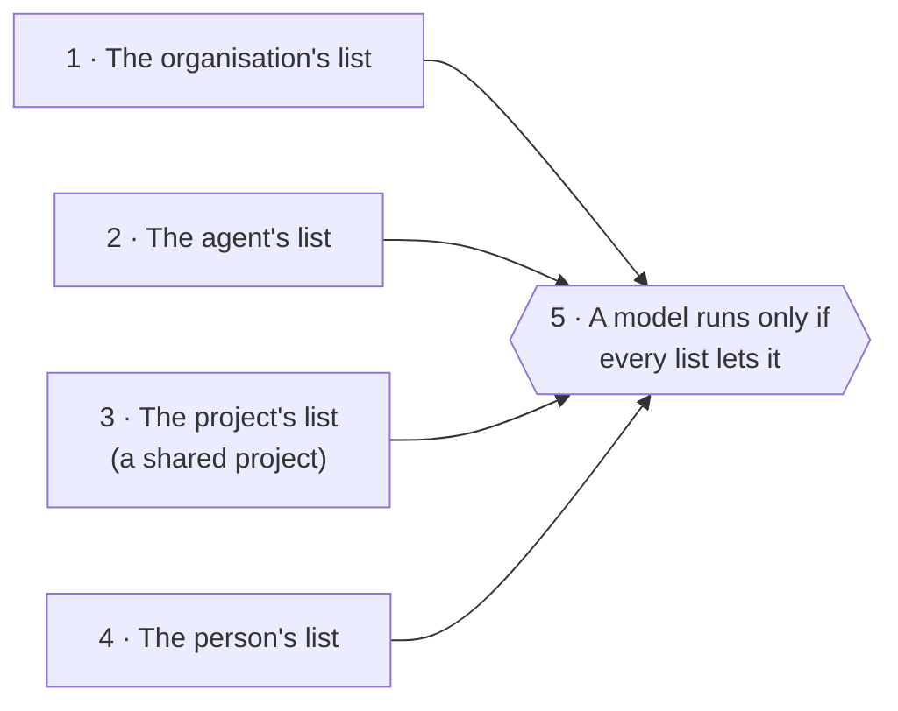

# Which models may run: lists

A **list** says which models may run. Four kinds of owner can hold one, and every list that applies to a call narrows
the set: a list never adds a model another has removed.

| Owner | Who changes it | Applies to |
|---|---|---|
| **The organisation** | Organisation admins, on **Manage organisation › Models** | Every call |
| **An agent** | Organisation admins, on the agent's page in the admin area | Every call that agent makes, wherever it works |
| **A project** | The project's admins, in the project's settings | Calls made in that shared project |
| **A person** | That person alone, in **Settings** | Everything they do, in their own place and in shared projects |

A personal project has no list of its own: its person's list applies. A person's own list cannot be changed by anyone
else, an organisation admin included.

## What a list says

A list has a mode and some entries.

| Mode | Lets run |
|---|---|
| **Any model your providers reach, except these** (the default) | Every model, except the entries marked **Never** |
| **Only these** | Only the entries marked **Only**. New models stay off until a name or pattern covers them |

An entry marked **Never** applies in either mode, so a **Never** inside **Only these** carves an exception out of it. A
**Never** always beats an **Only**. Under a project's, an agent's or a person's list the screen shows how many models the
list above allows and how many remain here.

Because a list only narrows, a model the organisation's list rules out cannot be brought back by a project, an agent or a
person. To allow it, an organisation admin widens the organisation's list.

## Names and patterns

An entry is a model, such as `anthropic/claude-sonnet-5`, or a pattern with `*` standing for anything:

| Entry | Matches |
|---|---|
| `deepseek/*` | Every model a maker named DeepSeek makes |
| `anthropic/claude-*` | Every Claude model |
| `*-pro` | Every model whose name ends in `-pro` |
| `gpt-5` | A name with no maker: matched against the model's name alone, so OpenAI's |

An entry matches a model's **maker and name**, never its provider, so a list keeps up with new models without naming who
serves them: banning `deepseek/*` bans it via every provider. A dotted version reads as a hyphenated one
(`claude-sonnet-4.5` and `claude-sonnet-4-5` are the same), and case is ignored. The editor shows how many models each
entry covers, and offers a bulk selection over the reachable models.

## What a list does not do

A list narrows which models may run. It does not choose one, and it does not change a provider's key or state. When a
list leaves nothing that a working provider reaches, the call fails with a problem saying so, and an organisation admin
can widen a list; a conversation already on a model that a list now rules out is offered the same model elsewhere or the
default, as for any choice that stops working ([models](models.md#how-a-model-is-chosen-for-a-call)).

## Where in the code

| What | Where |
|---|---|
| Matching an entry against a model | `hq/src/routing/listMatch.ts` |
| Reading and writing a list; who may change it | `hq/src/models-settings/modelLists.ts` |
| The editor | `hq/src/models-settings/components/ListEditor.tsx`, `OwnList.tsx` |
| The kinds, modes and effects | `core/src/providers/modelLists.ts` |
| Schema | `hq/schema.prisma`: `ModelList`, `ModelListEntry` |
