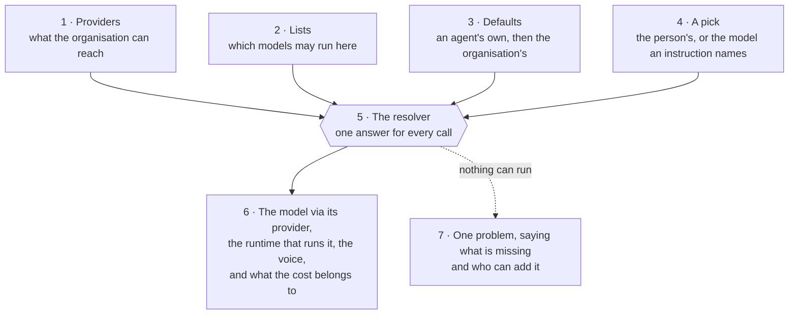

# Models

Which model answers a conversation, does a task's work, writes a title, listens or speaks is decided in one place,
for every call, from what the organisation's [providers](../providers/providers.md) reach. A person or an agent never
holds a key or a runtime setting: they choose a model, and the provider comes with it.

A **model choice** always names the provider that serves it, written *Claude Sonnet 5 · via Anthropic*. A model two
providers reach is two choices, because they may differ in price, reliability and who can see the prompt.

## What can be chosen

| Setting | What it is |
|---|---|
| **Conversation model** | What talks in a conversation, and writes its titles and summaries |
| **Worker model** | What does the work: a task's run, a worker started from a conversation, and the helpers a run starts |
| **Speech to text** | Listening, in voice |
| **Text to speech**, with the **voice** | Speaking, in voice |

The organisation's four are its **defaults**, set by organisation admins on **Manage organisation › Models**.
[Setup](../setup/setup-flow.md) writes all four, so a new organisation never starts without models and voice. Beside
them, a [list](lists.md) says which models may run at all.

An **agent** may have models of its own, on its page in the admin area: its own conversation model, worker model, speech
to text, and text to speech with its voice. Each row says whose it is. A row left as the organisation's follows the
organisation when it changes; an agent's own is used instead. An agent has no light or heavy tier and no runtime setting:
the model decides the runtime ([below](#the-runtime-follows-the-model)).

Memory search never asks: it always uses HQ's built-in embedding model.

## How a model is chosen for a call

Every call asks the resolver, giving what the call is for (a conversation reply, a title, a summary, work, a helper,
listening, speaking, or the voice sample phrase), where it is made, the agent, and the person. It works in two steps.

**1. Which models may run.** Every model that a working provider reaches, each as a model via a provider, narrowed by
every [list](lists.md) that applies. A provider that is not working is skipped. A person's own Claude subscription is
offered only for work in their own place.

**2. Which one.** The first of these that may run:

| For | In order |
|---|---|
| A conversation | The model the conversation is on, fixed when its first turn is answered; before that, the agent's own conversation model, then the organisation's |
| Titles and summaries | The conversation's own model |
| Work | The model the person's or the task's instruction names, else the agent's own worker model, else the organisation's |
| Listening and speaking | The agent's own speech to text or text to speech, else the organisation's |
| The voice sample phrase | The organisation's conversation model; it belongs to no place |

A **choice made for the call** (a person's pick, the model a conversation is on, the model a task names) is used as it
is or not at all. HQ never switches it silently: if it cannot run now, the person is told why and offered the same model
via another provider, else the model a new conversation would get, and nothing changes until they accept. A provider
that comes back switches nobody back.

A **default** (an agent's, then the organisation's) falls through when it cannot run: first the same model via another
provider that works (Anthropic's own key first), then the next layer, then any model that may run. The call says once
what was not used and why.

When nothing can run, the resolver answers with one problem that names what is missing and who can fix it:

| Problem | Said as | Fixed by |
|---|---|---|
| No provider of the type works | *No model provider is working. An organisation admin can add one, or fix the one there is.* | An organisation admin |
| A fixed choice's provider is not working | *The provider isn't working: Anthropic refused its key. An organisation admin has been told.* | An organisation admin, or the person picking another |
| Every model is cut by a list | *No model this agent may use is reached by the organisation's providers.* | An organisation admin |
| The pick is cut by a list, or its provider does not reach it | *That model is not one the lists here allow. Choose another…* | The person, or an organisation admin |
| Nothing chosen and nothing to fall to | *No model is chosen for this agent…* | An organisation admin |
| A subscription outside its owner's place | *Your own Claude subscription is used only for work in your own place…* | The person |

## Choosing a model as a person

- In a conversation, the **model picker** in the message box's plus menu lists exactly what the resolver would let run
  for that conversation now: the lists that apply, the person's own place, and each model as *model · via provider* with
  its price band. A provider that is not working is shown greyed out. A pick is checked on the server when it is made,
  never taken from the screen. Switching writes a quiet line into the thread and costs one reply that reads the
  conversation again. A task's thread has no picker: it talks on its agent's default model.
- A **task**, a routine and handed-off work can name a model for their runs. It is checked when it is saved against
  what may run in that place for that person and agent, and again when the run starts, because lists and providers
  change meanwhile. Left empty, it follows the agent's own worker model, else the organisation's. When the person's own
  words name a model for handed-off work, the lead passes one from the list of models that may run for that person and
  agent; it never invents one.
- A person can narrow what they may use in **Settings**, and a project's admins what a project may use ([lists](lists.md)).

## The runtime follows the model

Work runs in a harness on a site: Claude Code or OpenCode ([runtimes](../agents/agent-runtime-model.md)). Nobody chooses
it. It follows the model and the provider the resolver chose: a Claude model on an Anthropic key, a person's own Claude
subscription, or a Claude model through Agenthix Cloud runs on Claude Code; anything else runs on OpenCode. A conversation's replies are direct
model calls made by HQ and use no harness.

## What a provider reaches

A choice must be a model the provider reaches. For the organisation's own keys that is HQ's pinned catalogue (generated
from the catalogue of the OpenCode version the agent image carries, with each model's price); an OpenAI-compatible
endpoint reaches the models a choice names on it, typed by an admin; Agenthix Cloud's models will come from Cloud's own
catalogue once HQ's calls to it exist, so it reaches none today. A voice provider reaches no model: voice is chosen as
[speech models and a voice](../conversations/voice.md#the-speech-models-and-the-voice).

## Where in the code

| What | Where |
|---|---|
| The rule, with no database | `hq/src/routing/decide.ts`; its inputs `snapshot.ts`; the words of a problem `problems.ts`; list matching `listMatch.ts` |
| The request and the answer, shared | `core/src/providers/resolver.ts` |
| The Models page and an agent's own models | `hq/src/models-settings/` (`ModelDefaults`, `AgentModels`) |
| The picker's server side | `hq/src/conversations/modelChoice.ts`, `access/talkingModel.ts`, `hq/src/models-settings/offered.ts` |
| A task's or handed-off work's model | `hq/src/models-settings/taskModelChoice.ts`, `startWorkModels.ts`; `hq/src/agents/runModel.ts` |
| Defaults written by setup | `hq/src/setup/setupDefaults.ts` |
| Schema | `hq/schema.prisma`: `Org` (the four defaults), `AgentModelChoices`, `Conversation` (the model it talks on) |

How the resolver reaches a provider, and how a site's calls are relayed and costed, is
[model resolution](../../architecture/model-resolution.md). How a call's cost is recorded is [billing](../billing/billing.md).
