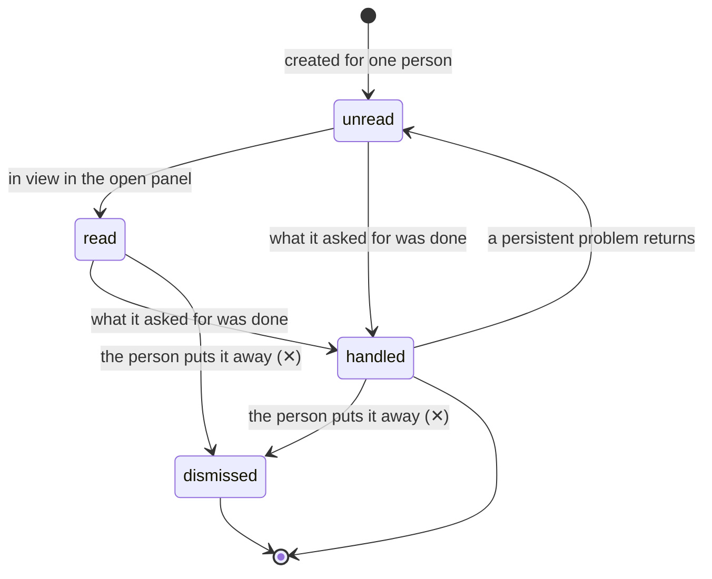

# Notifications

A **notification** is a message hq addresses to one person: something waits on them, or concerns them. A
person reads theirs in the **Notifications** panel, opened from the bell beside the logo on every screen. What
agents are doing is a different question, answered by the **Runs** panel beside it: a notification is kept
until it is handled or put away, while a run changes from moment to moment.

## The kinds

| Kind (`type`) | Raised when | Who gets it |
|---|---|---|
| `tool_approval` | A run asks for a tool or command it was not allowed | The person the run is on behalf of: whoever started it, or the task's person for a run nobody started ([ADR-0095](../../adr/adr-0095-a-run-is-on-behalf-of-whoever-started-it.md)) |
| `task_waiting` | A run stopped at its time or turn limit, and its task now needs a person | The person the task is done on behalf of, once while an unread one for the task stands |
| `credential_health` | A site reports that a model credential has expired or is missing | Every admin, once per site, agent and state per day |
| `provider_not_working` | A provider's state is not *works* (key refused, out of credit, not answering, disconnected) | Every organisation admin, one per provider, persistent and not dismissible; it clears itself when the provider works again or is replaced or removed ([providers](../providers/providers.md#a-providers-state)) |
| `provider_changed` | A provider is added, its key replaced, renamed, removed or revoked | Every organisation admin, so a change one makes is seen by the others |
| `conversation_approval` | Work in a [conversation](../conversations/conversations.md) asks for the person's okay | The conversation's reader (in a task's thread, everyone who has spoken in it and the person the task is for), linked to the conversation, with the request's own line. It clears once the request is answered or stopped |
| `conversation_result` | Work a conversation started has ended | The same people, with the first line of the agent's reply that presents it (or the result's own line when no reply can run). It is history from the start |
| Anything else | — | Never needs the person; it is history from the start |

`tool_approval`, `task_waiting`, `credential_health` and `conversation_approval` ask the person to act — approve, open the task, renew access. Nobody is notified
when the person has been removed, or when a task is blocked because its person lost access. Failing to notify
never fails what raised it: the request or the blocked task stands either way.

## Persistent notifications

A **persistent notification** is a general kind that anything can raise. It stays under Needs you until what it is
about is addressed, whichever person addresses it, or until a person dismisses it when its kind allows that.
A person has at most one per problem (its `type` and `subjectKey`): raising one for a subject that already has an
open one changes the open one, and a problem that returns after it was addressed reopens the handled one, unread and
back at the top of Needs you, rather than adding a second. A dismissible one a person has dismissed is not raised
again for the same subject.

The Execution Sites kinds are the first use: a site that needs upgrading, a site not connected while work waits on
it, HQ's own site not running (named after its machine and tagged, "hq-box · HQ's site", as everywhere), and a site
whose Docker is not running or whose disk is nearly full. Each goes to organisation admins and clears by itself once
fixed. They are worked out afresh from the database when a site's state changes and twice a minute, so a restart of
hq loses none, and a site away for less than the grace period keeps the not-connected notification it has instead of
having it cleared and raised again.

Fleet admins have their own about machines, raised and cleared the same way (`hq/src/sites/machineNotices.ts`): a
machine not heard from for 10 minutes — unless it was stopped on purpose, or its fleet admins chose not to be told —
and a machine that left by itself, until it is removed in the Fleet Console ([the fleet](../fleet/fleet.md)).

Three more go to organisation admins, worked out afresh whenever an admin's notifications are read:

| Kind (`type`) | What it says | How it clears |
|---|---|---|
| `agents_bypassed` | The agents whose approval is Bypassed, named — a fact, not a warning, since Bypassed is expected for automation | An admin acknowledges it, which records the agents acknowledged; putting it away in the panel acknowledges it too. It returns when another agent is set to Bypassed |
| `invitations_unanswered` | Invitations sent a week ago or more that nobody accepted, with who they are for | Once each is accepted, revoked or expired; it cannot be dismissed |
| `team_proposed` | The built-in agent proposed a team, with a link to review it | Once the proposal is confirmed, or when an admin puts it away |

One goes to a person: `routine_failing`, when a routine's last three rounds failed in a row. It goes to the
routine's person, once for the streak, with a link to the routine, and clears once a round succeeds — the next
one, or a failed one run again. It cannot be dismissed ([routines.md](../tasks/routines.md)).

In the panel, a notification that cannot be dismissed shows no ✕, under Needs you or Earlier; one that can shows
it in both places.

## Needs you and Earlier

The panel lists **Needs you** first, then **Earlier**, each newest first.

- **Needs you** holds every notification of a kind that asks for an action, until it is **handled**. Seeing it
  does not handle it.
- **Earlier** holds the rest: notices that ask for nothing, and anything handled.
- **One item per task.** A task appears once, by its latest request or notice; reading the list hands the older
  ones.
- **Every item is two lines and one action**: what it is, with the task's key; then why, in one line. A tool
  request's one button approves it at once; tapping the item opens the request inside the panel, with what the
  agent wants to run and its reason, Approve, Deny and a link to the task.

## Needs attention

On the admin area's Overview, an admin's **Needs attention** is one list of what needs them across the workplace and
the infrastructure, in the order they act: the site kinds, a provider that is not working, a site that is down, the
approvals waiting on them gathered as one item, then invitations, proposed teams and the Bypassed agents. Each
item is the admin's own notification, so handling it in either place clears both. Their own waiting tasks are
not in it; those are Home's.

## Seen

A notification is `unread` until it has been in view in the open panel — those visible when it opens, without
scrolling, and the rest as they come into view. It then becomes `read`. **The bell counts what is new:** Needs
you items not yet seen, and every persistent notification still open, seen or not, so opening the panel does not
put the bell out while a site is still down. The Needs you heading, and Home's count, keep the total.

## Handled, and how requests clear themselves

A request no longer waits once its run has moved on or someone answered it, whoever they were. hq then marks
the task's `tool_approval` and `task_waiting` notifications `handled`, for everyone they went to:

- when a new run of the task is dispatched;
- when anyone approves or rejects the task's request, from the panel, the task or the conversation.

Some paths do not pass through either point — a task stopped or dismissed by hand, for example. So when a
person's list is read, hq also checks what is still under Needs you: a tool request whose session has no run
pending approval any more, and a waiting notice whose task is no longer blocked or failed, are handled then. A
site that cannot be asked leaves the request as it is; it is never cleared on a guess. A handled item's second
line says it is no longer waiting.

A task's notifications are matched to the task by their link (`/tasks/KEY-N`), because a notification has no
task column of its own.

## Where in the code

| Concern | Path |
|---|---|
| The row | `hq/schema.prisma`: `Notification` (`type`, `status`, `actionUrl`) |
| Which kinds need the person, grouping, what is new, one per task | `hq/src/notifications/notificationKinds.ts` |
| The two lines | `hq/src/notifications/notificationText.ts` |
| Reading, marking seen, dismissing | `hq/src/notifications/queries.ts`, `actions.ts` |
| Handling a task's requests; clearing those that stopped waiting | `hq/src/notifications/handled.ts`, `staleRequests.ts` |
| Persistent notifications: raising, updating, reopening, clearing | `hq/src/notifications/persistent.ts` |
| Raising them | `hq/src/agents/approvalNotification.ts`, `taskSessionApproval.ts`, `taskWaitingNotification.ts`; `hq/src/sites/channel/siteEventHandler.ts` (a person's expired Claude login); `hq/src/providers/notices.ts` (providers); `hq/src/sites/siteNotifications.ts`; `hq/src/notifications/adminNotices.ts` (Bypassed, invitations, proposed teams); `hq/src/automation/routineFailing.ts` |
| Needs attention | `hq/src/notifications/needsAttention.ts` |
| The panel | `hq/src/shared/components/NotificationPanel/` |

## Decisions behind this

[ADR-0089](../../adr/adr-0089-every-task-runs-on-behalf-of-a-person.md) (a task's person answers its
approvals), [ADR-0095](../../adr/adr-0095-a-run-is-on-behalf-of-whoever-started-it.md) (the run's person does,
when someone started it).
