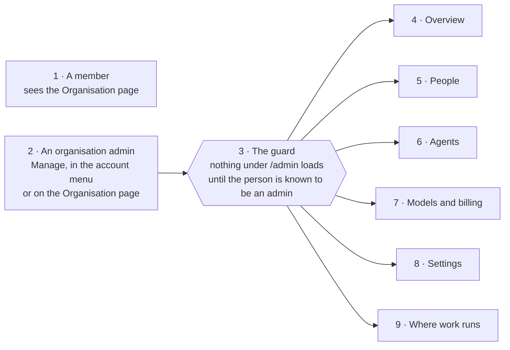

# The organisation's admin area

**Manage organisation** is a separate area of HQ, at `/admin`, for organisation admins only. Everything an admin
changes about the organisation lives there; the [Organisation page](organisation.md) is what every member sees and is
only a way in.

## Getting in, and who is kept out

An organisation admin reaches it from **Manage**, under the organisation's name in the account menu (the menu is grouped
by whose each item is: the organisation's Overview and Manage, then the person's own *Your settings*), or from **Manage**
on the Organisation page. In the area, the menu takes the place of the main navigation, with **Back to** the organisation
at its head.

Anyone else who opens an address under `/admin` is told it is for admins and shown nothing: the screen draws no admin page
and loads no admin data until the person is known to be an admin. This is the first guard and not the only one, because the
server refuses every admin operation again, whatever the screen showed. The fleet admin role is separate and gives no part
of this area: a fleet admin looks after machines and sites in the Fleet Console ([the fleet](../fleet/fleet.md)).

## What is in it

| Group | Pages | For |
|---|---|---|
| **Overview** | Overview | What needs an admin first, the organisation's figures (people, agents, projects) and today's numbers |
| **People** | People and invitations, Teams | Inviting, roles, removing and erasing people; teams |
| **Agents** | Agents | Each agent's instructions, skills, settings and permissions, its own models and voice and its list, the projects it is in, usage, export, stop and delete |
| **Models and billing** | [Providers](../providers/providers.md), [Models](../models/models.md), [Billing profiles](../billing/billing.md#billing-profiles), [Usage](../billing/billing.md#the-usage-report) | Who the organisation reaches AI through, what everyone uses by default and which models may run, whose cost is whose, and what it cost |
| **Settings** | General (with the sign-in page choice), GitHub, Automation, Runs, Memory, Tool risk rules, and Web search | How the organisation works |
| **Where work runs** | Sites, Sites for projects, Infrastructure | The Execution Sites and HQ itself; what a fleet admin does on the machines is in the Fleet Console |

Providers, model choices and billing profiles are together because they are one subject for one person: which accounts the
organisation reaches AI through, which models people get, and who a cost belongs to. The same group is where an
organisation admin lands when the home screen says agents cannot answer yet.

Setting or changing any of these is an organisation admin's alone. A project's admins and each person narrow which models
may run for them from the project's settings and **Settings**, never from here ([lists](../models/lists.md)).

## Where in the code

| What | Where |
|---|---|
| The routes, the menu and the guard | `hq/src/admin/` (`admin.wasp.ts`, `adminMenu.ts`, `components/AdminGate.tsx`, `AdminSidebar.tsx`) |
| Where a former `/org/...` address went | `hq/src/admin/adminPaths.ts` |
| The account menu | `hq/src/shared/components/sidebar/mainNav.tsx` |
| The Overview | `hq/src/admin/pages/AdminOverviewPage.tsx`; `org/components/NeedsAttentionSection.tsx`, `TodaySection.tsx` |
