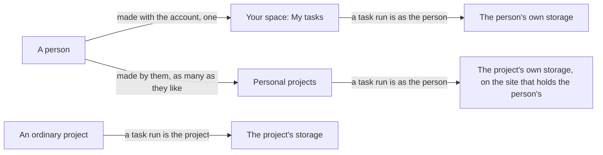

# Personal projects

Scheduled and repeating work needs somewhere to live for a person, not only for a project, and every task belongs to
a project. A person's own place is **Your space**, their default personal project, and every other **personal project** they make. All of them are ordinary
projects with one extra column, `Project.personalOwnerId`, and the rules that column brings. They reuse the project's
task types, boards, tasks and [routines](../tasks/routines.md), and start work the same way ([how work starts](../tasks/automation.md)), shown through the same screens as a project
([places](places.md)).

## Your space and the others

| | Your space | A personal project the person made |
|---|---|---|
| How many | One per person, marked `Project.personalSpace`; a partial unique index on `(personalOwnerId) WHERE personalSpace` keeps it one | As many as the person likes |
| Made by | The account: `ensurePersonalProject` runs when it is created and at boot for any account without one | The person, with *New project* › *Just for you* (`createPersonalProject`) |
| Name, key | **My tasks**, shown as **Your space**; key `MY` and letters | Their own name; a key made from it, as for any project |
| Storage | None of its own: the person's own storage, on the site that holds it | Its own (`files/`, `workspaces/`, `artefacts/`, `tasks/`), on the site that holds the person's |
| Knowledge | The person's own, at the `personal:` level | Its own pages, at the level named after the project: a place of its own, never `personal:` |
| In a conversation | Reached as the conversation's own place when the conversation is in it; otherwise only when the person adds it | A place like any project: reached only when it is the conversation's place or the person adds it |
| Deleted | Never, before the person is erased | By its owner, who types its name |
| Settings | None | Name and description, whether agents may set start times when asked, and Delete. A project has no picture yet |

**Runs act as the person**, in both. A task run in a personal project resolves to the person (`taskRunOwner`,
`hq/src/projects/personalProject.ts`): the person's own settings apply (their list of models, their own Claude subscription, their agent
settings), and no project's authority is used. Only the storage differs, and `taskRunOwner` says which: `storage` is the person's own for
the space and the project's own for any other personal project. A personal project has no model list or billing profile of its own: the person's [list](../models/lists.md) applies, and its cost goes to the organisation's default [billing profile](../billing/billing.md#billing-profiles). A person's own Claude subscription serves work here and in their space, and nowhere else ([providers](../providers/providers.md#a-persons-own-claude-subscription)).

**Each is created private**, with its owner as its one admin and the types **Task** and **Epic**, as every project has (columns Backlog, To do, In progress and Done), and the built-in task state and execution boards.

## What they hide or refuse

| | |
|---|---|
| **Who sees them** | Only the owner, while they are in the organisation. Membership checks answer for the owner alone, whatever the access level or member rows say, so an organisation admin sees neither a personal project's contents nor its name; once the owner has left, not even they |
| **Members** | Exactly one. No one can be added, removed or have their role changed, and the owner cannot leave |
| **Access level, lead, filing** | Cannot be changed, named or filed under a product or programme; a personal project never becomes an organisation project |
| **Deleting** | The owner deletes a personal project that is not their space; the space is never deleted. Organisation admins delete only organisation projects. Deleting stops its runs, removes its storage and closes its conversations |
| **Leaving and erasing** | Leaving keeps them all, for Reactivate. Erasing deletes them all, storage included, and the erase dialog says how many there are besides the space ([ADR-0100](../../adr/adr-0100-leaving-deactivates-erasing-is-separate.md)) |
| **Keys, lists and overrides** | They take no provider key, no model list, no billing profile and no agent overrides of their own; the person's apply, and the organisation's providers pay |
| **Boards and conversations** | A saved board shows only its own project's tasks, so one person's task in a personal project is never shown on a board others see. A conversation is never moved into or out of one ([ADR-0096](../../adr/adr-0096-a-conversation-belongs-to-a-place.md)) |
| **Activity** | Making one writes nothing to the organisation's activity feed |

## Where the code tells them apart

Every reader of `personalOwnerId` was checked. Privacy and membership keep testing `personalOwnerId` (a personal
project is its owner's alone): `membership.ts`, the refusals in `personalProject.ts`, the people and invitation lists.
Anything about storage, and the screens that stand for Your space, test `personalSpace`, through `isYourSpace` and
`placeStorageOf`: the location a run works in and the site it goes to (`taskRunOwner`, `tasksRunOnSite`,
`dispatchService.ts`, `capabilityService.ts`), the storage a place reads (`locationAccess.ts`, `placeInstructions.ts`,
the storage listing), a place's active runs and Stop all, the timeline's runs, the cards' last run, and the screens that
send a person to Chat instead of a project (the project pages, the dock, the breadcrumb's list, notifications).

## Where in the code

| What | Where |
|---|---|
| The space, the owner rules, which storage a run uses | `hq/src/projects/personalProject.ts` |
| Making one | `hq/src/projects/personalProjectActions.ts` (`createPersonalProject`), with `createProject` in `projectService.ts` |
| Deleting, which takes the owner for a personal project | `hq/src/projects/actions.ts`, `requireMayDeleteProject` |
| Visibility | `hq/src/projects/membership.ts` (`isProjectMember`, `entitledProjectsFilter`) |
| Dispatch as the person | `hq/src/agents/dispatchService.ts`, `dispatchSiteResolution.ts` |
| Erasing | `hq/src/settings/erasePerson.ts`; its dialog is `hq/src/org/pages/people/ErasePersonDialog.tsx` |
| *New project*, *Your personal projects*, a personal project's Settings | `hq/src/projects/screen/`, `hq/src/projects/pages/` |
| Shown as Your space and Chat | `hq/src/chat/` |
| Schema | `hq/schema.prisma`: `Project.personalOwnerId`, `Project.personalSpace` |

## Decisions behind this

[ADR-0175](../../adr/adr-0175-work-starts-only-by-an-explicit-act.md) (work starts only by an explicit act, in a person's own place as in a project),
[ADR-0089](../../adr/adr-0089-every-task-runs-on-behalf-of-a-person.md) (every task runs on behalf of a person),
[ADR-0096](../../adr/adr-0096-a-conversation-belongs-to-a-place.md) (a conversation belongs to a place),
[ADR-0152](../../adr/adr-0152-a-conversation-reaches-only-its-own-place-and-the-places-its-person-added.md) (a
conversation reaches only its own place and the places its person added),
[ADR-0100](../../adr/adr-0100-leaving-deactivates-erasing-is-separate.md) (leaving and erasing).
