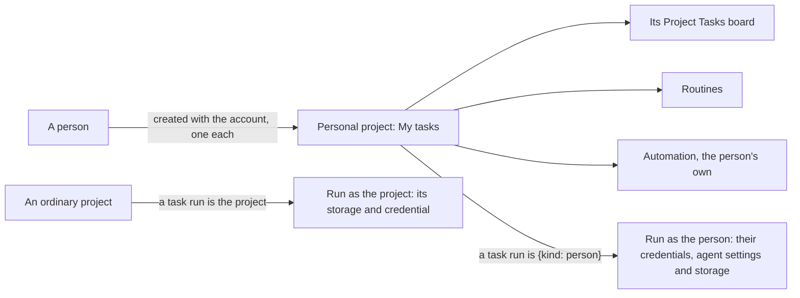

# Personal projects

Scheduled and repeating work needs somewhere to live for a person, not only for a project, and every task
belongs to a project. So each person has a **personal project** that always exists, named **My tasks** and shown
as **Your space**, the person's own [place](places.md), the default personal project. It is an ordinary project with one extra column,
`Project.personalOwnerId`, and the rules that column brings. It reuses the project's boards, tasks and
[automation](../tasks/automation.md), shown through the same screens as a project.

## What makes it personal

**Its runs are the person's, not a project's.** A task run in a personal project resolves to the person's own
boundary (`taskRunOwner`, `hq/src/projects/personalProject.ts`):

- the run's runner is the person (`{ kind: 'person' }`), never a project;
- it works in the person's own storage, on the Execution Site that holds it;
- it uses that person's model credentials and that person's agent settings (the personal overrides), not a
  project's;
- it is visible only to that person.

This is the condition that makes unattended work safe in a personal space: it can never act with a project's
authority.

**It is created with the account.** `ensurePersonalProject` runs when an account is created and at boot for
any account without one, so it is idempotent. It is created **private**, with its owner as its one admin, and
with its **Project Tasks** board, as every project has (the `todo`, `in_progress` and `done` columns, and a
Backlog), so work can be queued there and a routine's rounds have somewhere to land. Its key is `MY` and three letters.

## What it hides or refuses

| | |
|---|---|
| **Who sees it** | Only its owner, while they are in the org. Membership checks answer for the owner alone, whatever the access level or member rows say, so an org admin cannot see it; once the owner has left, not even they |
| **Members** | Exactly one. No one can be added, removed or have their role changed, and the owner cannot leave |
| **Access level** | Cannot be changed |
| **Deleting, filing** | It cannot be deleted, nor filed under a product or programme. It stays when its person leaves, for Reactivate, and goes only when they are erased ([ADR-0100](../../adr/adr-0100-leaving-deactivates-erasing-is-separate.md)) |
| **Storage** | It has no storage of its own: its work is in the person's files, so Your space's Files and Workspaces tabs show the person's own |
| **Credentials and overrides** | It takes no model credential and no agent overrides of its own; the person's apply |
| **Boards** | A task and a board must be in the same project when either is a personal project, so one person's task is never shown on a board others see |

Shown as Your space, it has the **Overview, Conversations, Tasks, Boards, Runs, Automation, Files, Artefacts, Knowledge, Workspaces and Agents** tabs,
and no Members, Timeline or Settings. Its address, and a link to one of its conversations, lead to Your space or Chat (its list of conversations). Its automation is the person's
own switch, off by default and bounded by the org like any boundary's. The org's run limits and the archiving of finished
tasks apply as in any project.

## Where in the code

| What | Where |
|---|---|
| Creation, the owner rules, which storage a run uses | `hq/src/projects/personalProject.ts`, `personalProjectQueries.ts` |
| Visibility | `hq/src/projects/membership.ts` (`isProjectMember`, `entitledProjectsFilter`) |
| Dispatch as the person | `hq/src/agents/dispatchService.ts`, `dispatchSiteResolution.ts` |
| Shown as Your space and Chat | `hq/src/chat/` |
| Schema | `hq/schema.prisma`: `Project.personalOwnerId` |

## Decisions behind this

[ADR-0087](../../adr/adr-0087-work-starts-on-its-own-only-from-a-boundarys-automation.md) (automation belongs to
a boundary, which a person's own space is),
[ADR-0089](../../adr/adr-0089-every-task-runs-on-behalf-of-a-person.md) (every task runs on behalf of a person).
