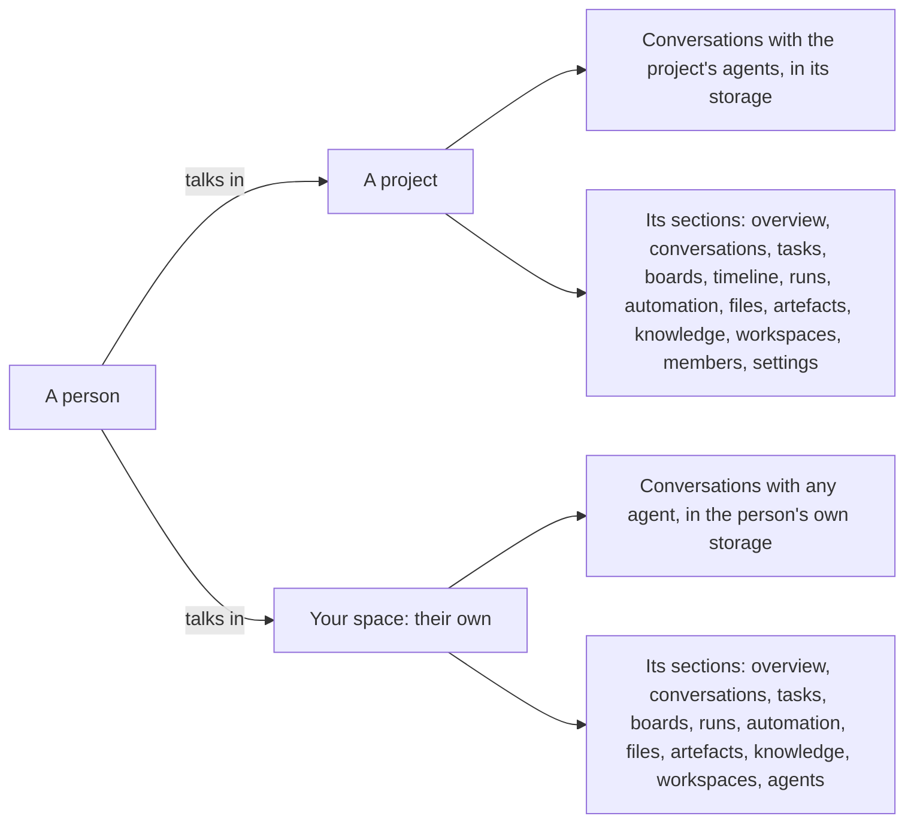

# Places

A **place** is where a conversation belongs, and where a person works with agents: a **project**, or the
person's **own space**, **Your space**, whose conversations are listed in **Chat**. A person works in a place's
sections, listed in the left panel, and talks to an agent in the conversation docked beside them.

## A conversation belongs to one place

Every conversation belongs to one place, fixed when it starts
([ADR-0096](../../adr/adr-0096-a-conversation-belongs-to-a-place.md)):

| | A project | Your space, the person's own |
|---|---|---|
| Started from | The dock's new conversation, with the project chosen | The dock's new conversation with your space chosen, Home, or an agent's page |
| Works in | The project's storage, with the project's authority | The person's own storage |
| Agents | Only the project's; another is refused when the conversation is created | Any agent in the organisation |
| Who sees it | Only the person who started it ([ADR-0041](../../adr/adr-0041-chat-session-privacy.md)) | Only the person |

A conversation is never moved; one about another place is started there. Besides its own place, a conversation reaches
the places its person adds to it, and no others
([below](#the-places-a-conversation-reaches)); the conversation stays where it was started
([conversations](../conversations/conversations.md#where-a-conversation-lives)).
A task has a third home, its own page, where its thread is shared with the project; a task's session is the agent's
working record and is shared too ([sessions](../agents/sessions.md#a-tasks-session-is-shared)).

## The places a conversation reaches

A place is a project, Your space included. A conversation starts with its own place. Its person can **add** other
places to it, in the conversation's header (*Places: Your space · Website rebuild ✕ · + Add place…*; on a phone, "2 places"
and a sheet), and the lead can only ask for one: it shows a card, *Add a place to this conversation: Shop*, and only
the person's click adds it. Only places the person can open are offered, and one they lose access to drops out.

| A conversation can, in a place it reaches | In any other place |
|---|---|
| Search and read the place's [knowledge](../knowledge/knowledge.md), and start work there, each piece of work authorised for that place alone | Nothing; the lead is told the place is out of reach, and never answers as if it were empty |

The organisation's knowledge and the platform guide are always in reach. The lead is told its places every turn, by the
names the person sees: **Your space**, a project's name, or a personal project's own name. A worker, or a task's run,
reaches the one place it works in. How this is built is in
[the conversation layer](../../architecture/conversation-layer.md#a-conversations-places).

## The person's own place

A person's own place is **Your space** and every [personal project](personal-projects.md) they make. Only they see
them, agents work in them as the person, and the person's own Claude subscription serves Claude models there and
nowhere else. Your space is the person's default personal project; any other personal project is a place of its own,
like any project, and a conversation reaches it only when it is the conversation's place or the person adds it.

**Your space** is the person's default personal project, which every person has, together with their own storage,
shown through the same screens as a project. It has its own entry, fixed at the top of the navigation under Chat, and the same
sections as a project; Chat is the list of its conversations alone. Its conversations are those in no project, in the
person's own storage or in their space. Its facts say that only the person sees it, that any agent can be talked to,
which personal projects they have, which site holds their storage (once it is placed on one), and where their files
are. It has no Members, Timeline or Settings; its **Agents** section (any agent in the organisation) is open from its
row and from the link in its facts. A link to the space, or to a conversation in the person's own storage, leads to
Your space or Chat.

**A personal project** the person made is a place of its own at `/projects/KEY`, marked *Only you* in the Projects page
under *Your personal projects*, in the project switcher and in the dock's list of places. It has the sections of Your
space and a Settings, and its own storage, so its Files, Artefacts, Knowledge and Workspaces are its own and not the
person's. Its knowledge is at its own level, named after the project, and only Your space is `personal:`. Its conversations are listed in it, and only with the person's own choices (the person's list, not the
project's).

## A place's sections are the left panel

Inside a place the left panel drills in: its header (‹, the place's picture and name, its pin), then one entry per
section with its count, the one shown marked, under small group labels, and the chosen section fills the canvas at full
width. There is no row of tabs and no header in the canvas. ‹ shows the main navigation over the panel; choosing the
current place, ✕, Esc or a click outside closes it and nothing moves. The breadcrumb's parts open lists too: Home,
Projects, the place's name and the section. The same model serves a project, your space and an agent's page:

| Place | Sections, in this order |
|---|---|
| A project | Overview, Conversations, Tasks, Boards, Timeline, Runs, Automation, Files, Artefacts, Knowledge, Workspaces, Members, Settings, Memory (admins only) |
| Your space | Overview, Conversations, Tasks, Boards, Runs, Automation, Files, Artefacts, Knowledge, Workspaces, Agents |
| A personal project | The sections of Your space, then Settings |
| An agent's page | Overview, Conversations, Now, Projects, Runs, Usage, Your instructions, Memory, Your settings |

The section is the address's `?tool=` (none opens Overview), so a link, a reload and Back return to it. On a medium
window the panel is icons, with names on hover; below 1024 px it is a drawer, and the header names the section and
lists the sections. There is no reordering. A project's former page addresses (`/projects/KEY/tasks`,
`/files`, `/routines`) open the project on the matching section.

**Overview** holds the place's **facts** — for a project: Lead, Site, Default agent, Product and Access — then **Members**
as a row without a heading, then each section as a row with a short count or state, in groups: Tasks, Boards and (in a
project) Timeline; Runs and Automation, with Run all and Stop all; Files, Artefacts, Knowledge and Workspaces; and a
project's Settings. A row opens its section. **Conversations** is the list of the place's conversations; choosing one opens
it in the dock.

## The docked conversation

One conversation is open at a time, docked on the right of every page, and it stays open until the person changes it;
navigating never does. The shell around the pages is drawn once, in the app's root, so the open conversation and its
streaming reply stay mounted while the page changes. The address carries both, as `?c=<id>` on the page; a conversation's
own addresses (`/chat/t/<id>`, `/projects/KEY/t/<id>`) still work and are replaced at once by that form. The dock
shows the conversation, a chip for its place (your space, a project or a task), and the buttons for recent conversations,
a new one, expanding it over the page, and collapsing it to a rail. A new conversation is a draft in the dock: a list of
the places the person can use, the place they are on already chosen, and Cancel to put back what was open. A place
chosen there is where the conversation lives; the place the person is on stands for everything inside it. Why a
conversation still belongs to one place is above; where it is shown does not change that.

## What the sections hold

Some facts about what a place holds, in a project:

- **Lead.** A project may name a lead, set by a project admin from its members. The lead is shown in the facts
  and has no rights of their own.
- **Default agent.** The first agent added to a project with no default becomes its default; the message box
  starts with it. Removing the default agent asks which agent here becomes the default, or none.
- **Agents.** Each agent the place uses, with what it is doing there (needs you, running or idle, with the
  task), its tasks there by state, its model and whether the project narrows it; opened, its Now and Coming up,
  **In this project** (shown to every member, changed by the project's admins) and its instructions there —
  the organisation's, then the place's `AGENTS.md` and its own file under `.agents/agents/`, read from the
  place's Files. A project's instructions are the project's; a person's are read only from their own Files,
  never into a project.
- **Members.** A row on Overview after the facts, and a section, with a count and up to four pictures of its people and
  agents (`getProjectPanelRows`); People and Agents are one view. It shows the project's **teams** as
  cards (their role there, ⋯ Remove team), then its **people**, then its **agents**, with All · People · Agents,
  a search, and ＋ Add for a person, an agent or a team. Each person has a name, picture and role there; what
  waits on them — a task waits on the person its run is for — or what they are doing, or when they were last
  there, from their conversations and comments there; and their tasks there by state (`getProjectPeople`,
  `hq/src/projects/projectPeopleQueries.ts`). Each agent shows as the Agents section above describes it.
  Someone there through a team carries the team's name and is changed through the team
  ([teams](teams.md)); a person or an agent opens inside the view. `?tool=people` and `?tool=agents` still open
  the Members section. The view is `hq/src/projects/place/members/`.
- **Stop all** withdraws the place's queued tasks and stops its running task runs and the caller's own
  conversations there. Another person's conversation is theirs to stop. In a project only a project admin may
  use it; in Chat, the person.

## Where in the code

| Concern | Path |
|---|---|
| The place screens, built once for both kinds | `hq/src/places/` |
| A project as a place | `hq/src/projects/place/`, `hq/src/projects/pages/ProjectConversationsPage.tsx` |
| Chat as a place | `hq/src/chat/` |
| Personal projects: making, deleting, where a run works | `hq/src/projects/personalProject.ts`, `personalProjectActions.ts`, `projectService.ts` ([personal projects](personal-projects.md)) |
| A conversation's place and a place's conversations | `hq/src/conversations/` ([conversations](../conversations/conversations.md)) |
| A conversation's added places, and the header that lists them | `hq/src/conversations/places.ts`, `components/PlacesBar.tsx`, `components/SuggestPlaceCard.tsx` |
| Lead, first agent as default, Stop all | `hq/src/projects/projectLead.ts`, `agentAssignment.ts`, `placeRunStop.ts` |
| A project's Members view | `hq/src/projects/place/members/`, `hq/src/projects/place/teamRows.tsx` |
| An agent's instructions in a place | `hq/src/agents/projectAgentQueries.ts`, `hq/src/storage/placeInstructions.ts` |
| The shell drawn once, and the pages' `AppShell` that publishes to it | `hq/src/shared/layouts/` (`RootShell`, `ShellFrame`, `AppShell`) |
| The docked conversation, `?c=`, the draft and its list of places (personal projects marked *Only you*) | `hq/src/dock/` (`placeList.ts`) |
| A place's sections, and the place handed to the shell | `hq/src/places/` (`placeSections.ts`, `placeNav.ts`, `components/PlaceScreen.tsx`) |
| The drilled-in panel, the main navigation over it, the breadcrumb's lists | `hq/src/shared/components/sidebar/`, `hq/src/shared/layouts/` (`CrumbLists.tsx`) |

## Decisions behind this

[ADR-0096](../../adr/adr-0096-a-conversation-belongs-to-a-place.md) (a conversation belongs to a place),
[ADR-0152](../../adr/adr-0152-a-conversation-reaches-only-its-own-place-and-the-places-its-person-added.md) (a
conversation reaches only its own place and the places its person added),
[ADR-0039](../../adr/adr-0039-files-and-workspaces.md) (a run's primary location),
[ADR-0041](../../adr/adr-0041-chat-session-privacy.md) and
[ADR-0077](../../adr/adr-0077-within-a-boundary-a-running-chat-is-visible-its-content-is-not.md) (a
conversation's content is its person's).
