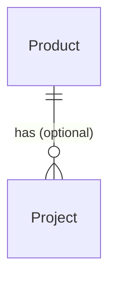

# Product

A **Product** is a persistent, named thing being built — a software product, a service, a platform. Projects are the units of work that build or maintain it.

---

## What is a Product?

A product exists independently of any individual project. "Agenthix Site" exists as a thing whether or not any particular project is active under it. Projects can optionally declare which product they are contributing to, which adds context without imposing structure.

Not every project needs a product. A project called "Manage my personal life" belongs to no product and that is fine. A project called "Auth overhaul" might reference *Agenthix Site* to make clear what it is contributing to.

---

## What a product does

A product groups projects for reports and lookups, and nothing else. It owns no files, workspaces, members, knowledge or runs, no access check consults it, and filing a project under one grants nobody anything ([ADR-0061](../../adr/adr-0061-a-product-and-a-programme-group-work-and-own-nothing.md)). Storage belongs to a project or a person ([workspace.md](../workspace/workspace.md)); content that spans a product's projects lives in one of them.

Organisation › Products shows the list of products beside the one opened, which shows its projects as the Projects screen's cards, with **File a project** for admins (`hq/src/products/components/`). Creating, changing and deleting a product, and filing a project under one, take an org admin (`hq/src/products/actions.ts`, `updateProject` in `hq/src/projects/actions.ts`).

---

## Relationship to Projects

- A project belongs to **at most one** product
- A product can have many projects
- Projects with no product are first-class — the field is nullable

---

## Fields

| Field | Type | Purpose |
|---|---|---|
| `name` | string | Display name — e.g. "Agenthix Site", "HQ" |
| `slug` | string (unique) | URL-safe, lowercase, hyphenated identifier — e.g. `agenthix-site` |
| `description` | string? | What this product is |
| `vision` | string? | Where it is headed long-term — useful context for agents scoping decisions |
| `status` | `ProductStatus` | `active` (the default) or `sunset`; a sunset product should not attract new work |

### Status values

| Value | Meaning |
|---|---|
| `active` | Actively being built or maintained |
| `sunset` | No longer receiving investment; projects should be closed or migrated |

---

## What it is not

- **Not a container that owns projects** — projects merely reference a product; deleting a product unlinks projects but does not delete them. A product owns no storage, members or runs either ([ADR-0061](../../adr/adr-0061-a-product-and-a-programme-group-work-and-own-nothing.md))
- **Not a time-bounded construct** — products have no start or end date; they persist as long as the thing exists
- **Not required** — many valid projects will have no product

---

## Related

- [project.md](./project.md) — the unit of work a product groups
- [program.md](./program.md) — cross-cutting strategic initiatives
