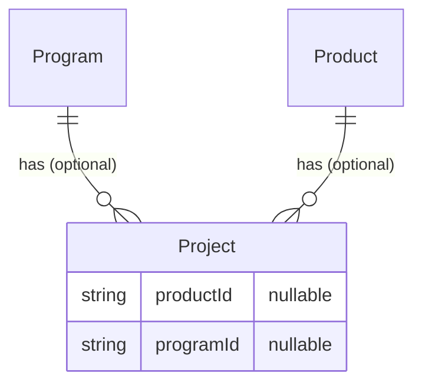

# Program

A **Program** is an optional label that groups projects under a named strategic initiative. It answers the question: *what larger goal are these projects collectively working toward?*

---

## What is a Program?

A program is a strategic initiative with a defined outcome — a goal that multiple projects, potentially across multiple products, are working together to achieve. When the goal is reached, the program is archived.

Programs are cross-cutting by nature. While a product is a vertical slice ("what we build"), a program is a horizontal slice ("what we're trying to achieve"). A single program may involve projects from several different products.

Like products, programs are entirely optional, and like them they only group: a program owns no files, workspaces, members, wiki or runs, and filing a project under one grants nobody anything ([ADR-0061](../../adr/adr-0061-a-product-and-a-programme-group-work-and-own-nothing.md)). Storage belongs to a project or a person ([workspace.md](../workspace/workspace.md)). Organisation › Programs is the same screen as Products: the list beside the one opened, which shows the programme's goal (its description) and its projects. A programme has no end date yet. Creating, changing and deleting a program, and filing a project under one, take an org admin (`hq/src/products/actions.ts`).

---

## Relationship to Projects and Products

- A project belongs to **at most one** program
- A program can span projects from **many products** (or none)
- Neither the program nor the product is required on a project

---

## Goal-bound, not time-bound

Programs end when their strategic goal is achieved — not on a calendar date. A "3-year plan" program might complete early or run long; the date is irrelevant. What matters is whether the objective was met.

When a program completes, it is archived rather than deleted, preserving the record of what was accomplished and which projects contributed.

---

## Fields

| Field | Type | Purpose |
|---|---|---|
| `name` | string | Display name — e.g. "Enterprise Readiness", "Agent Intelligence" |
| `slug` | string (unique) | URL-safe identifier |
| `description` | string? | What this initiative is and what success looks like |
| `status` | `ProgramStatus` | `planning` (the default), `active` or `archived` |

### Status values

| Value | Meaning |
|---|---|
| `planning` | Initiative defined but work not yet started |
| `active` | Projects are actively working toward the goal |
| `archived` | Goal achieved (or abandoned); no new work should be assigned |

---

## What it is not

- **Not an epic** — programs are not time-boxed iterations of work; they are named goals
- **Not a product phase** — "Phase 1.5" is a program that may involve multiple products, not a sub-division of one product
- **Not a schedule** — no start date, no target date; goal-bound, not calendar-bound
- **Not required** — many valid projects will have no program

---

## Related

- [product.md](./product.md) — persistent vertical product groupings
- [project.md](./project.md) — the unit of work a program groups
