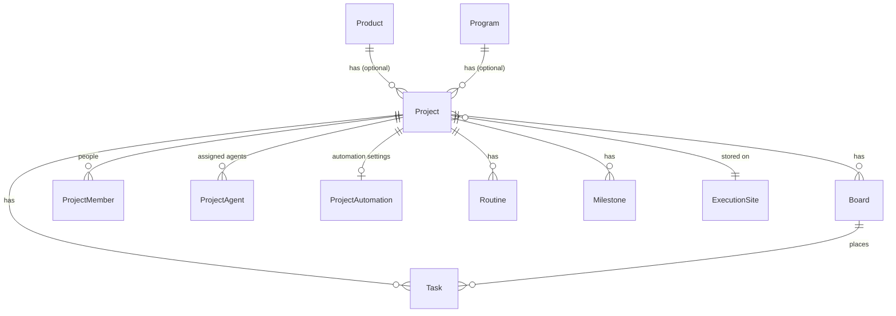

# Project

A **Project** is the primary unit of work in Agenthix. It is where tasks are created, boards are organised, and agents are assigned work. Everything actionable lives inside a project.

---

## What is a Project?

A project is a scoped coordination zone — a bounded space where people define work, assign it to agents, and track progress. It is also a [place](./places.md): it opens on an Overview of its facts and sections, which are tabs across the screen, and a conversation about it is docked beside whatever page is open. It is also one of the two owners of storage, the other being a person ([ADR-0061](../../adr/adr-0061-a-product-and-a-programme-group-work-and-own-nothing.md)): a project's files, artefacts, workspaces and runs belong to the project, and so do its [knowledge](../knowledge/knowledge.md) pages. Storage is described in [workspace.md](../workspace/workspace.md).

Projects are freestanding by default. They can optionally be filed under a Product (what is being built) and/or a Program (what strategic initiative this contributes to), but neither is required, and filing grants nobody anything.

Examples:
- "Manage my personal life" — standalone, no product, no program
- "Auth overhaul" — linked to Product: *Agenthix Site*
- "Enterprise SSO" — linked to Product: *Agenthix Site* + Program: *Enterprise Readiness*

---

## Relationships

| Relationship | Cardinality | Notes |
|---|---|---|
| Project → Product | Many-to-one (optional) | A project contributes to at most one product |
| Project → Program | Many-to-one (optional) | A project contributes to at most one program |
| Project → Board | One-to-many | Every project has its **Project Tasks** board, made with it, and may have workflow and sprint boards ([board.md](../tasks/board.md)) |
| Project → Task | One-to-many | Tasks belong to the project, each on exactly one of its boards — Project Tasks when put on no other |
| Project → Milestone | One-to-many | Dated goals its epics can belong to ([task.md](../tasks/task.md#plan-epics-and-milestones)) |
| Project → ProjectMember | One-to-many | People, each with a role of `ADMIN`, `MEMBER` or `VIEWER` (`ProjectRole`; a Viewer reads and changes nothing) |
| Project → ProjectAgent | One-to-many | The agents the project uses; an assignment grants an agent nothing |
| Project → ExecutionSite | Many-to-one | The site whose disk holds the project's storage; chosen at creation |
| Project → ProjectAutomation | One-to-one (optional) | The project's own automation choices; none stored means automation is off ([automation.md](../tasks/automation.md)) |
| Project → Routine | One-to-many | Repeating work that keeps its next round ready as a task ([routines.md](../tasks/routines.md)) |

---

## Fields

| Field | Type | Purpose |
|---|---|---|
| `name` | string | Display name |
| `slug` | string? (unique) | URL-safe name, generated from `name` |
| `key` | string (unique) | Short prefix for the project's task numbers |
| `description` | string? | What this project is about |
| `accessLevel` | `ProjectAccessLevel` | `OPEN` (the default: listed to everyone, who may join) or `PRIVATE` (shown only to its members) |
| `executionSiteId` | string? | The Execution Site holding the project's storage |
| `productId` | string? | Optional link to a Product |
| `programId` | string? | Optional link to a Program |
| `defaultAgentId` | string? | Agent assigned to new tasks by default, and the one a new conversation starts with; the first agent added to a project with none becomes it |
| `leadUserId` | string? | The project's lead, a member shown in its facts; it carries no rights of its own |
| `personalOwnerId` | string? | Set only on a person's [personal project](./personal-projects.md); never changes once set |
| `runTimeLimitMinutes`, `runTurnLimit` | int? | The project's own run limits, which may only tighten the org's; null means the org's |
| `archiveFinishedAfterDays` | int? | Archive finished tasks after this many days; 0 is never, null means the org's default |

The model is `Project` in `hq/schema.prisma`; the project's files themselves are on its site, not in hq's database ([storage-and-placement.md](../../architecture/storage-and-placement.md)).

---

## Components

### Boards
A project can have several boards, each a lasting workflow: a set of columns a kind of work moves through, until it is archived ([ADR-0097](../../adr/adr-0097-a-board-is-a-lasting-workflow.md)). Every project is made with **Project Tasks**, whose columns are the task's own states and which cannot be deleted, renamed or changed; a task put on no other board is on it. A board may have sprints, numbered time boxes finished in place. Every board's first column is its **Backlog**, the tasks on it not yet started. See [board.md](../tasks/board.md).

### Tasks
The atomic unit of work. A task has a title, description, state, priority, and an optional agent assignment. Tasks belong to the project and are always on one of its boards, in a column or its Backlog. A task has a **plan** — the days its work is meant to happen — kept apart from its start time and its runs; a task may be an **epic** grouping others, and an epic may belong to a **milestone** ([task.md](../tasks/task.md#plan-epics-and-milestones)).

### Automation and routines
A project is a **boundary**: where a run's authority comes from. Its **automation** is a switch, off by default, that lets work start without a person pressing Run. With it on, the project's pulse starts queued tasks one at a time per agent, and tasks with a start time and routines start on schedule. The org sets every value and may turn automation off everywhere; a project admin may only make a value stricter. See [automation.md](../tasks/automation.md) and [routines.md](../tasks/routines.md). Every task in a project is also done on behalf of a person, who answers its approvals ([task.md](../tasks/task.md#on-behalf-of)). A project's **Automation** tool shows whether automation is running and what it will start, with its routines and rules; the run time limit and archiving are in its **Settings** tool. **Settings** shows each part as a field only to the people who may change it, and as text to everyone else, who read one line naming the project's admins. A project's admins change its name, key, description, lead, whether it is open or private, its default agent (one of the project's own agents, which new conversations start with), its model access, run time limit and archiving. Filing a project under a product or programme, and deleting it, are the organisation's admins'. The key is a field only until the project has a task; after that it is fixed text, because task numbers and links are made from it. The Execution Site where its files are kept and its agents run is shown, read only. Each part saves on its own as it is changed.

### Members
A project's members are people, and **membership is the gate**: reading a project's work needs a member row, whether the project is open or private ([ADR-0099](../../adr/adr-0099-an-open-project-is-open-to-join.md)), and acting in it — talking to its agents, starting, stopping or changing its work, commenting, approving its agents' requests — needs that row's role to be Member or Admin ([ADR-0102](../../adr/adr-0102-viewer-is-a-project-role.md)). A Viewer reads everything a member reads and changes nothing; nothing is done on a Viewer's behalf. The member list is everyone who reads the project, and every list or count of a project's people reads it; the people a task can be done on behalf of are its Members and Admins. The checks are `isProjectMember` and `mayWorkInProject` (`hq/src/projects/membership.ts`); a project admin also administers the project itself.

Whether a project is **open** (`accessLevel` `OPEN`, the default) or **private** (`PRIVATE`) decides only who may see what it is and who may join it:

- An **open** project is listed to everyone in the organisation (`visibleProjectsFilter`). Anyone may **join** it in one step, as a Member (`joinProject`, `hq/src/projects/memberActions.ts`); until then they read its **preview** — description, lead, product, site, when it started, its people and agents, its open tasks, how many are running and when it last ran — and none of its work (`getProjectPreview`, `hq/src/projects/projectPreview.ts`).
- A **private** project is shown only to its members; to anyone else it answers as a project that does not exist. Its admins decide who is on it.

Anyone may **leave** a project (`leaveProject`), except its last admin; the open tasks done on their behalf there then wait. A project always keeps an admin.

**Who changes a project's people.** Its admins, and the organisation's admins in any project they can see — an open one, or a private one they are in — may add, promote, demote and remove (`mayManageProjectPeople`). A private project an org admin is not in stays out of reach: on a person's page it is counted as "a private project", never named or changed. An org admin may still add themselves to a private project, and the member list shows it ([ADR-0062](../../adr/adr-0062-people-are-members-agents-are-assigned.md)). **Removing** someone takes where the open tasks done on their behalf there go — another member, or left waiting, blocked until someone takes them on — as a required choice with no default; a run in progress finishes first (`removeProjectMember`). Every site holding their home there is told, and ends their conversations there ([membership ending](../../architecture/identity-and-trust.md)).

Agents are assigned to a project rather than being members: an assignment says which agents the project uses, and grants the agent nothing ([ADR-0062](../../adr/adr-0062-people-are-members-agents-are-assigned.md)).

### Agents in a project
A project's admins assign agents to it, and so may an organisation admin, to any project but a person's own
(`requireMayAssignAgents`, `hq/src/projects/membership.ts`); assigning reads nothing in the project and shows in
its Members view. A private project stays private to organisation admins: on Manage organisation › Agents, a private
project the admin is not on is shown only as "A private project" — counted, so they see how many projects an
agent works in, but with no name, key or narrowing — and its usage is summed with the others like it into one
line. Assigning from there offers only the projects the admin can see (`getAgentAssignments`,
`hq/src/agents/agentAssignments.ts`; `getAgentUsage`, `hq/src/agents/agentUsageQueries.ts`).

**Removing** an agent takes what happens to its open tasks and routines there as a required choice, with no
default: another agent assigned to the project, or none, when they wait until someone assigns them. When the
agent is the project's default agent, which agent becomes the default — another assigned there, or none — is a
required choice too. Everything moves in the same transaction as the removal; its done tasks keep it, and a run
in progress finishes (`removeAgentFromProject`, `hq/src/projects/agentAssignment.ts`). Every member sees the project's agents in its
**Agents** tool — what each is doing there, its tasks there, and **In this project**, the project's narrowing of
it — while only the project's admins change that narrowing.

---

## Personal projects

Every person also has a **personal project**, named **My tasks** and shown as **Your space**: private to them, one member, created with their account. Its task runs act as the person, in their own storage, instead of as a project. See [personal-projects.md](./personal-projects.md).

---

## What it is not

- **Not a Product** — a project is work; a product is the thing being built. Multiple projects can contribute to one product over its lifetime.
- **Not a Program** — a project is a discrete unit of work; a program is a strategic initiative that may span many projects and products.
- **Not a team** — members belong to a project, not to a product or programme. Anyone in the org may join an open project; a private project admits only the people its admins add.

---

## Related

- [product.md](./product.md) — what a product is; why projects reference one
- [program.md](./program.md) — what a program is; cross-cutting strategic initiatives
- [personal-projects.md](./personal-projects.md) — each person's own project, whose runs are theirs
- [places.md](./places.md) — a project, or a person's own space, as the place where conversations belong
- [automation.md](../tasks/automation.md) — the pulse, depth, throttle and the boundary's switch
- [routines.md](../tasks/routines.md) — start times and routines
- [workspace.md](../workspace/workspace.md) — a project's storage, and what an agent sees there
- [ADR-0062](../../adr/adr-0062-people-are-members-agents-are-assigned.md) — people are members, agents are assigned
- [ADR-0099](../../adr/adr-0099-an-open-project-is-open-to-join.md) — an open project is open to join; membership is the only gate
