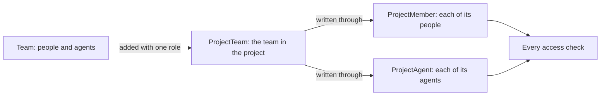

# Teams

A **team** is a group of people and agents with a purpose — Marketing, Support. It has an identity, as an
organisation, a person and an agent do: a name, a purpose, a picture and a cover. The organisation's admins make
and change teams; everyone in the organisation sees them.

A team can be **one member of a project**: added in one step with one project role (Admin, Member or Viewer),
removed in one step, and kept in step when the team changes
([ADR-0103](../../adr/adr-0103-a-team-joins-a-project-as-one-member.md)).

## Written through to its members

A team owns nothing and grants nothing of its own. Adding it to a project writes each of its people into the
project's members and each of its agents into the project's agents, marked as being there through a team. Every
access check keeps reading those rows as it always has; no check knows about teams.

- **Someone there both ways.** A person can be a member in their own right and through a team, or through two
  teams. The higher role applies. Their own role is kept apart, so taking the team away gives it back exactly.
- **Changed through the team.** Someone there only through a team is changed in the team: their role there is
  the team's, and removing them, or their leaving, is refused with the team's name. Someone also there in their
  own right keeps that membership, its role and its ⋯; removing them in their own right leaves them there
  through the team, with its role.
- **Removing a team** removes everyone there only through it. As removing a person or an agent does, it first
  takes where the open tasks of those leaving go — another person who works in the project, or left waiting;
  another agent that stays, or none — and, if the project's default agent is leaving, which agent becomes the
  default. Each site holding a leaving person's home there is told, as when a person is removed.
- **A team's change follows it** into every project it is in: someone added joins them, someone taken out
  leaves those they were in only through the team. Nobody is asked about their work then, so it goes as when a
  person leaves a project themselves: their open tasks wait, an agent's open tasks have no agent, and a leaving
  default agent leaves the project with none.
- **No project is left without an admin.** A change that would leave one without an admin is refused whole.
- **Someone who has left the organisation** is taken out of every team, as erasing someone does, and is never
  written in through a team; Reactivate brings back neither their projects nor their teams.

## On screen

- **Teams** (Organisation › Teams): a card for each team with its cover and picture, purpose, members' faces, its
  mix ("2 people · 1 agent") and how many projects it works in. Admins make one with ＋ New.
- **A team's page**: its hero (an admin changes the picture and cover), **Add to a project** and ⋯ (edit, delete),
  its **People**, its **Agents** with what each is doing, and **Works in** — a card per project with the team's
  role there and what is happening in it now; private projects the reader is not in are only counted.
- **A project's Members**: its teams as cards above its people and agents ([places](places.md)). A team is added
  with ＋ Add › A team and removed with ⋯ › Remove team, which asks where the open tasks of those leaving go.

## Who may

| Act | Who |
|---|---|
| Make, rename and delete a team; change its picture and cover | Organisation admins. A team still in a project cannot be deleted: remove it from each first |
| Change a team's people | Organisation admins, and only where they may change the people of every project the team is in: a team cannot reach into a private project its admin is not in |
| Change a team's agents | Organisation admins |
| Add a team to a project, change its role there, remove it | Whoever may change that project's people: its admins, and organisation admins in a project they can see. Never a person's own project |
| See a project's teams, and who is there through which | The project's members |

## Where in the code

| Concern | Path |
|---|---|
| The rows | `hq/schema.prisma`: `Team`, `TeamPerson`, `TeamAgent`, `ProjectTeam`; `ProjectMember.direct` and `ownRole`, `ProjectAgent.direct` |
| The role rule | `hq/src/org/teams/teamRoles.ts` |
| Rewriting a person's or an agent's row | `hq/src/org/teams/writeThrough.ts` |
| The screens | `hq/src/org/pages/TeamsPage.tsx`, `TeamPage.tsx`, `hq/src/org/components/teams/`, `hq/src/projects/place/members/` |
| One change carried through, with its refusals and the work of those leaving | `hq/src/org/teams/membershipChange.ts` |
| Teams, and a team in a project | `hq/src/org/teams/teamActions.ts`, `projectTeamActions.ts`, `teamQueries.ts` |
| A person's or an agent's own membership, aware of teams | `hq/src/projects/memberActions.ts`, `agentAssignment.ts` |
