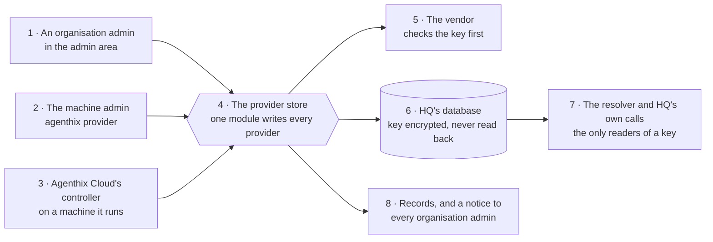

# Providers

A **provider** is a service an organisation reaches AI through and is billed by. HQ holds them: one place, managed by
the organisation's admins, and the only place a key is ever entered. People and projects do not bring keys.

A provider is of one or more **types**:

| Type | What it serves | Vendors today |
|---|---|---|
| **LLM** | Models: conversation, work, titles and summaries | Anthropic (an API key), OpenAI, Google Gemini, OpenRouter, Inworld, an OpenAI-compatible endpoint the organisation runs or chooses |
| **STT** (speech to text) | Listening, in [voice](../conversations/voice.md) | Inworld (the default way to hear), AssemblyAI |
| **TTS** (text to speech) | Speaking, in voice | Inworld |
| All three | | Inworld, on one key; Agenthix Cloud, the hosted service |

**Inworld is one provider of all three types on one key.** Its models are reached by a `provider/model` id (a saved router
in Inworld's own portal is not used), and are offered with no feature switch
(as of 11 Nov 2026 Inworld is the default provider of models as well as speech). hq reads
the list of models the key reaches from Inworld, holds it in memory for each provider, reads it again every hour, and
retries each minute while a provider has none yet. A provider with no list reaches no models and is not shown as down.

A model's *maker* (DeepSeek, reached through OpenRouter) is not a provider; the provider is whoever serves the call.
Every model choice names its provider, as in *Claude Sonnet 5 · via Anthropic*, so a model two providers reach is two
choices ([models](../models/models.md)).

## One key per provider, written one way

An organisation holds **at most one provider of each vendor**. Its key is checked with the vendor before it is stored,
encrypted under HQ's master key, and never returned by any read: a screen or the command line sees at most the key's
last four characters. A Claude subscription is never the organisation's: it belongs to one person ([below](#a-persons-own-claude-subscription)).

Every write goes through one module (`hq/src/providers/write.ts`), which accepts it from exactly three actors, checks
that actor's authority itself, and refuses anyone else:

| Actor | Where they act | Checked by |
|---|---|---|
| **An organisation admin** (1) | **Manage organisation › Providers** in the [admin area](../organisation/admin-area.md), or during [setup](../setup/setup-flow.md) | The role is read from the database again at the write |
| **The machine admin** (2) | `agenthix provider add`, `list` and `remove` on HQ's machine; the key is asked for at the terminal, never given as an argument | Being able to run commands on the machine, over HQ's control socket |
| **Agenthix Cloud's controller** (3) | On a machine Cloud runs, and only to supply Cloud itself as a provider | HQ is told Cloud runs its machine |

HQ reads no provider key from its environment at start. A fleet admin looks after machines only; providers
are not theirs.

## What an organisation admin can do

On **Providers**, each provider is a line with its types, its state and since when, what depends on it, and the end of
its key. An admin can:

- **Add** one. **Add a provider** opens one pop-up, the same in setup and here, that lists every vendor; the key form
  carries a short guide (three steps and a button to the vendor's key page). The key is checked with the vendor before
  anything is stored; a custom endpoint also takes its address and may need no key.
- **Replace a key**. The new key is checked before the old one is dropped; nothing else about the provider changes.
- **Rename** one.
- **Remove** one. The confirmation says which defaults and which agents' own choices used it and what each falls to.
  It is never refused: removing the last provider of a type says that type is down until another is added
  ([ADR-0160](../../adr/adr-0160-setup-defines-the-organisation-first-and-ai-may-come-later.md)).
- **Revoke** one at once, for a key that may have leaked. It is never refused, whatever it leaves without a provider,
  and it reminds the admin to revoke the key at the vendor too, which HQ cannot do.
- **Check now**, and open its **history**: every add, key replacement, rename, removal, revocation and change of state,
  with who made it (a person, the machine admin, Cloud's controller, or HQ itself).

Every write is announced to every organisation admin, so a change one makes is seen by the others. Removing a provider
does not re-point anything: a default or an agent's choice that named it is left empty, and the
[resolver](../models/models.md#how-a-model-is-chosen-for-a-call) takes the next that is allowed.

## Defaults

When a provider that can serve a type first works, the organisation's default for it is filled if it is empty, and never
replaced once a person has changed it. A default model is the newest stable model of a named family (Claude Sonnet for
Anthropic, OpenRouter and Inworld; the main GPT line for OpenAI; Gemini Pro for Google), picked from the provider's own
list by one shared helper in core (`newestOfFamily`), never a fixed id; a family with no match falls back to the dearest
model of the middle price band.

## A provider's state

HQ keeps a state for each provider, moved by the outcome of real calls and by a check it runs itself, hourly while the
provider works and every five minutes while it does not:

| State | Meaning |
|---|---|
| **Works** | The last call or check succeeded |
| **Key refused** | The vendor refuses the key. A failed call asks for a check at once; the check confirms it |
| **Out of credit** | The vendor refuses for the account's money, confirmed the same way |
| **Not answering** | Three failures in a row, at least a minute apart. A refused key or no credit says more and wins |
| **Not available yet** | Agenthix Cloud only: Cloud does not offer models and voice to this HQ yet |
| **Disconnected** | Agenthix Cloud only: the connection ended |

A rate limit is retried and is not a state. A provider that is not working is skipped: new work goes to the next
provider that serves the same model or type. For each one that is not working, every organisation admin gets one
persistent notice that says what is down in the vendor's words, what depends on it, and where new work moves instead
(or that nothing else provides the type, so it is down). It clears by itself when the provider works again, or is replaced
or removed. *Not available yet* tells nobody, since nothing broke. The failing calls of an agent's run on a site count
the same as HQ's own, because the site reports each call's outcome ([model resolution](../../architecture/model-resolution.md)).

**Voice is not optional.** An organisation has a working STT and TTS provider from [setup](../setup/setup-flow.md)
on. When one stops working with no other of its type, voice is down, said as an outage to the person who tries it
("an organisation admin has been told"), never as a setting someone chose.

## Agenthix Cloud

Agenthix Cloud is one more provider, of all three types, with no key: HQ reaches it through its connection
([cloud connection](../../architecture/cloud-connection.md)). An organisation admin connects it from setup or from
Providers; it then reads **Not available yet**, because Cloud does not offer models and voice to HQs yet and HQ's calls to
it are not built, and **Disconnected** if the connection ends. Nothing about choosing models changes when it does: it is a
provider like the others, billed by Agenthix, and its costs come back from Cloud ([billing](../billing/billing.md)).

## A person's own Claude subscription

A Claude subscription belongs to one person. A person signs in with theirs in **Settings**, and it serves Claude models
for work in their own place (their space and their personal projects), and nowhere else: never in a shared project, never
for HQ's own calls such as titles or the voice sample phrase. The organisation holds no Claude subscription. HQ shows the
subscription as an LLM provider owned by that person, with no key, whose calls are costed as *included*.

## Where in the code

| What | Where |
|---|---|
| The one write module, its three actors | `hq/src/providers/write.ts` |
| The store; the only way to a key | `hq/src/providers/store.ts` (`credentialOf`) |
| Vendor checks, state rules and the hourly check | `hq/src/providers/checks.ts`, `healthRules.ts`, `health.ts` |
| Notices to admins | `hq/src/providers/notices.ts` |
| What removing one touches | `hq/src/providers/impact.ts` |
| The Providers page and its operations | `hq/src/providers/pages/`, `components/`, `operations.ts` |
| `agenthix provider` | `host/src/cli/provider.ts`; HQ's side `hq/src/providers/machineCommands.ts` |
| A person's Claude subscription | `hq/src/model-access/claudeSubscription.ts`, `claudeLoginActions.ts` |
| Types, vendors, states | `core/src/providers/providers.ts`, `records.ts` |
| The newest model of a family | `core/src/models/newestOfFamily.ts`, `modelFamilies.ts` |
| Inworld's model list | `hq/src/routing/inworldModelsRefresh.ts`, `inworldModelStore.ts` |
| The key form's guide | `hq/src/providers/keyGuides.ts` |
| Schema | `hq/schema.prisma`: `AiProvider`, `AiProviderRecord` |

## Decisions behind this

[ADR-0042](../../adr/adr-0042-hq-is-the-orgs-own.md) (HQ is the organisation's own, so its keys are too),
[ADR-0134](../../adr/adr-0134-an-hq-connects-to-cloud-by-device-approval-and-signed-tokens.md) (how HQ connects to Cloud).
