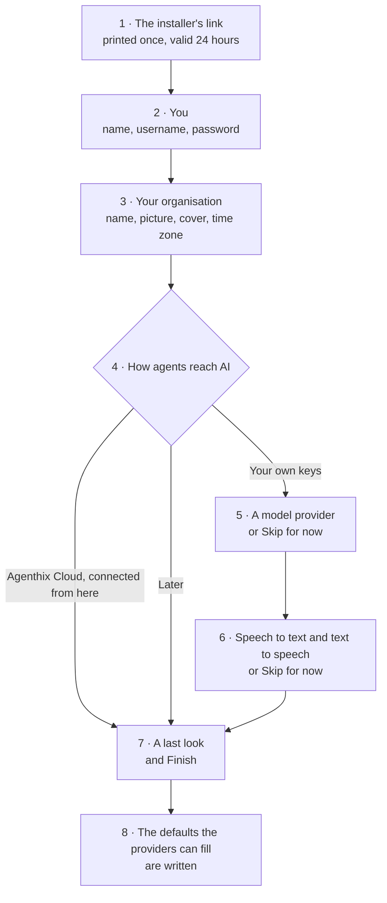

# Setup

Setup happens once per HQ, for its first admin, in HQ itself. It carries Agenthix's own brand, because the HQ is not yet
the organisation's: the Agenthix mark and name at the top of each step, and no "Powered by Agenthix". Everyone invited
afterwards goes through [onboarding](../onboarding/onboarding-flow.md) instead, in the organisation's identity.

Setup asks for the organisation first, and **models and voice may be left for later**
([ADR-0160](../../adr/adr-0160-setup-defines-the-organisation-first-and-ai-may-come-later.md)): it finishes with whatever
providers were added, none included, and every screen afterwards says what is *not set up*, as distinct from *down*. It
needs no Execution Site, and no agent: a missing site is shown on the last look and is never a reason the person cannot
continue.

## Before the first account: the link

A fresh HQ has no accounts, and says so on its sign-in page: it is *not set up yet*, and points to where the link is. The
link is made while HQ has no users, printed in HQ's log and by `agenthix install` when it finishes, valid 24 hours, and a
new one (`agenthix hq invite-admin` on HQ's machine) withdraws the last
([invitations](../auth/invite-auth.md)). The first admin opens it, which makes their account (an organisation admin, and a
fleet admin too) and sends them into setup. There is no Fleet Console step before this: the Fleet Console is for machines,
is installed with HQ, and signs in with the account this link makes.

HQ is in one of three states, worked out from its data and never stored: **not set up** (no account), **setting up** (the
first account exists and setup is not finished: the sign-in page says HQ is almost ready),
and **set up**.

Setup is theirs only while it is unfinished: `needsSetup` (`hq/src/setup/setupState.ts`) is true for the person who
consumed the `FIRST_ADMIN` invitation, while `Org.setupCompletedAt` is empty and their role is admin. For anyone else,
and once it is done, `/setup` sends the person to Home. Home sends an unfinished first admin to `/setup`.

## The steps

The step is in the address (`/setup?step=you|organisation|choice|model|voice|review`, with `path=cloud`, `path=keys` or
`path=later`), so a refresh keeps it and Back and Forward move between steps. Setup opens at the first step whose need is
unmet: the organisation until its step is saved (which makes the default billing profile), then the choice while no
provider is added, otherwise the last look. Every step after the first has **Back**. Setup is two columns: the form on
the left and, on the right, Agenthix's mark and name centred on a branded panel beside You, then, from the organisation
on, a live preview of the organisation's sign-in page. Each step's buttons sit in one row under the form, pinned to the foot of the
window while the form is longer than it (`ActionRow`, `hq/src/auth/pages/parts/authUi.tsx`).

1. **You** — name, username, password. The account exists already; coming back shows the name to edit, the username
   (which cannot change) and the password as set.
2. **Your organisation** — name, an optional picture and an optional cover, each showing what was uploaded, with Change and
   Remove, and the organisation's **time zone**, in which the usage report cuts its months. Saving it also makes the
   default [billing profile](../billing/billing.md#billing-profiles), named after the organisation.
3. **How will your agents reach AI?** — three cards.
   - **Agenthix Cloud**: models and voice with no keys, billed by Agenthix. The admin connects HQ to Cloud from here with
     a short code, approved on Cloud's page ([cloud connection](../../architecture/cloud-connection.md)). Cloud does not
     offer models and voice to HQs yet, so the card reads *Not available yet* and cannot be used.
   - **Your own keys**: an account at a model provider and one at a speech provider, two more steps.
   - **Later**: straight to the last look; agents can't think or talk until a provider is added.
4. **Your model provider** (own keys) — one provider of Anthropic, OpenAI, Google Gemini, OpenRouter or an
   OpenAI-compatible endpoint, with its key. The key is checked with the vendor before it is stored. More providers, and
   Agenthix Cloud, can be added later in the admin area. **Skip for now** goes on without one.
5. **Voice** (own keys) — speech through Inworld (one key serves speaking and hearing, and it is the default way to hear), with AssemblyAI
   as another way to hear, each with its key, checked the same way. **Skip for now** goes on with whichever was added.
6. **A last look** — each step summarised with **Edit** (which returns to the last look), in the order the steps ran: who
   they are, the organisation, where models and voice come from and what is not set up yet, the organisation's three
   **defaults** (the default model, listening, and speaking with its voice, which can be changed in
   **Manage organisation › Models**; *chosen when a provider is added* while there is none), the built-in agent, and where
   agents run. **Finish**.

Finishing calls `completeSetup`, which is never refused for providers. It writes whichever of the three defaults is not set
yet and the providers added can fill:
Claude Sonnet 5 as the one default model, for conversations and their work, where the provider reaches it, otherwise by
price from the provider's catalogue (the dearest model of the middle price band), and for voice the first
working provider of each type with Inworld TTS 2, the voice Alistair, and the most accurate listening model. A default
the person changed on the last look stays. A default left empty is filled the same way when a provider is added later or
its key replaced (`fillEmptyDefaults`). It records `Org.setupCompletedAt` and lands the person on Home, where the
built-in agent waits. It never reaches an Execution Site, so a site outage cannot hold setup open.

## After setup without AI

An organisation that left models or voice for later is told so where it matters, as *not set up* rather than as an outage:
Home's line under the message box says no model provider has been added; an admin's **Needs attention** lists *Agents
can't answer yet* and *Voice isn't set up*, each linking to Providers and clearing itself once a provider is added; the
voice button says voice isn't set up; and a member's last look in onboarding says the organisation hasn't set up models
yet. A provider that was added and stopped working is still shown as down.

## Where the code is

| File | Role |
|---|---|
| `hq/src/setup/pages/SetupPage.tsx`, `setupSteps.ts` | The page, its step state and the order of steps for each path |
| `hq/src/setup/pages/steps/` | One component per step, the sign-in preview, the image upload |
| `hq/src/setup/queries.ts` | `getSetupData`: the organisation, whether setup is the person's, HQ's site; `getSetupResume`: the step to open at |
| `hq/src/setup/setupState.ts` | HQ's state, whose setup it is, the step to resume at, and finishing |
| `hq/src/setup/setupDefaults.ts` | The three defaults written when setup finishes, and filled later when a provider is added |
| `hq/src/setup/organisation.ts` | The time zone and the default billing profile |
| `hq/src/setup/actions.ts` | `completeSetup` |
| `hq/src/auth/firstAdmin.ts` | The installer's link |
| `hq/src/setup/hqSiteState.ts` | Whether HQ's own site is running |
