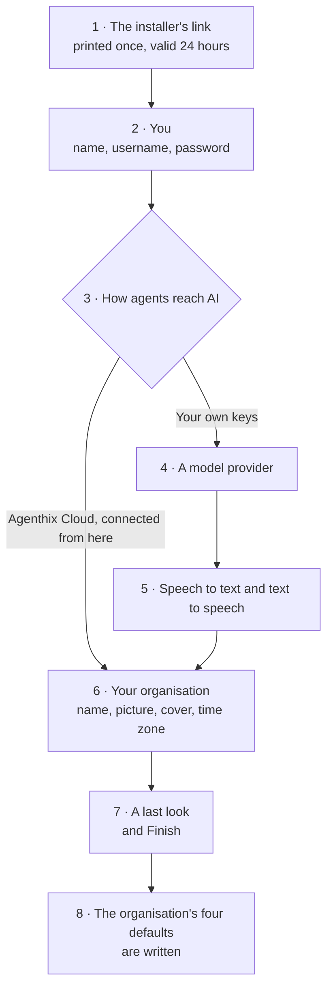

# Setup

Setup happens once per HQ, for its first admin, in HQ itself. It carries Agenthix's own brand, because the HQ is not yet
the organisation's: the Agenthix mark and name at the top of each step, and no "Powered by Agenthix". Everyone invited
afterwards goes through [onboarding](../onboarding/onboarding-flow.md) instead, in the organisation's identity.

Setup requires **models and voice**: it cannot be finished until the organisation has a working model provider, a working
speech-to-text provider and a working text-to-speech provider. It needs no Execution Site, and no agent: a missing site is
shown on the last look and is never a reason the person cannot continue.

## Before the first account: the link

A fresh HQ has no accounts, and says so on its sign-in page: it is *not set up yet*, and points to where the link is. The
link is made while HQ has no users, printed in HQ's log and by `agenthix install` when it finishes, valid 24 hours, and a
new one (`agenthix hq invite-admin` on HQ's machine) withdraws the last
([invitations](../auth/invite-auth.md)). The first admin opens it, which makes their account (an organisation admin, and a
fleet admin too) and sends them into setup. There is no Fleet Console step before this: the Fleet Console is for machines,
is installed with HQ, and signs in with the account this link makes.

HQ is in one of three states, worked out from its data and never stored: **not set up** (no account), **setting up** (the
first account exists and setup is not finished: the sign-in page says HQ is almost ready),
and **set up**.

Setup is theirs only while it is unfinished: `needsSetup` (`hq/src/setup/setupState.ts`) is true for the person who
consumed the `FIRST_ADMIN` invitation, while `Org.setupCompletedAt` is empty and their role is admin. For anyone else,
and once it is done, `/setup` sends the person to Home. Home sends an unfinished first admin to `/setup`.

## The steps

The step is in the address (`/setup?step=you|choice|model|voice|organisation|review`, with `path=cloud` or `path=keys`),
so a refresh keeps it and Back and Forward move between steps. Setup opens at the first step whose need is unmet: no
working model provider opens at the choice, a model provider but no voice opens at voice, otherwise the organisation.
Every step after the first has **Back**. Setup is two columns: the form on the left and, on the right, Agenthix's brand until
the organisation has a picture or cover, then a live preview of its sign-in page.

1. **You** — name, username, password. The account exists already; coming back shows the name to edit, the username
   (which cannot change) and the password as set.
2. **How will your agents reach AI?** — two cards.
   - **Agenthix Cloud**: models and voice with no keys, billed by Agenthix. The admin connects HQ to Cloud from here with
     a short code, approved on Cloud's page ([cloud connection](../../architecture/cloud-connection.md)). Cloud does not
     offer models and voice to HQs yet, so the card reads *Not available yet* and cannot be used.
   - **Your own keys**: an account at a model provider and one at a speech provider, two more steps.
3. **Your model provider** (own keys) — one provider of Anthropic, OpenAI, Google Gemini, OpenRouter or an
   OpenAI-compatible endpoint, with its key. The key is checked with the vendor before it is stored. More providers, and
   Agenthix Cloud, can be added later in the admin area.
4. **Voice** (own keys) — one speech-to-text provider (AssemblyAI) and one text-to-speech provider (Inworld), each with its
   key, checked the same way.
5. **Your organisation** — name, an optional picture and an optional cover, each showing what was uploaded, with Change and
   Remove, and the organisation's **time zone**, in which the usage report cuts its months. Saving it also makes the
   default [billing profile](../billing/billing.md#billing-profiles), named after the organisation.
6. **A last look** — each step summarised with **Edit** (which returns to the last look): who they are, where models and
   voice come from, the organisation's four **defaults** (conversation model, worker model, listening and speaking with
   their voice, which can be changed in **Manage organisation › Models**), the organisation, the built-in agent, and where
   agents run. **Finish**.

Finishing calls `completeSetup`. It is refused (409) until the providers cover a model, speech to text and text to speech
that work. It then writes whichever of the four defaults is not set yet, so a finished setup always has models and voice:
Claude Sonnet 5 to talk and Claude Opus 5 to work where the provider reaches them, otherwise by price from the provider's
catalogue (the dearest model of the middle price band talks, the cheapest of the top band works), and for voice the first
working provider of each type with Inworld TTS 2, the voice Alistair, and the most accurate listening model. A default
the person changed on the last look stays. It records `Org.setupCompletedAt` and lands the person on Home, where the
built-in agent waits. It never reaches an Execution Site, so a site outage cannot hold setup open.

## Where the code is

| File | Role |
|---|---|
| `hq/src/setup/pages/SetupPage.tsx`, `setupSteps.ts` | The page, its step state and the order of steps for each path |
| `hq/src/setup/pages/steps/` | One component per step, the sign-in preview, the image upload |
| `hq/src/setup/queries.ts` | `getSetupData`: the organisation, whether setup is the person's, HQ's site; `getSetupResume`: the step to open at |
| `hq/src/setup/setupState.ts` | HQ's state, whose setup it is, the step to resume at, and finishing |
| `hq/src/setup/setupDefaults.ts` | The four defaults written when setup finishes |
| `hq/src/setup/organisation.ts` | The time zone and the default billing profile |
| `hq/src/setup/actions.ts` | `completeSetup` |
| `hq/src/auth/firstAdmin.ts` | The installer's link |
| `hq/src/setup/hqSiteState.ts` | Whether HQ's own site is running |
