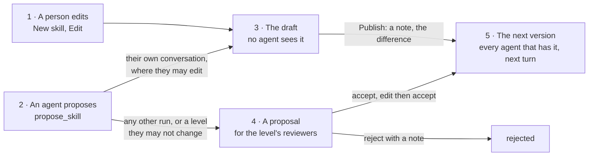

# Drafts, Publishing and Proposals

**Agents draft skills; people publish them** ([ADR-0159](../../adr/adr-0159-agents-draft-skills-people-publish-them.md)). A skill that agents will follow for everyone is standing instruction, so nothing becomes live until a person with the right to change it says so. This page is how that works for the Library's skills and for a project's.

1. **A person** edits through the editor: *New skill*, or *Edit* on a skill.
2. **An agent** has one way to write a skill: the `propose_skill` tool.
3. **A draft** is the one shared copy of the skill under edit. It saves itself a moment after typing stops; each change records its author, or the run that proposed it. *Discard draft* is the way back.
4. **A proposal** is a skill waiting for the people who may publish at its level.
5. **Publishing** makes the next version.

---

## Editing and publishing

*Edit* makes a **draft** that no agent sees, one per skill, shared by everyone who may edit it. *Publish* shows the full difference since the last version, every file including `scripts/`, asks for a note, and publishes only the draft revision the publisher looked at: it is refused if the draft changed since. It makes the next version (patch, minor or major; minor by default), writes that version into `SKILL.md` and the skill's `package.json`, so the files and hq's record agree, and moves the pin. Every agent that has the skill uses it from its next turn, and rolling back stays one click.

*New skill* asks for a name and a description (what it does and when to use it), offers a plain skill, one with `scripts/` and `references/`, or asking an agent to write it, and opens the editor on a draft. Its first publish is version 1, and the editor then offers *Add to agents…*.

*Ask an agent* opens a dialog that says, before anything is sent, which agent will answer and where the conversation will be, and opens a conversation with the skill attached. The agent's edit updates the person's draft when that person may edit the skill, and becomes a proposal when they may not.

Every save, upload and install is checked against the Agent Skills specification: a name of 1 to 64 lowercase letters, digits and hyphens, a description of 1 to 1,024 characters, a warning for a body over 500 lines, and a flag on header keys that are *ignored when run*.

## What an agent can do

`propose_skill` takes the skill's name, description, files, why, the level it aims at (the organisation, the project or the person) and optionally the skill it edits. **Who asked is never something the agent says**: hq takes the person from the run's on-behalf-of record. Where the call lands depends on that:

| The call comes from | And | It becomes |
|---|---|---|
| The person's own interactive conversation | They may edit at that level | Their **draft**. The conversation's card offers *Open draft* and *Publish* |
| The person's own interactive conversation | They may not | A **proposal**, aimed at a level they can change on the card |
| Any other run: a task, a scheduled or automated run, a run someone else started | | Always a **proposal**, never a draft, Bypassed or not |

At most five per run. Each call is checked as `propose_workflow` is: the Agent Skills rules, size, header keys, and that the files `SKILL.md` names are present. A draft or a proposal reaches no agent. The built-in `skill-creator` teaches agents to write a good skill and to propose it rather than write it into files. A skill an agent writes into files anyway is governed by the place's default ([skills in files](./skills-in-files.md#defaults-and-switches)).

No agent setting skips a person's approval. An agent's request to publish, roll back, switch a skill on or install becomes a card for the person it acts for, runs only when they approve it and hold the right at that moment, and is recorded with them as the publisher and the agent as who asked. Trusting a publisher and naming Library maintainers have no agent request at all.

## Who approves

| Level | Reviewers |
|---|---|
| The organisation's Library | Administrators and Library maintainers |
| A project | The project's administrators |
| Your space | The person |

A proposal reaches its reviewers wherever they look: Overview counts the proposals at every level the person reviews, a project's Skills page says how many wait for it, and the Library leads to its queue. Reviewing **accepts**, **edits then accepts**, or **rejects with a note**, and the agent is told the outcome on its next turn. Accepting publishes through the level's own path, so its checks and history apply; the reviewer names the content they looked at, and a proposal that has moved on is refused. A rejected proposal is removed 90 days after review.

The same person-by-action rules apply everywhere, from one policy:

| | Library | A project's skills | Your space |
|---|---|---|---|
| Edit a draft | Administrators, Library maintainers | Members | The person |
| Publish, roll back, review | Administrators, Library maintainers | The project's administrators | The person |
| Install from outside | Administrators; maintainers when the organisation allows | not applicable | not applicable |
| Remove, choose which agents have a skill, trust publishers, name maintainers | Administrators | not applicable | not applicable |

Naming a Library maintainer shows the role's reach first: they publish skills that run for every agent, in every project, including ones they cannot access.

## Related

- [skills.md](./skills.md)
- [the Library](../library/library.md): versions, history and the organisation's own copy
- [skills in files](./skills-in-files.md)
