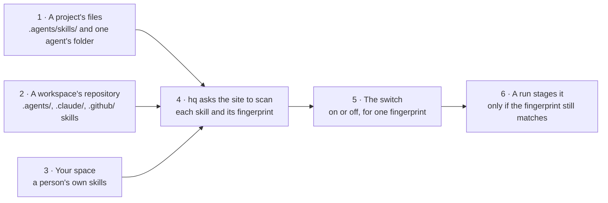

# Skills in Files

Some skills are not installed from the Library. They are folders in files that someone else owns: a project's storage, a workspace's repository, or a person's own space. They belong to whoever can write those files, so hq **lists them and switches them but never pins them**: a file changes when someone writes it, a repository when someone commits. The levels are in [skills](./skills.md#where-a-skill-lives); this page is how they are controlled.

1. A project's own folder serves every agent working there; an agent's folder inside it serves that agent only.
2. A workspace's repository is read in all three folders teams already use. It is read-only in hq: its versions are its commits.
3. A person's own space is a place like a project.
4. The site lists the folders and reports a **fingerprint** for each, one digest over its files. The fingerprint is what a switch and a run name.
5. A switch is *on* or *off* and holds for **one fingerprint**. A skill that changes is a different fingerprint.
6. The site stages the skill only if what it reads now has exactly the fingerprint hq named.

---

## Defaults and switches

| Control | Who sets it | Choices |
|---|---|---|
| **Skills found in files**, the organisation's default (Manage organisation › Settings › Library and skills) | Administrators | **Off by default** (the shipped choice): everything found is listed and stays off until switched on, and a skill that changes goes off again. **On by default**: everything found runs, and anyone who may can switch one off. Choosing it says that agents' writes then run unreviewed. **Never**: hq does not read skills from files |
| **A place's default**, for a project or Your space | The project's administrators, or the person | Only stricter than the organisation's, as every override is ([ADR-0072](../../adr/adr-0072-an-agent-is-defined-once-in-hq-and-overridden-per-boundary.md)) |
| **Each skill's switch**, on the place's Skills page | The same | On or off, remembered by fingerprint |

The Skills page groups what was found by where it was found (the project, one agent, each workspace), with **All on** and **All off** for the page and each group. Switching a skill on shows every one of its files, scripts and references included, not only `SKILL.md`, so what is switched on is what was read.

A skill the project does not use shows its state in plain words: *off*, *changed in files, not published*, *Set aside* with the reason, or, when the site could not read it, why.

## Versions by publishing

A project's skills are versioned like the Library's: by **publishing**. The editor, draft and *Publish* are the same ([drafts and proposals](./drafts-and-proposals.md)). hq keeps the draft in its own records, never in the project's live folder, so no agent sees it; *Publish* writes the skill's folder through the site, records the version, the fingerprint and the content, and writes the version number into the skill's `metadata`. Rolling back publishes an older version's files as the next version.

A change made some other way, an agent's file tools or the Files page, shows as **changed in files, not published**, with its changes and two actions: *Publish as the next version* or *Put back* the newest published one. Under *Off by default* it is off until then. Publishing is itself the review, so it carries the skill's switch with it.

*Add to this place* copies an installed skill into the project's folder, or one agent's, at the version the Library has pinned, and records its identity and version in the skill's `metadata`. So the page can show where it came from and offer a newer Library version as an update, which is an offer and never enforced. *Remove* deletes a project's skill folder and keeps its history; a workspace's skill can only be switched off.

## Who acts

**Writing is open; publishing is the control.** Anyone with write access to the project edits: its members, in the editor as a draft or directly in the files, and the agents working there. **Only the project's administrators publish**, switch skills on and off, roll back, review proposals aimed at the project and set its default. Viewers read the Skills page. An organisation administrator who is not in the project does not act inside its skills; they govern through the organisation's default. In Your space, the person does everything. A project on *On by default* chooses to skip the gate.

## The person's own skills

A person's own skills live in Your space's files and **follow them into their own conversations everywhere**, projects included. Only a version the person **published** follows them; an unpublished change in Your space never leaves it. They apply to the person's own conversation only, including the work it hands to an agent on their behalf. They do not apply to runs someone else started, to tasks, or to scheduled or automated runs.

This is safe because a skill adds no capability: in the person's own conversation it can only make the agent do what the person could ask by typing the same words, and the conversation stays within the person's access ([ADR-0152](../../adr/adr-0152-a-conversation-reaches-only-its-own-place-and-the-places-its-person-added.md)). Each person sees their own skills on a project's Skills page as a private group. The organisation can turn this off with *Personal skills outside Your space*, on by default.

When the same skill is in the project and in the person's space, the project's wins ([the order](./skills.md#when-the-same-skill-comes-from-two-places)).

## What the site does

The site scans a place's skill folders and its workspaces' repositories when hq asks, under the bounds staging uses and a cap of 200 skills per place. It reads each folder into memory and computes the fingerprint over exactly those bytes. Hidden entries are left out, links are refused, and anything whose real path leaves the place is refused. Writing, rolling back and removing a skill folder go through one call that writes or removes a whole folder at once, only in a project's skill folders and never in a repository.

## Related

- [skills.md](./skills.md): the levels and the clash order
- [drafts-and-proposals.md](./drafts-and-proposals.md)
- [architecture/skills-and-assets.md](../../architecture/skills-and-assets.md): the scan, the dispatch and staging
