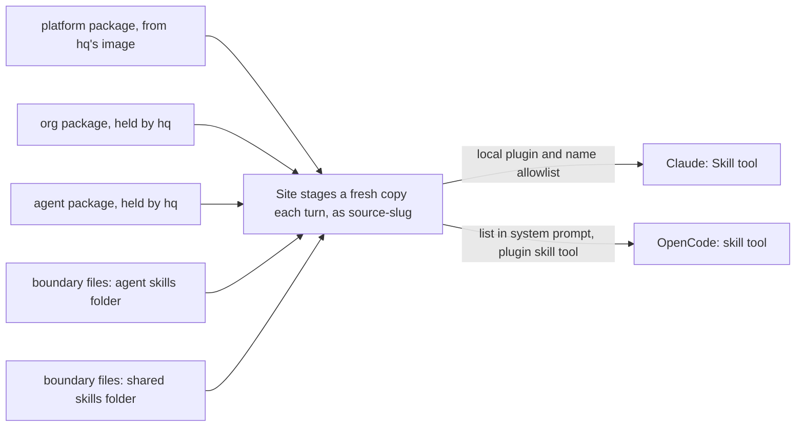

# Skills



A skill is a set of instructions an agent loads when a task matches it. Skills extend what an agent can do without changing its identity or its system prompt. A skill is a folder with a `SKILL.md` file, and may hold other files (scripts, reference text) beside it.

Agenthix gives an agent its skills the same way on every runtime: **it stages them for each turn**, and the model is shown only that set. A runtime's own skill discovery is never used ([ADR-0084](../../adr/adr-0084-an-agents-skills-are-staged-by-agenthix-per-turn.md)).

---

## What is a skill

```markdown
---
name: Code Review
description: Guides the agent through structured code review
---

# Code Review

When asked to review code, follow these steps...
```

The `description` is what the model reads to decide whether a skill fits the task. The body is loaded only when the model asks for the skill.

---

## Where a skill comes from

A skill has one of five **sources**. There is no precedence between them, and no source overrides another.

| Source | Whose | Where it lives |
|--------|-------|----------------|
| `platform` | Every agent | The platform's package, held by hq |
| `org` | Every agent in the organisation | The organisation's package, held by hq |
| `agent` | One agent | The agent's own package, held by hq |
| `boundary` | One agent, in one storage boundary | `.agents/agents/<agentId>/skills/` in the boundary's files |
| `shared` | Every agent working in one storage boundary | `.agents/skills/` in the boundary's files |

The org and agent packages hold copies of library skills made when a skill was installed (a later change to the library skill does not reach them until it is installed again), and the org package also receives every platform library skill; see [the library's skills](../library/skills.md). A storage boundary is the workspace a run works in, for a project or for a person's own space. The first three come from the agent's definition ([ADR-0072](../../adr/adr-0072-an-agent-is-defined-once-in-hq-and-overridden-per-boundary.md)); the last two are the boundary owner's additions on top of it.

### Names

Each skill reaches the model under `<source>-<slug>`, for example `org-code-review` or `boundary-deploy`. So two skills with the same slug in different sources both reach the agent, under different names, and the agent can say which one it used. The `name` in a staged `SKILL.md` is rewritten to match, because a skill's name must match its folder. The name a model calls, and a person types as `/name`, is the same on every runtime; Claude Code's own list labels each skill `agenthix:<name>`, after the plugin it comes from (below).

A **slug** is lowercase letters, digits and hyphens, starting with a letter or digit (`/^[a-z0-9][a-z0-9-]*$/`). It is the skill's folder name. A staged name is at most 64 characters, so a slug that would make the full name longer is skipped, with a warning.

---

## Staging

At the start of every turn, the site copies the agent's skills from all five sources into a fresh folder, each under its `<source>-<slug>` name. What the turn sees is the skills as they are at that turn: a skill edited or added since the last turn is picked up by the next one, with no restart and no reload.

Staging copies files and never makes links. Skills in a boundary's files are on disk the agent can write, so everything read from there is checked as it is read: links are refused, anything whose real path leaves the boundary is refused, and the amount read is bounded. A broken or hostile tree yields fewer skills, never a failed run. Nothing an agent writes becomes a skill except through the two boundary folders above, and only through these checks. The details are in [skills-merge.md](./skills-merge.md).

The staged folder is inside the run's container and read-only there, so the agent cannot rewrite what it was given. Commands the agent runs may read it, so a skill's scripts work.

**A staged `SKILL.md` carries a rebuilt header, not a copy of the author's.** Its body is kept byte for byte, but its front matter is written afresh from an allowlist of keys that only describe the skill: `name` (the staged name), `description`, `when_to_use`, `argument-hint`, and the two flags that only narrow who may invoke it, `disable-model-invocation` and `user-invocable`. Every other key is dropped — `hooks`, `allowed-tools`, `model`, `effort`, `context`, `agent`, `shell`, `paths`, and plugin-level keys among them — because a harness would act on them outside the tool gate, and boundary skills are written by agents. Every text value is written back quoted (the name is already restricted to safe characters, and the flags are only `true` or `false`), so nothing in it can open another key or end the header early (`site/src/agents/runtime/skillFrontmatter.ts`). The same rebuild serves both runtimes.

---

## How each runtime receives them

Both runtimes work in two steps, which is also how a person meets a skill: the model is shown a list of skill names and descriptions, and when a task matches one it calls the `skill` tool with the name and receives the skill's full instructions and where its other files are.

### Claude

The staged folder is handed to the Claude Code process when it starts as a **local plugin** named `agenthix` — a `.claude-plugin/plugin.json` beside `skills/` — together with an allowlist of the staged names (the SDK's `plugins` and `skills` options), and Claude Code lists and loads them with its own `Skill` tool, as it does natively. Every agent has `Skill`, whatever its permissions; each load is logged by the gate as `skill`, and a name that was not staged is refused (`skill-not-staged`). The allowlist also hides Claude Code's own bundled skills from the model.

Claude Code's list shows each skill as `agenthix:<name>`; the model calls it by the plain name, and `/name` works too. Nothing else from the working tree is loaded: the process reads no settings files (`settingSources: []`), so no project skills, `CLAUDE.md` or settings from files the agent can write. A skill's inline shell (`` !`…` ``) is switched off (`disableSkillShellExecution`), and its hooks never reach the process, since the header rebuild drops them.

A Claude process stays running between a conversation's turns, and Claude Code reads its skills once, at start. So each turn's staged skills are compared, by content, with those the running process started with:

- **Unchanged:** the running process takes the turn, and the new staging folder is discarded.
- **Changed:** the running process is ended and a new one, started with the new folder, resumes the conversation. The same happens when the agent's tools, prompt or credential change.

A change to a skill therefore costs one process start, about a quarter of a second, on the next turn. The old process's folder is removed when it ends.

### OpenCode

One OpenCode server is shared by every conversation in a container, and those conversations may belong to different agents. OpenCode's own skill discovery keeps one pool per project folder, keyed by name, and reads it once, so two agents' same-named skills could not coexist and a change would need a reload that cancels every running turn. Agenthix does not use it.

Instead, for each turn of a conversation:

1. **The site stages the skills** into a folder for that conversation, replacing the previous turn's. The new set is built beside the old and swapped in, so the folder is never seen half-written.
2. **The list goes in the turn's system prompt.** The site sends each skill's name and description in OpenCode's own format, after the agent's instructions.
3. **Agenthix's OpenCode plugin replaces the `skill` tool.** OpenCode lets a plugin tool take the place of a built-in one by name. The plugin's `skill` is given the calling session, finds its conversation, and loads a skill only from that conversation's staged folder. It returns the same output as OpenCode's own tool, and every load passes the same per-call check as any other tool.
4. **OpenCode's own list is switched off**, so the model sees the turn's list and no other.

Two conversations on the same server, for different agents, therefore each see only their own skills, under the names they have on Claude, as they are at that turn, and a change never interrupts another conversation's turn. Nothing is restarted when skills change.

The conversation's staged folder is removed when the conversation goes idle or ends.

---

## Slug uniqueness

Within a source, slugs are unique (they are folder names). Across sources the same slug may appear; the source prefix keeps the names distinct.

See [authoring-skills.md](./authoring-skills.md) for writing one and [skills-merge.md](./skills-merge.md) for how staging reads the sources.
