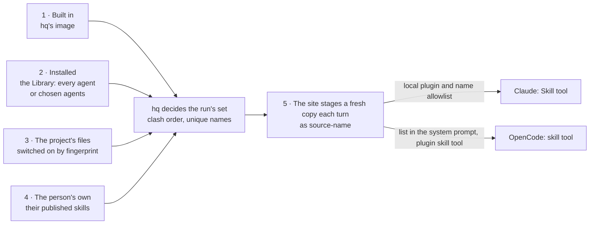

# Skills



A skill is a set of instructions an agent loads when a task matches it. Skills extend what an agent can do without changing its identity or its system prompt. A skill is a folder with a `SKILL.md` file, and may hold other files (scripts, reference text) beside it.

Agenthix gives an agent its skills the same way on every runtime: **it stages them for each turn**, and the model is shown only that set. A runtime's own skill discovery is never used ([ADR-0084](../../adr/adr-0084-an-agents-skills-are-staged-by-agenthix-per-turn.md)).

How a skill is looked after is in four parts: [this page](#where-a-skill-lives) (where skills live and which wins), [the Library](../library/library.md) (installed skills are assets: versioned, pinned, checked on the way in), [skills in files](./skills-in-files.md) (a project's and a person's own) and [drafts and proposals](./drafts-and-proposals.md) (who may change a skill, and what agents may do). How a turn stages them is [skills-merge.md](./skills-merge.md); the machinery is [architecture/skills-and-assets.md](../../architecture/skills-and-assets.md).

---

## What is a skill

```markdown
---
name: Code Review
description: Guides the agent through structured code review
---

# Code Review

When asked to review code, follow these steps...
```

The `description` is what the model reads to decide whether a skill fits the task. The body is loaded only when the model asks for the skill, or when a person picks it with `/` in the message box.

### Instructions, skills and knowledge

Three things shape what an agent does, and the line between them decides where anything is written.

| | Steers the agent? | When it applies | Holds |
|---|---|---|---|
| **Instructions** (`AGENTS.md`, the organisation's and the project's) | Yes, always | Every turn | Standing rules for all work |
| **Skill** | Yes, explicitly, for one kind of task | When a task matches its description, or a person picks it | A routine the agent must follow, often with scripts |
| **[Knowledge](../knowledge/knowledge.md)** | No, not by itself | When the agent looks something up | Policies, guidance, processes, reference, decisions |

**A skill instructs; knowledge informs.** A process is where they overlap: write it once in knowledge, where it is owned and versioned, and let a skill make it binding ("when asked for release notes, follow the process in knowledge"). A built-in skill follows the same line with the platform's own knowledge, the user guide: it says what to do and points to the guide for what things are ([ADR-0156](../../adr/adr-0156-built-in-skills-sit-beside-platform-knowledge.md)).

---

## Where a skill lives

| Level | Where | Who has it | Who changes it |
|---|---|---|---|
| **Built in** | hq's image | Every agent, unless an administrator switches it off | Agenthix, with each release; never edited |
| **Installed for every agent** | The Library, in hq | Every agent in the organisation | Administrators and Library maintainers |
| **Installed for chosen agents** | The Library, in hq | The agents it was added to | The same |
| **The project's files, every agent** | `.agents/skills/` in a project's storage | Every agent working in that project | Whoever can write the project's files, agents included |
| **The project's files, one agent** | `.agents/agents/<agent id>/skills/` | That agent, in that project | The same |
| **A workspace's repository** | `.agents/skills/`, `.claude/skills/`, `.github/skills/` in a workspace | Runs working in that workspace | Whoever commits to the repository |
| **The person's own** | The same folders in the person's own space (Your space) | Their own conversations, in any project | The person |

The first three are **installed**: hq holds them, one version at a time ([the Library](../library/library.md)). The rest are **skills in files**: they belong to whoever owns the files, and hq lists and switches them but never pins them ([skills in files](./skills-in-files.md)). An agent *has* a skill, whichever level it comes from.

Agenthix ships 2 built-in skills, `working-with-git` and `skill-creator`, and offers 17 more on a shelf in the Library that nobody has until someone installs one ([library skills](../library/skills.md)).

### When the same skill comes from two places

Only the same skill clashes, found by its identity (`publisher/name`, which a skill copied into a project's files keeps in its `metadata`), else by its name, else by its folder. Different skills all apply. A clash is settled by a fixed order:

| Order | Level | Why |
|---|---|---|
| 1 | **Installed** by the organisation | The organisation always uses the same version |
| 2 | **The project**: its files and workspaces | A project's procedures and standards prevail |
| 3 | **The person**: their own skills | They add to the project. To change how the project works, a person writes a complementary skill or updates the project's knowledge |

The one set aside is not staged, and the project's Skills page and the agent's page show it as *Set aside*, with the reason. Renaming a skill in files makes it a different skill.

---

## Names

Each skill reaches the model under `<source>-<name>`, for example `org-code-review`, `shared-deploy` or `person-code-review`. The source says where it comes from:

| Source | From |
|---|---|
| `platform` | A built-in skill |
| `org` | Installed for every agent |
| `agent` | Installed for chosen agents |
| `shared` | The project's own folder |
| `boundary` | One agent's folder in the project |
| `workspace-<n>` | A workspace's repository |
| `person` | The person's own |

The name part is the skill's folder or the last part of its identity, so a role skill `agenthix/project-manager/read-context` stages as `agent-read-context`. The `name` in a staged `SKILL.md` is rewritten to match, because a skill's name must match its folder. A run is told what the prefix means, so a person's `/code-review` is the skill ending in `code-review`. **Every name is unique within a run**: if two skills would share one, neither is staged and both are set aside with that reason. The name a model calls, and a person picks with `/`, is the same on every runtime; Claude Code's own list labels each skill `agenthix:<name>`, after the plugin it comes from.

A name is lowercase letters, digits and hyphens, and at most 64 characters with its source in front.

---

## Picking a skill, and seeing it used

Typing `/` at the start of the message box opens a picker of the skills the conversation's agent has, with where each comes from, narrowed as the person types. The picked skill stays in the message as highlighted text and travels as a separate field, never parsed from the words. The site checks the field: it keeps it only if it names a skill staged for this turn that a person may invoke (it does not set `user-invocable: false`), then tells the runtime to load that skill first. **A typed `/word` is plain text**: the runtime's own commands are never reached from a message.

When a turn used a skill, the work shows *Used the skill* and its name. It opens the skill beside the conversation at the version the run used, found by its recorded fingerprint. Whether the viewer may open it is checked at that moment: an installed skill is for anyone in the organisation, a project's skill for whoever sees the project, a person's own only for them.

---

## Staging

At the start of every turn, the site builds a fresh folder from exactly the skills hq named, each under its name above. What the turn sees is the skills as they are at that turn: a skill published or switched since the last turn is picked up by the next one, with no restart and no reload.

**The site re-checks what it was told.** An installed skill's files must still match the version hq named by digest. A skill in files must still match the fingerprint it was switched on at; one that changed since is not staged and is recorded with that reason. Staging copies files and never makes links, reads a tree under bounds (1,000 entries, 16 MB, 8 levels deep) and refuses any link or path that leaves the project's files. A broken or hostile tree yields fewer skills, never a failed run. The details are in [skills-merge.md](./skills-merge.md).

The staged folder is inside the run's container and read-only there, so the agent cannot rewrite what it was given. Commands the agent runs may read it, so a skill's scripts work.

**A staged `SKILL.md` carries a rebuilt header, not a copy of the author's.** Its body is kept byte for byte, but its front matter is written afresh from an allowlist of keys that only describe the skill: `name` (the staged name), `description`, `when_to_use`, `argument-hint`, and the two flags that only narrow who may invoke it, `disable-model-invocation` and `user-invocable`. Every other key is dropped, `hooks`, `allowed-tools`, `model`, `effort`, `context`, `agent`, `shell`, `paths` and plugin-level keys among them, because a harness would act on them outside the tool gate, and files in a project can be written by agents. Every text value is written back quoted, so nothing in it can open another key or end the header early (`site/src/agents/runtime/skillFrontmatter.ts`). The same rebuild serves both runtimes.

---

## How each runtime receives them

Both runtimes work in two steps, which is also how a person meets a skill: the model is shown a list of skill names and descriptions, and when a task matches one it calls the `skill` tool with the name and receives the skill's full instructions and where its other files are.

### Claude

The staged folder is handed to the Claude Code process when it starts as a **local plugin** named `agenthix` — a `.claude-plugin/plugin.json` beside `skills/` — together with an allowlist of the staged names (the SDK's `plugins` and `skills` options), and Claude Code lists and loads them with its own `Skill` tool, as it does natively. Every agent has `Skill`, whatever its permissions; each load is logged by the gate as `skill`, and a name that was not staged is refused (`skill-not-staged`). The allowlist also hides Claude Code's own bundled skills from the model.

Claude Code's list shows each skill as `agenthix:<name>`; the model calls it by the plain name. A person picks it with `/` in the message box, not by typing a command. Nothing else from the working tree is loaded: the process reads no settings files (`settingSources: []`), so no project skills, `CLAUDE.md` or settings from files the agent can write. A skill's inline shell (`` !`…` ``) is switched off (`disableSkillShellExecution`), and its hooks never reach the process, since the header rebuild drops them.

A Claude process stays running between a conversation's turns, and Claude Code reads its skills once, at start. So each turn's staged skills are compared, by content, with those the running process started with:

- **Unchanged:** the running process takes the turn, and the new staging folder is discarded.
- **Changed:** the running process is ended and a new one, started with the new folder, resumes the conversation. The same happens when the agent's tools, prompt or credential change.

A change to a skill therefore costs one process start, about a quarter of a second, on the next turn. The old process's folder is removed when it ends.

### OpenCode

One OpenCode server is shared by every conversation in a container, and those conversations may belong to different agents. OpenCode's own skill discovery keeps one pool per project folder, keyed by name, and reads it once, so two agents' same-named skills could not coexist and a change would need a reload that cancels every running turn. Agenthix does not use it.

Instead, for each turn of a conversation:

1. **The site stages the skills** into a folder for that conversation, replacing the previous turn's. The new set is built beside the old and swapped in, so the folder is never seen half-written.
2. **The list goes in the turn's system prompt.** The site sends each skill's name and description in OpenCode's own format, after the agent's instructions.
3. **Agenthix's OpenCode plugin replaces the `skill` tool.** OpenCode lets a plugin tool take the place of a built-in one by name. The plugin's `skill` is given the calling session, finds its conversation, and loads a skill only from that conversation's staged folder. It returns the same output as OpenCode's own tool, and every load passes the same per-call check as any other tool.
4. **OpenCode's own list is switched off**, so the model sees the turn's list and no other.

Two conversations on the same server, for different agents, therefore each see only their own skills, under the names they have on Claude, as they are at that turn, and a change never interrupts another conversation's turn. Nothing is restarted when skills change.

The conversation's staged folder is removed when the conversation goes idle or ends.

---

---

## Decisions

[ADR-0072](../../adr/adr-0072-an-agent-is-defined-once-in-hq-and-overridden-per-boundary.md) ·
[ADR-0084](../../adr/adr-0084-an-agents-skills-are-staged-by-agenthix-per-turn.md) ·
[ADR-0149](../../adr/adr-0149-platform-knowledge-is-the-user-guide.md) ·
[ADR-0152](../../adr/adr-0152-a-conversation-reaches-only-its-own-place-and-the-places-its-person-added.md) ·
[ADR-0156](../../adr/adr-0156-built-in-skills-sit-beside-platform-knowledge.md) ·
[ADR-0157](../../adr/adr-0157-every-library-item-is-a-versioned-asset-pinned-once-per-organisation.md) ·
[ADR-0158](../../adr/adr-0158-an-asset-is-installed-from-anywhere-through-one-signed-protocol.md) ·
[ADR-0159](../../adr/adr-0159-agents-draft-skills-people-publish-them.md)

See [authoring-skills.md](./authoring-skills.md) for writing one.
