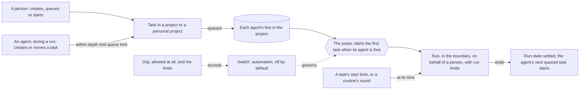

# Automation

Agents have no schedule of their own. Work starts without a person pressing **Run** only through a
**boundary's automation**: a project, or a person's own
[personal project](../projects/personal-projects.md). Automation is hq code, not an agent run. It makes no
model call and needs no container, and it costs nothing when nothing is queued
([ADR-0087](../../adr/adr-0087-work-starts-on-its-own-only-from-a-boundarys-automation.md)).

| Term | Meaning |
|---|---|
| **Boundary** | Where a run's authority comes from: a project, or a person's own space |
| **Automation** | A boundary's switch, off by default. It turns on both the pulse and the boundary's scheduled starts. Off is the boundary's pause |
| **Pulse** | The part of automation that starts a boundary's queued tasks |
| **Scheduler** | The one loop in hq that starts every pulse and every scheduled start that is due |
| **Throttle** | An optional part of the pulse, off by default: queued tasks start only in rounds of limited size |
| **Depth** | How many agent runs led to a task being queued |
| **Queue limit** | How many tasks agents may hold queued in one boundary |

## The switch, and who decides

An org admin sets every value once, in **Organisation › Settings › Automation**. That value is both where every boundary
starts and the furthest it may go. A project admin, or a person for their own personal project, may move a
value only in the stricter direction (`hq/src/automation/automationSettings.ts`):

| Setting | Org out of the box | Stricter is | A boundary may choose |
|---|---|---|---|
| **Automation allowed** | On | Off | On or off, only if the org allows it |
| **Maximum depth** | 3 | Lower | 0 up to the org's value; at 0 every task an agent queues waits for a person |
| **Queue limit** | 20 | Lower | 0 up to the org's value; at 0 every task an agent creates waits for a person |
| **Throttle required** | Off | On | On or off, only if the org leaves it optional |
| **Interval** | 30 minutes | Longer | The org's value or longer; never below 5 minutes |
| **Batch size** | 3 | Smaller | 1 up to the org's value |
| **Agents may set schedules when asked** | Off | Off | On or off, only if the org allows it |

The org's word is final. A boundary's own choice is stored as it set it, and the stricter of the two
applies each time it is used, so nothing stored is rewritten. If the org tightens a value below a project's
choice, the project's Automation tool shows the choice as limited by the org; if the org loosens it again, the
project's choice applies again. An org admin who turns automation off turns every pulse and every scheduled
start in the org off at once, and no project admin can turn it back on. The same narrow-only rule governs
the [run limits](#run-limits) and the per-boundary agent settings.

Interval and batch size matter only where the throttle is on.

## The pulse: each agent's line, one task at a time

With automation on, an agent's queued tasks in a boundary form **one line**. When the agent is free in
that boundary, the pulse starts the first task in the line, and when that run ends the next one starts at
once. The line is ordered:

1. tasks someone asked to start (a person's Run, a start time, `run_task`), which go ahead whatever the
   boundary's automation;
2. then the rest, highest priority first, then longest queued first.

Agents run in parallel and do not compete with each other. The rule that an agent works on one task at a
time in a project is what makes each line sequential, and the database enforces it
(`hq/src/agents/taskSlotClaim.ts`; [task-execution-concurrency.md](../agents/task-execution-concurrency.md)).
Queueing a task nudges the scheduler, so a task whose agent is free starts at once rather than at the next
minute. The site's own limit on runs at once caps the whole site ([below](#the-sites-limit-on-runs-at-once)).

A person is never limited by automation: they can queue any task or press **Run** at once, whatever the
switch says.

## One scheduler

hq runs one scheduler (`hq/src/automation/scheduler.ts`,
[ADR-0088](../../adr/adr-0088-one-scheduler-in-hq-starts-every-automated-start.md)), not a timer per
boundary or per task. Everything that starts on its own stores **when it is next due** in hq's database. At
the top of every minute, and when a task is queued or a run ends, the scheduler asks the database what is
due and does, in order:

1. closes every throttle round whose tasks have all finished;
2. moves on every routine whose round time has come: makes the waiting round's time a start time that is due,
   and creates the next round ([routines.md](./routines.md));
3. starts every task whose start time is due, a routine's round among them, in the same tick;
4. fires every pulse that is due and has queued work;
5. raises or clears the notice of each routine whose last three rounds failed.

Each start is claimed with an atomic database update, so overlapping ticks, or hq running as more than one
process, start an item once. Nothing about timing is held only in memory, so a restart, an edit or a pause
changes a stored time and nothing else. A start that fell due while hq was down happens when hq is back.

## Depth bounds chains

Agents can queue work for each other, and left alone that never ends. **Depth**
([ADR-0091](../../adr/adr-0091-work-agents-cause-is-bounded-by-its-depth.md)) bounds it:

- A task a **person** queues or starts, directly or by asking an agent in a run they started, is at
  **depth 0**.
- A task queued by a run the pulse, a schedule or an agent's `run_task` started is **one deeper** than the
  task that run was for.
- Past the boundary's maximum depth the task is still created or moved, but **not queued**. The tool's
  result tells the agent so, and the task waits for a person; a person queueing it puts it back at depth 0.

Depth is counted on every act of queueing, not on creating a task: creating a task queued, moving it into a
column that queues, moving a finished task back into one, and starting it with `run_task` all count, so
recycling an old task never resets the count. hq works it out from the run's own task, never from anything
the agent or its site sends (`hq/src/server/controlplane/queueGate.ts`).

The **queue limit** is the other bound: when agents already hold that many queued tasks in the boundary, a
task an agent creates is created but not queued, and waits for a person. It counts tasks whose last queuer
was an agent, and applies to agents only. Depth bounds how far agents' work can lead; the queue limit
bounds how much they can pile up.

## The throttle

The throttle is for a boundary that wants agents' work to arrive in rounds, to bound cost over time or to
leave a gap to see what happened. It is off by default. Turned on, newly queued work is held as
**Throttled**, and a round lets work through:

- Each **round** moves up to the **batch size** of each agent's throttled tasks, highest priority first, into
  that agent's line. The rest stay throttled until the next round. The batch then runs one task after
  another.
- It fires on the **leading edge**: a task queued into a boundary whose last round finished at least an
  interval ago starts a round at once. Otherwise the next round starts one interval after the last round
  **finished**, measured from its end.
- A round starts only what was throttled when it opened.
- When each boundary's last round finished is stored, so a restart neither resets the throttle nor starts
  every boundary at once.

A round is open until none of its tasks is still queued or running. A person's **Run** is never throttled.
A boundary with the throttle on shows the current round, or the time of the next, above its board.

## Run state and why a task waits

A task carries two separate facts. Its **column** (`column`, or its board's Backlog, and the `status` the column maps to) is the
agent's or a person's to change. Its **run state** (`Task.runState`) says whether a run of it is pending or
going now, and **only the system sets it**; agents have no tool for it. Each run's own outcome is kept on
that run.

| Value | Label | Means |
|---|---|---|
| `RUN_NONE` | none shown | No run pending |
| `RUN_QUEUED` | Queued | In its agent's line |
| `RUN_THROTTLED` | Throttled | Queued, but outside the current round (throttle on) |
| `RUN_ACTIVE` | Running | A run is going, including one its site holds until a run slot is free |
| `RUN_BLOCKED` | Needs you | A person must act: approve a tool request, look at a run stopped at a limit, or reassign a task whose person lost access |
| `RUN_FAILED` | Run failed | The last run failed |

A queued or throttled task says why it has not started (`hq/src/automation/queueNotes.ts`): its place in its
agent's line, the next round's time, automation being off, or that no agent is assigned. A running task
whose site holds it for a free run slot says that. A person clears a failed or blocked run by running the
task again or choosing **Dismiss**, which returns it to no run pending. A task blocked because its person
lost access is released only by [reassigning it](./task.md#on-behalf-of).

When a run ends, hq settles the run state whatever the agent did to the task, and the agent's next queued
task in the project starts. Moving a task between columns never changes its run state, with two exceptions
(see [board.md](./board.md#columns-that-start-work)).

## Run limits

Every run has a **time limit**, and a run no person started has a **turn limit** as well (60 minutes and
100 turns out of the box). The site enforces both, so they hold when hq restarts. The org sets the values
and a project may only tighten them; a run stopped at a limit ends with a reason that names the limit, and
its task is blocked with that reason rather than retried.

## The site's limit on runs at once

Each Execution Site runs at most `AGENT_MAX_CONCURRENT_RUNS` runs at once (5 unless set otherwise). It is
shared by every boundary on the site, so one busy project can delay another's pulse. A run waiting for a
slot shows Running and says it is waiting.

## Pausing

Turning automation off, in the boundary or for the whole org, stops new pulses and scheduled starts at once.
Runs already going finish. Queued tasks stay queued in order. A task whose start time falls due while
automation is off becomes queued and waits for a person or for automation to be turned back on. The settings
are kept. Stopping one running task is the separate per-run **Stop**.

## The record

Each time a pulse fires or a scheduled start happens, hq records the boundary, the time, and which tasks it
started with which agents. A project's Automation tool shows what is running and in line, when the next
round may start, anything stuck with its fix, and what will start later: each routine's next run and the
start times set on tasks. With a task's
[on-behalf-of and queued-by](./task.md#on-behalf-of) fields, any automated work can be traced back to the
person responsible and what queued it. Responsibility for what a pulse does lies with whoever configured
it: the project's admins, or the person for their own space.

## Where in the code

| What | Where |
|---|---|
| Settings and the narrow-only rule | `hq/src/automation/automationSettings.ts`, `automationStore.ts`, `operations.ts` |
| The scheduler | `hq/src/automation/scheduler.ts`, `schedulerNudge.ts` |
| The pulse, the throttle's rules | `hq/src/automation/pulse.ts`, `pulsePlan.ts` |
| Why a task waits | `hq/src/automation/queueNotes.ts`, `hq/src/agents/taskDisplayReason.ts` |
| Depth and the queue limit | `hq/src/server/controlplane/queueGate.ts`, `hq/src/projects/taskQueueing.ts` |
| Claiming an agent's slot | `hq/src/agents/taskSlotClaim.ts`, `TaskRunner.ts` |
| Run limits | `hq/src/agents/runLimits/`, `core/src/protocol/runLimits.ts` |
| Schema | `hq/schema.prisma`: `ProjectAutomation`, `AutomationStart`, `Org`, `Task.runState` |

## Decisions behind this

[ADR-0087](../../adr/adr-0087-work-starts-on-its-own-only-from-a-boundarys-automation.md) (work starts on its
own only from a boundary's automation),
[ADR-0088](../../adr/adr-0088-one-scheduler-in-hq-starts-every-automated-start.md) (one scheduler),
[ADR-0089](../../adr/adr-0089-every-task-runs-on-behalf-of-a-person.md) (every task runs on behalf of a
person),
[ADR-0091](../../adr/adr-0091-work-agents-cause-is-bounded-by-its-depth.md) (depth).
