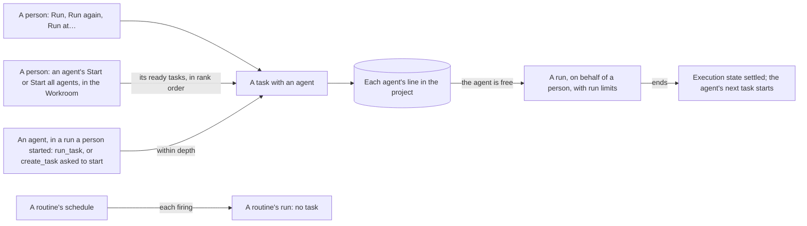

# How work starts

**Work starts because someone started it.** A person, or an agent with its tool. Nothing starts on its own: no column,
no assignment, no switch, no pulse, no throttle and no queue limit starts a task
([ADR-0175](../../adr/adr-0175-work-starts-only-by-an-explicit-act.md)). Agents have no schedule of their own. This page
is about tasks; a routine is its own kind of run ([routines.md](./routines.md)).

Starting is hq code, not an agent run. It makes no model call and needs no container, and it costs nothing when nothing is
started.

| Term | Meaning |
|---|---|
| **Ready** | A task in a To do column that has never been run (Not started), has no run pending, is not archived, is not an epic, and has no Run at… time still to come |
| **Agent's line** | The tasks started for one agent in a project, taken one at a time in the project's rank order |
| **Depth** | How many agent runs led to a task being started |
| **Scheduler** | The one loop in hq that fires routines and starts every Run at… time that is due |

## The explicit acts

| Act | Who | What it does |
|---|---|---|
| **Run** (and **Run again**), on a task's page or a card's ⋯ | Anyone who works in the project | Starts that one task, whatever its column. Run again is for a Failed or Finished task, or a Needs you one that can run again |
| **Run at…** | The task's person or a project admin | Starts that one task, once, at the time. See [below](#run-at) |
| An agent's **Start**, in the project's Workroom | Anyone who works in the project | Starts that agent's ready tasks, in rank order, after a confirm that lists them with ticks |
| **Start all agents** | Anyone who works in the project | Does Start for every agent at once, grouped by agent |
| An agent's tool: `run_task`, or `create_task` asked to start | An agent, in a run a person started | Starts one task. See [below](#an-agent-starts-a-task) |

Start and Start all agents skip what **cannot run** and list it beside, with why: an epic (never run), a task with a Run
at… time still to come, and, for Start all agents, a task with no agent. A task whose run finished and which nobody moved
on is not ready again, so Start never re-runs finished work; its page's **Run again** still does. Boards only arrange the
work: a single task is run from its page or a card's ⋯.

## An agent's line and Start

A started task joins its agent's line in the project and shows Waiting. Agents run in parallel and do not compete with each
other. An agent works on **one task at a time in a project**, so the line is sequential, and the database enforces it
(`hq/src/agents/taskSlotClaim.ts`; [task-execution-concurrency.md](../agents/task-execution-concurrency.md)). When its
run ends the next task in the line starts at once. The line is ordered by the **project's rank**, whatever started each
task (`hq/src/agents/agentLineOrder.ts`). A failed run does not hold the line.

The site's own limit on runs at once caps the whole site ([below](#the-sites-limit-on-runs-at-once)).

## Stop

- **Stop**, on a running task, ends its run; the task is Not started.
- An agent's **Stop**, in the Workroom, stops that agent: it takes its waiting tasks out of line back to Not started,
  clears any Run at… time still to come on them, and cancels its running runs. Nothing more starts until someone starts it.
  Anyone who works in the project may use it, with no confirm.
- **Stop every run**, in the Workroom, does the same for every agent in the project, after a confirm. It is the project
  admins'.

A task is settled to Not started in one write before any run is cancelled, and a task whose run cannot be confirmed stopped
is put back to Running (`hq/src/projects/agentStop.ts`, `placeRunStop.ts`). A Stop landing while a dispatch is on its way
cancels the run that dispatch started (`stoppedDuringDispatch` in `TaskRunner.ts`).

## Run at…

A person who sets 9:00 expects 9:00. When the time arrives the scheduler starts the task through the same path as Run, on
behalf of the person who set the time, at depth 0 (`hq/src/automation/scheduledStart.ts`), joining its agent's line in rank
order. Only something real delays it, and the task says which:

- its agent is already running a task in that project, so it starts when that task finishes;
- the site is at its limit on runs at once, so it starts when a run ends.

Other cases:

- **No agent.** Nothing can run it. The task says that its time was reached and no agent is assigned.
- **An epic or an archived task** is never started.
- **A failed or Needs you last run** is not cleared by time passing; it waits for a person.
- **A time passed while hq was down** starts when hq is back.

Setting a Run at… time is a **Run the person asked for later**, so the task starts in whichever column it is in. A Run at…
time is cleared by Stop and Stop every run.

### Who can set one

- **The person the task is done on behalf of, or an admin of its project**, because a Run at… time makes the work done on
  behalf of whoever set it. (Reassigning the task to someone else is a project admin's alone,
  [task.md](./task.md#on-behalf-of).)
- **An agent, only when a person asked it to**, with `set_task_schedule`, `create_routine` and `update_routine`. Only in a
  run a person started directly (their chat, or a task they pressed Run on), never in a run a schedule or another agent
  started, and only where the project's setting **agents may set start times when asked** is on and the organisation allows
  it. It is done on behalf of the person who started the run. A person's connection can do the same with its *Start work*
  permission ([connections.md](../auth/connections.md)).

Times an agent sets without a timezone are read in the timezone of the person it works for; the tool's result says which
was used.

## An agent starts a task

An agent's `run_task`, and `create_task` asked to start (`queue: true`), go through one gate
(`hq/src/server/controlplane/startGate.ts`, `startByTool.ts`):

- **Only when a person asked.** Refused in a run no person started (a routine's scheduled run, a Run at… run, or a run an
  agent started) and through a connection without *Start work*. A refused `create_task` still makes the task and says why
  it was not started.
- **The run it starts is the agent's, not the person's.** It carries the turn limit and cannot start another task, so one
  press of Run can never become an unbounded chain. The task is done on behalf of the task's person.
- **Refused for** the task the run is working on, an epic, an archived task, a task with no agent, one already running,
  failed or needing a person, and one with a Run at… time still to come.
- **Bounded by depth**, below.

## Depth bounds chains

Agents can start work for each other, and left alone that never ends. **Depth**
([ADR-0091](../../adr/adr-0091-work-agents-cause-is-bounded-by-its-depth.md)) bounds it:

- A task a **person** starts, directly or by asking an agent in a run they started, is at **depth 0**.
- A task started by an agent's tool is **one deeper** than the task that run was for.
- Past the organisation's maximum depth (3 out of the box, set in **Manage organisation › Settings › Automation**) the task
  is still created or moved, but **not started**. The tool's result tells the agent so, and the task waits for a person; a
  person starting it puts it back at depth 0.

hq works depth out from the run's own task, never from anything the agent or its site sends. An agent's start keeps the
depth it was given, so a chain is never reset by its own links.

## Settings

The organisation has two values (`hq/src/automation/automationSettings.ts`): the **maximum depth** (0 to 20; at 0 an agent's
start is never made) and whether projects may let their agents **set start times when asked** (off out of the box). A
project, or a person for their personal project, may switch the second on only where the organisation allows it; the
stricter of the two applies each time, so nothing stored is rewritten when the organisation changes a value. There is no
automation switch, queue limit, throttle, interval or batch size.

## One scheduler

hq runs one scheduler (`hq/src/automation/scheduler.ts`,
[ADR-0088](../../adr/adr-0088-one-scheduler-in-hq-starts-every-automated-start.md)), not a timer per task or routine.
Everything that starts on a time stores **when it is next due** in hq's database. At the top of every minute, and when
nudged, the scheduler asks the database what is due and does, in order:

1. fires every routine whose next due time has come: one run each ([routines.md](./routines.md));
2. starts every task whose Run at… time is due.

Each start is claimed with an atomic compare-and-set, so overlapping ticks, or hq running as more than one process, start
an item once. Nothing about timing is held only in memory, so a restart, an edit or a pause changes a stored time and
nothing else. A start that fell due while hq was down happens when hq is back.

## Why a task waits

A Waiting task says why (`hq/src/automation/queueNotes.ts`): its place in its agent's line, that its agent is running
another task, that a branch it needs is busy, or that the site is full. A task Needs you for a tool approval, a run limit
or its person having lost access; a failed one says what failed. A person clears a Failed or Needs you task by running it
again or choosing **Dismiss**, which returns it to Not started. A task held because its person lost access is released only
by [reassigning it](./task.md#on-behalf-of).

## Run limits

Every run has a **time limit**, and a run no person started has a **turn limit** as well (60 minutes and 100 turns out of
the box). The site enforces both, so they hold when hq restarts. The organisation sets the values and a project may only
tighten them; a run stopped at a limit ends with a reason that names the limit, and its task is set to Needs you with that
reason rather than retried.

## The site's limit on runs at once

Each Execution Site runs at most `AGENT_MAX_CONCURRENT_RUNS` runs at once (5 unless set otherwise). It is shared by every
project on the site, so one busy project can delay another's start. A run waiting for a slot shows Running and says it is
waiting.

## The record

Who started a run is kept with it: a person, a Run at… time (`schedule`), or an agent. With a task's
[on-behalf-of and started-by](./task.md#on-behalf-of) fields, any started work can be traced back to the person
responsible. The Runs history names each run's starter ([runs-and-workroom.md](./runs-and-workroom.md)).

## Where in the code

| What | Where |
|---|---|
| Settings | `hq/src/automation/automationSettings.ts`, `automationStore.ts`, `operations.ts` |
| Ready, Start, Start all agents | `hq/src/projects/agentStartPlan.ts`, `agentStart.ts`, `agentLineOperations.ts` |
| Stop | `hq/src/projects/agentStop.ts`, `placeRunStop.ts` |
| The scheduler, Run at… | `hq/src/automation/scheduler.ts`, `schedulerNudge.ts`, `scheduledStart.ts`, `taskSchedule.ts`, `dueTime.ts` |
| The line and the claim | `hq/src/agents/agentLineOrder.ts`, `taskSlotClaim.ts`, `TaskRunner.ts` |
| Why a task waits | `hq/src/automation/queueNotes.ts`, `hq/src/agents/taskDisplayReason.ts` |
| An agent's start, depth | `hq/src/server/controlplane/startGate.ts`, `startByTool.ts`, `runTaskOp.ts` |
| Run limits | `hq/src/agents/runLimits/`, `core/src/protocol/runLimits.ts` |
| Schema | `hq/schema.prisma`: `Org` (`automationMaxDepth`, `automationAgentSchedules`), `Project.agentSchedules`, `Task` |

## Decisions behind this

[ADR-0175](../../adr/adr-0175-work-starts-only-by-an-explicit-act.md) (work starts only by an explicit act),
[ADR-0088](../../adr/adr-0088-one-scheduler-in-hq-starts-every-automated-start.md) (one scheduler),
[ADR-0089](../../adr/adr-0089-every-task-runs-on-behalf-of-a-person.md) (every task runs on behalf of a person),
[ADR-0091](../../adr/adr-0091-work-agents-cause-is-bounded-by-its-depth.md) (depth).
