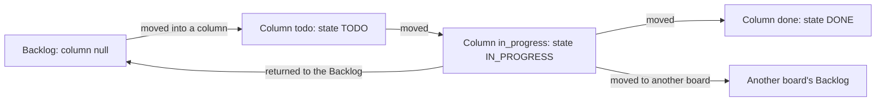

# Board

A board is a **workflow**: a lasting, named set of **columns** that a kind of work moves through
([ADR-0097](../../adr/adr-0097-a-board-is-a-lasting-workflow.md)). It lasts until it is archived; no board is
completed, and boards do not form series. A project can have many, and a board does not own agents: the
project's assigned agents work on it ([project.md](../projects/project.md)).

Three words keep three kinds of state apart: a board has **columns**, a task has a **state** (To do, In
progress, Done), and a run has a **run state** ([task.md](./task.md)).

## Three kinds of board

| Kind (`Board.kind`) | What it is |
|---|---|
| `PROJECT_TASKS` | **Project Tasks**, made with every project. Its columns are the task's own states (To do, In progress, Done) and fixed. It cannot be deleted, renamed, archived, given other columns, given sprints, or given a column that starts work. **Every task put on no other board is on it.** |
| `WORKFLOW` | Any columns, each mapping to a state. Lasts until archived. |
| `SPRINTS` | A workflow board with **sprints** ([below](#sprints)). |

Every path that creates a project makes its Project Tasks with it (a person's project, a personal project,
a workforce template, the demo seed), and every path that creates a task without naming a board puts it
there — a person's action, an agent's `create_task`, a person's connection, a routine whose template names
no board. The rules are enforced in the service (`hq/src/projects/boardService.ts`), not only on screen, so
they hold whoever asks. A project made some other way gets its Project Tasks the first time a task needs it
(`ensureProjectTasks`).

## A task is always on one board

A task has a `boardId` and a `column`:

| `column` | Where it is |
|---|---|
| a column's `name` | In that column; its state is the column's |
| null | In the board's **Backlog**: not yet started, state To do |

- **Backlog is every board's first column**, though it is no entry in the board's column list: it is where a
  task with no column sits. It never starts work. A board's Backlog shows only its own tasks; a person can
  choose to show other boards' backlogs beside it (**Show also**), each under its own heading. The choice is
  remembered per board, per person (`BoardShowAlso`).
- Creating a task on a board puts it in the column named (by name, or loosely by its state, as an agent may
  write it), or in the Backlog when none is. A task created asking to be queued, with no column named, goes to
  the board's first column instead, since the Backlog starts nothing.
- **Moving a task to another board** puts it in that board's Backlog (`moveTaskToBoard`) and withdraws a queued
  or throttled run. Moving it into a column of another board directly (dragging it from a Backlog shown beside
  this one) puts it in that column.
- Returning a task to its board's Backlog clears its column, sets its state to To do and withdraws a queued or
  throttled run (`returnTaskToBacklog`).
- A task may only be moved to a board the caller may act in, and not to an archived board.

`Task.boardId` is required: a task cannot exist without a board.

## Columns

A board's columns are stored as JSON on the board (`Board.columns`). Each column has:

| Field | Meaning |
|---|---|
| `name` | Identifier within the board, such as `in_review`. Tasks refer to it. `backlog` is refused: every board has one already. |
| `label` | What the column shows. |
| `status` | The state it maps to: `TODO`, `IN_PROGRESS` or `DONE`. Several columns may share one. |
| `color`, `order` | Display, and column order. Colour is assigned from a palette when the board is made. |
| `description`, `hint` | Text for agents: what the column means, and when to move a task into it. |
| `autoQueue` | Off by default. When on, the column **starts work**: a task entering it is queued for its agent ([below](#columns-that-start-work)). |

Defaults when no columns are given: `todo`, `in_progress`, `done`. A task's state follows its column, so a
task in any board's done column is `DONE`.

## Columns that start work

A column with `autoQueue` on queues a run of a task that is created in it or moved into it. The task is
**queued for the pulse**: it joins its agent's line and starts when the agent is free, and only while the
boundary's [automation](./automation.md) is on (or a person presses **Run**). The rules
(`hq/src/projects/taskRunMoves.ts`, [ADR-0087](../../adr/adr-0087-work-starts-on-its-own-only-from-a-boundarys-automation.md)):

- **Never in a done column.** Moving a task into a done column does the opposite: it withdraws a run that is
  queued or throttled, because the work has been decided. A run already going is never touched.
- **Never from the Backlog.** The Backlog is no column and starts nothing; moving a task there withdraws a
  pending run.
- **Never without an agent.** Nothing could run it, so a task with no assigned agent waits as it is.
- **Never before its time.** A task with a start time, or a routine's round, whose time is still to come is
  not queued by landing in the column. At that time it starts in whichever column it is in — a start time a
  person set, and a routine's round with an agent alike ([routines.md](./routines.md)).
- **Only from no run pending.** A task whose last run failed or is blocked is not queued again by a move.
- **Agents are limited, people are not.** When an agent's move or `create_task` would queue the task, it is
  queued only within the boundary's queue limit and maximum depth; past either, the move or creation still
  happens and the tool's result says the task was not queued.

Switching a column to `autoQueue` queues the tasks already in it that qualify under the same rules, and needs
the role that starting a run needs. Switching it off releases the queued tasks it had queued, except any
someone asked to start. Project Tasks has no column that starts work. A board with the pulse's throttle on
shows the current round, or the time of the next, above its columns ([automation.md](./automation.md#the-throttle)).

## Sprints

A sprint board has **sprints** (`Sprint`): numbered time boxes, made with the board (Sprint 1, two weeks
unless another length is given). A sprint can be renamed; its number stays, shown beside the name ("Sprint 12
· Pricing push").

- The **current sprint** is the one not finished. The board's columns show its tasks; its Backlog holds the
  tasks in no sprint. Moving a task from the Backlog into a column puts it in the current sprint; returning it
  to the Backlog takes it out.
- **Finish sprint** (`finishSprint` in `hq/src/projects/sprintService.ts`) keeps the sprint's done tasks
  recorded in it, starts the next sprint with the same length from that day, and sends its unfinished tasks
  where whoever finishes it says: `next` (the next sprint, same columns) or `backlog` (the Backlog, where a
  queued run is withdrawn). **The destination is required, with no default**, in hq's action and in the
  agents' `finish_sprint` alike. Two finishes at once finish it once.
- Past sprints stay readable, each with the tasks it holds.

## Archiving

A board no longer used is **archived** (`archiveBoard`): it leaves the boards list, which shows archived boards
only when asked, and no task can be put on it until it is unarchived. Its tasks stay on it. Archiving,
unarchiving and deleting take someone who works in the project, as every change to it does: a project Viewer
reads the board and changes nothing.

**Deleting** a board (never Project Tasks) keeps its tasks: they go to Project Tasks, the done ones to its Done
and the rest to its Backlog, where a queued run is withdrawn.

## Finished tasks leave the board

A task that has sat in a done column with no run pending for longer than the project's setting (1 day unless
the org or the project chose otherwise) is archived automatically: off the board, still searchable. See
[task.md](./task.md#archiving-finished-tasks).

## Board templates

A board template is a saved set of columns. `BoardTemplate` holds only the metadata and an `assetPath`; the
columns live in a JSON file there. System templates ship in `hq/assets/library/boards/` (kanban, sprint,
issues, ideation, roadmap, workforce assembly); an organisation's own are written under its hq storage. A
template must contain at least one column for each of the three states, and none named `backlog`.

Making a board from a template copies the columns into the board and records `templateId`. The copy is
independent: editing or deleting the template later does not change existing boards. The library side is
described in [board-templates.md](../library/board-templates.md).

## What the Boards tool reads

| Operation | What it gives |
|---|---|
| `getProjectBoards` | The project's boards, Project Tasks first: each one's columns with their task counts, its Backlog count, how many of its tasks need a person, and a sprint board's current sprint with its days left. Archived ones only when asked. |
| `getBoard` | One board: its columns, the tasks in them (a sprint board's current sprint's), its Backlog, the other boards' backlogs the reader shows beside it, and its current sprint. |
| `getBoardShowAlso`, `setBoardShowAlso` | The reader's Show also choice for a board, and the project's other boards to choose from. |
| `getBoardSprints`, `getSprintTasks` | A sprint board's sprints, newest first, and one sprint's tasks. |

"Needs a person" is the Tasks tool's own rule (`hq/src/projects/needsYou.ts`, held to it by a test).

## What agents can do

Agents use `list_boards`, `get_board`, `create_board` (a workflow or a sprint board, optionally from a
template), `finish_sprint`, `rename_sprint`, and `update_task` with a `column` (null for the Backlog) or a
`boardId` (`hq/src/server/controlplane/boardOps.ts`, `taskWriteOps.ts`). The board's columns, each with its
state and `description`, are put into the context of a task run, so the agent knows the workflow its task sits
in. Archiving and deleting a board are a person's actions; no platform tool does them.

## Where in the code

| What | Where |
|---|---|
| Schema | `hq/schema.prisma`: `Board`, enum `BoardKind`, `Sprint`, `BoardShowAlso`, `BoardTemplate` |
| Columns, Project Tasks | `hq/src/projects/boardColumns.ts`, `boardService.ts` |
| Sprints | `hq/src/projects/sprintService.ts`, `sprintDates.ts` |
| Moving tasks between boards and columns | `hq/src/projects/taskService.ts` |
| Auto-queue on/off for a column | `hq/src/projects/autoQueueColumns.ts` |
| What entering a column does to a run | `hq/src/projects/taskRunMoves.ts`, `notBeforeItsTime.ts` |
| What the Boards tool reads, and its actions | `hq/src/projects/boardView.ts`, `boardOperations.ts`, `actions.ts` |
| Templates | `hq/src/library/boardTemplateService.ts`, `hq/assets/library/boards/` |
| Tools for agents | `hq/src/server/controlplane/boardOps.ts`, `taskWriteOps.ts` |

## Decisions behind this

[ADR-0097](../../adr/adr-0097-a-board-is-a-lasting-workflow.md) (a board is a lasting workflow),
[ADR-0062](../../adr/adr-0062-people-are-members-agents-are-assigned.md) (who may act on a board's project),
[ADR-0087](../../adr/adr-0087-work-starts-on-its-own-only-from-a-boundarys-automation.md) (a column queues; the
boundary's automation starts).
