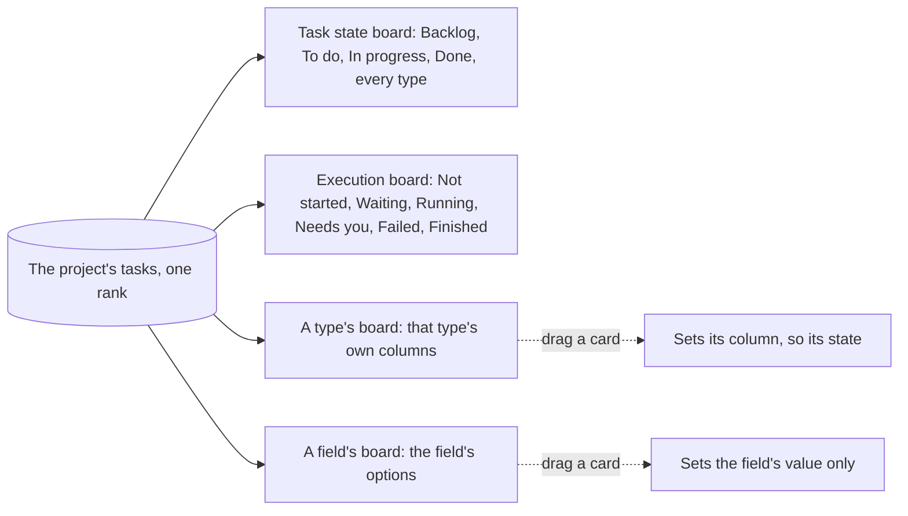

# Board

A board is a **saved view** of the project's tasks in columns. It holds no task, no state and no sprint: it is a way of
looking, and the same task can be on many boards at once
([ADR-0176](../../adr/adr-0176-a-board-is-a-saved-view.md)). Deleting a board deletes a view and nothing else. Boards are
the project's own, shared by everyone who works in it; there is no per-person view.

Three words keep three kinds of fact apart: a task has a **column** of its type, which sits in a **task state**
(Backlog, To do, In progress, Done), and a run gives it an **execution state** ([task.md](./task.md)). Only a type's
columns set the task state. A board that groups another way never does.

## Kinds of board

| Kind (`BoardKind`) | Columns | Dragging a card |
|---|---|---|
| **Task state**, built in | Backlog · To do · In progress · Done, across every type | Sets the state: the task lands on its type's default column for it |
| **Execution**, built in | Not started · Waiting · Running · Needs you · Failed · Finished | Not dragged: Run, Stop and Answer are on the card. Epics are left out, since an epic is never run |
| **Type** (for example Feature request) | That type's own columns | Sets the task's column, so its state, and its rank |
| **Field** | One custom field's options | Sets that field's value only |

Every project has the two built-in boards without a stored row; they hold nothing of their own. A saved board of any kind
is a stored row (`Board`) with its kind, the type or field it shows, and an optional **filter**. Names are unique in a
project, ignoring case; a project has at most 50 boards. A board of an archived field is hidden and cannot be read.

A **filter** narrows a board to a sprint (the current one, one named, or none), an epic, an agent, and, on a board that
spans types, one type. A drop on a filtered board goes after the visible card above it; the server checks that card is on
the board and answers "someone moved it" if not.

The board's control for changing its columns is **Columns**; a type is listed there only when its columns differ from the
four states. Wherever a task's column shows, it is the column's name only, never the state beside it.

## Rank

A task has **one rank, project-wide**. Every board sorts by it, and dragging a card on any board changes it, so putting
work in order on one board orders it on all of them. It is the order an agent's Start takes its ready tasks in
([automation.md](./automation.md#an-agents-line-and-start)). Reordering inside a column changes only the rank; a drop on
an empty column keeps the rank. A rank is a text value compared by code unit (`core/src/tasks/rank.ts`) and is never shown.

## Custom fields

A **custom field** is something a project defines to sort its tasks another way: a name and options, each with a colour.
Only **single select** is built; a task has one option or none in each field, so it can be on many boards. A field never
sets the task state. Fields and task types are defined per project, in Settings, by anyone who may work in it, and can be
shared as a Library task template ([task-templates.md](../library/task-templates.md)).

## Backlog

Backlog is the first task state, so the project's Backlog is every task whose column sits in Backlog, across types. It has
a view of its own, and starts nothing. A task added from a board's column starts in that column; *New task* in a header
starts in Backlog.

## Sprints

A **sprint** belongs to the **project**, not to a board: a numbered time box in the project's one series, with one cadence
for every type. A task is in at most one sprint, and a sprint board is any board filtered to the current sprint. A sprint
can be renamed; its number stays, shown beside the name ("Sprint 12 · Pricing push").

- The **current sprint** is the lowest-numbered one not finished. Up to two more can be planned ahead. A sprint is
  finished only explicitly: it stays current, shown as overdue, after its date.
- **Adding a Backlog task to a sprint commits to it**: the task moves to To do, on its type's default To do column. Any
  other state is kept. Taking a task out of a sprint keeps its state. An epic is never planned into a sprint.
- **Finish sprint** (`finishProjectSprint` in `hq/src/projects/projectSprintService.ts`) keeps the sprint's done tasks
  recorded in it, makes the next sprint current (making one if none is planned), and sends its unfinished tasks where
  whoever finishes it says: `next` (the next sprint) or `none` (no sprint). **The destination is required, with no
  default**, in hq's action and in the agents' `finish_sprint` alike; with nothing unfinished, none is asked. Their state
  and column stay either way. Two finishes at once finish it once.
- A sprint's last day is its `finishDate`, and the next sprint starts the day after. The series' length is its newest
  sprint's; changing it re-lays the sprints planned ahead and leaves the current one alone.
- A sprint's counts include archived tasks, so a past sprint's record does not shrink when finished tasks are archived.
  Past sprints stay readable, each with the tasks it holds.

## Archiving

A saved board no longer used is deleted, which removes the view only. A task no longer wanted is archived (by hand, or by
the done-task sweep, [task.md](./task.md#archiving-finished-tasks)): off every board, still searchable. Changing a board
needs someone who works in the project, as every change to it does; a project Viewer reads the board and changes nothing.

## What the Boards tool reads

| Operation | What it gives |
|---|---|
| `getBoardViews` | The project's boards, the two built in first, with each one's spread across its columns |
| `getBoardView` | One board: its columns and the tasks in them, in rank order, with the sprint, epic, agent and field facts a card shows |
| `getProjectSprints`, `getSprintPlanning` | The project's sprints, and the lists the Plan Sprint screen drags between |
| `getTaskTypes` | The project's types with their columns |

"Needs a person" on a card is the one rule in `core/src/tasks/executionState.ts`: a task asking for an okay or an answer, or
a failed run of an open task. Cards show an agent's avatar with a ring for the run (Waiting a thin dotted ring, Running a
turning ring, Needs you a full ring with a dot, Failed a full ring with a !; Not started and Finished none).

## What agents can do

Agents use `list_boards` (boards, types with their columns, fields with their options, and sprints, each with its id),
`get_board`, `open_board` (shows a board to the person as a card in a conversation), `create_board`, `finish_sprint`,
`rename_sprint`, and `update_task` or `change_tasks` with a type, column, state, sprint, epic, agent, field values or a
place in the order (`core/src/tasks/agentTools.ts`, `hq/src/server/controlplane/boardOps.ts`, `taskWriteOps.ts`). A type's
columns, each with its state, are put into the context of a task run, so the agent knows the steps its task goes through.
Moving a card is changing the task, and starts nothing.

## Where in the code

| What | Where |
|---|---|
| Model | `core/src/tasks/boardModel.ts`, `taskModel.ts`, `defaults.ts` |
| Schema | `hq/schema.prisma`: `Board` (`view`, `typeId`, `fieldId`, `filter`), `Sprint`, `CustomField`, `FieldOption`, `TaskFieldValue`, `TaskType`, `TypeColumn` |
| Saved views and reads | `hq/src/projects/boardViewService.ts`, `boardViewRules.ts`, `boardViewOperations.ts`, `boardService.ts` |
| Drops | `hq/src/projects/boardDropService.ts` |
| Custom fields | `hq/src/projects/fieldService.ts`, `fieldOperations.ts` |
| Sprints | `hq/src/projects/projectSprintService.ts`, `sprintSeries.ts`, `sprintOperations.ts`, `sprintPlanningView.ts` |
| Screens | `hq/src/projects/boards/`, `hq/src/projects/sprints/` |
| Tools for agents | `hq/src/server/controlplane/boardOps.ts`, `taskWriteOps.ts` |

## Decisions behind this

[ADR-0176](../../adr/adr-0176-a-board-is-a-saved-view.md) (a board is a saved view),
[ADR-0174](../../adr/adr-0174-a-tasks-type-and-column-set-its-state.md) (type and column set the state),
[ADR-0062](../../adr/adr-0062-people-are-members-agents-are-assigned.md) (who may act on a board's project).
