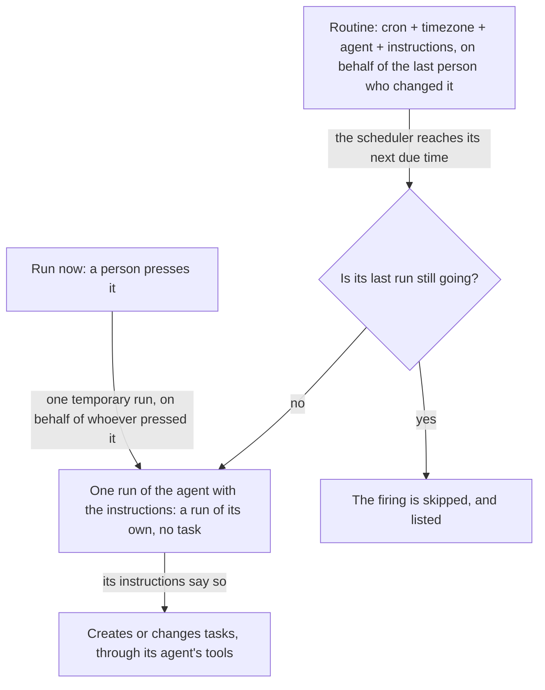

# Routines

A **routine** is a repeatable run: a schedule, an agent, instructions and an optional model, in a project or a person's own
space, that is either on or off ([ADR-0177](../../adr/adr-0177-a-routine-is-a-repeatable-run-on-a-cron-schedule.md)). On
its schedule the agent runs the instructions, and **each firing starts one run**, shown in Runs like any other. A routine
owns no task: it does not make a task per round, and nothing in a routine's run is a task unless its instructions have the
agent create one with its tools. For one task at one time, use **Run at…** on the task instead
([automation.md](./automation.md#run-at)).

## What a routine holds

| | |
|---|---|
| **Schedule** | A cron rule of five fields (minute, hour, day of the month, month, day of the week) and an IANA **timezone** its times are read in, so a daily 09:00 stays at 09:00 across a daylight-saving change. No more often than every 5 minutes |
| **Agent** | The agent that does the work. It must be in the project |
| **Instructions** | What the agent does each time, in Markdown, in the one Markdown editor. Each run starts from these alone |
| **Model** | Optional: the model each run uses (`<provider>/<model>`); empty follows the agent's own |
| **On behalf of** | The last person who changed the routine. Every scheduled run is on their behalf, with their access |
| **State** | On or off. An off routine fires nothing |

### The schedule

People build a schedule from presets in words, or type any cron under **Advanced**. It is read back in plain words with the
next three run times.

- Presets: every N minutes (N of 5, 6, 10, 12, 15, 20 or 30), every N hours (N dividing 24) at a minute, daily, weekdays,
  weekly on chosen days, monthly on day N, and monthly on the first or last weekday. Several times a day are allowed when
  they share a minute, since one cron rule cannot say 09:00 and 15:30.
- The dialect is standard cron, where a rule restricting both day fields fires on either. It adds `d#n` (the nth weekday of
  the month, such as `1#1` for the first Monday) and `dL` (the last, such as `5L`), because the first or last weekday of a
  month cannot be said otherwise. The first-Monday preset writes `0 9 * * 1#1`.
- The floor of 5 minutes is the shortest wall-clock gap between firings, across the hour and across midnight, so "every 7
  minutes" is refused (it would fire 4 minutes apart at the hour).
- Clock changes: a time that a clock skips fires as the clock that skipped it reads (02:30 becomes 03:30); a time that
  repeats fires once, the first time, unless the hour field is `*`; and a firing a clock change brings within 5 minutes of
  the one before it is skipped (`core/src/tasks/cron.ts`, `cronWords.ts`).

## How it runs

1. hq's one scheduler reads each routine's stored next due time, not a timer per routine
   ([automation.md](./automation.md#one-scheduler)). It claims a due routine with a compare-and-set, so two ticks or two hq
   processes fire it once, and moves the next due time on in the same write.
2. A firing **starts one run** of the agent: a chat run with no task, in a fresh session of its own, in the project's
   storage, whose input is the instructions (`hq/src/automation/routineFiring.ts`, `routineDispatch.ts`). The site records
   it as a run with a `routineId` and no task.
3. **A firing while the routine's last run is still going is skipped**, recorded and listed as skipped. Going means starting
   or running; a run that ended asking for approval has ended. A run whose end is never heard of stops counting as going
   after its time limit plus 10 minutes, and is marked failed.
4. A routine's own scheduled run **cannot make or change routines or start tasks**, so a routine cannot propagate itself.
   Scheduled firings carry `startedBy: schedule`, which the start gate and the schedule tools refuse.
5. A run waiting for a person (an approval, a question, a time limit) shows as **Needs you** on the routine and in Runs. The
   run's person answers it.
6. **Three failed runs in a row** notify the routine's person, once for the streak, with a way to the routine. The notice
   stays under Needs you until the newest run finishes
   ([notifications.md](../notifications/notifications.md#persistent-notifications), `hq/src/automation/routineFailing.ts`).

A routine is hq data and is evaluated by the scheduler, so it survives a restart. A firing that fell due while hq was down
happens once when hq is back, not once per missed time.

## On behalf of the last person who changed it

**Anyone who may work in the project may make or change a routine.** It always runs on behalf of the last person who
changed it, so saving says so first, and asks before it moves a routine from another person to the saver. A change is
anything that edits the routine, including switching it on or off. There is no project-admin takeover.

**Run now** is one temporary run, on behalf of the person who pressed it, listed as started by them. It does not change who
the routine belongs to, and the routine's scheduled runs stay on behalf of the last person who changed it. Run now is
refused while the routine is off and while its last run is going.

Who a run of the routine is for decides who may read it. A routine run is a session of its own, whose transcript only the
run's person reads ([ADR-0041](../../adr/adr-0041-chat-session-privacy.md)); the project's other members see the
run's line on the routine (state, reason, who, when), and Answer on a Needs you bar is for the run's person.

Agents may use `create_routine` and `update_routine`, under the same rule as setting a Run at… time: only in a run a person
started, where the project lets agents set start times when asked, and never in a routine's own scheduled run. The agent
must be in the project, the schedule at least 5 minutes apart, and the model usable there. A change by an agent makes the
routine run on behalf of the person the agent works for, and the tool tells the agent to say so before it changes one someone
else set up.

## If the person loses access

If the person a routine is on behalf of can no longer work in its project, the next firing **switches the routine off** with
a reason that says so, records that firing as failed and starts nothing. Anyone who works in the project switching it back
on clears the reason and makes it theirs. A firing with no agent, or an agent taken off the project, is recorded failed and
the routine stays on.

## Where routines are

A project's routines are in its **Routines** tool, in the *Agents at work* group of the project menu, and Your space has its
own. The rail's **Routines** lists every routine in the person's projects and their space on the same cards. A card shows
the agent's ring, on whose behalf, the switch, Run now, its last runs, and a run waiting as a Needs-you bar. A routine's page
is its edit screen, with the schedule builder, **Advanced** cron, timezone and read-back, its details and its runs; *New
routine* is a focused page. Cards can be reordered by dragging, kept for the project. Each firing's cost and today's runs
are read from the sites.

## Where in the code

| What | Where |
|---|---|
| Model, cron and its words | `core/src/tasks/routineModel.ts`, `cron.ts`, `cronWords.ts` |
| Life: create, change, delete, switch off | `hq/src/automation/routines.ts`, `routineActions.ts` |
| Firing, dispatch, a run's frames, the failing notice | `hq/src/automation/routineFiring.ts`, `routineDispatch.ts`, `routineRunStatus.ts`, `routineFailing.ts` |
| Reading routines, across projects | `hq/src/automation/routineQueries.ts`, `routinesAcross.ts` |
| Tools | `hq/src/server/controlplane/routineOps.ts`, `scheduleOps.ts` |
| Screens | `hq/src/projects/routines/` |
| Schema | `hq/schema.prisma`: `Routine`, `RoutineRun` (hq's record of each firing, skipped ones included); site `AgentRun.routineId` |

## Decisions behind this

[ADR-0177](../../adr/adr-0177-a-routine-is-a-repeatable-run-on-a-cron-schedule.md) (a routine is a repeatable run),
[ADR-0088](../../adr/adr-0088-one-scheduler-in-hq-starts-every-automated-start.md) (one scheduler),
[ADR-0095](../../adr/adr-0095-a-run-is-on-behalf-of-whoever-started-it.md) (a run's person).
