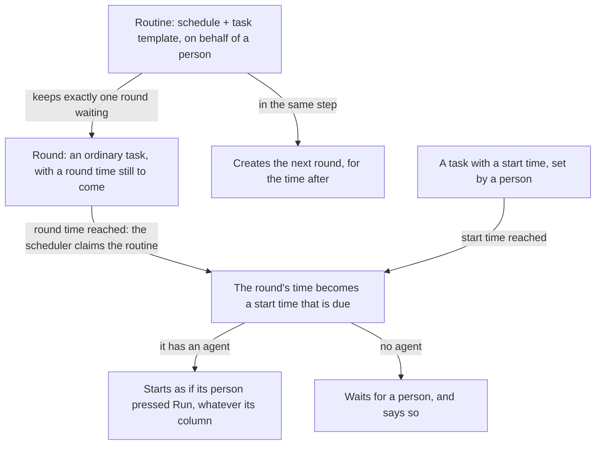

# Start times and routines

Two things, kept apart, because what repeats is the work, not a task
([ADR-0092](../../adr/adr-0092-a-routine-is-its-own-thing-that-creates-tasks.md)):

- A **start time** is a time at which one task starts, once. A task never repeats.
- A **routine** is its own object: a schedule and a template for a task. Its one job is to make sure its
  **next round exists**, an ordinary task created ahead of time for the routine's next time. What happens to
  a round afterwards is the task's business and the person's: the routine does not wait for a round to
  finish, follow it across the board, or clean it up.

Both belong to a boundary's [automation](./automation.md) and are started by its one scheduler. To the scheduler
they are the same thing: a time at which one task starts
([ADR-0104](../../adr/adr-0104-a-routines-round-starts-at-its-time.md)). A task starts in one of three ways: its
column starts work when it is placed there, a person presses **Run**, or its time comes. A round starts the third
way.

A project's routines, and those of a person's own Chat, are in its **Automation** tool, under **Routines**; a
routine opens there at its own address, and its old address `/routines/<id>` forwards to it. The **Projects**
screen's **Routines** view lists every routine in the person's projects and their Chat.

## A task's start time

A person who sets 9:00 expects 9:00, so a task with a start time **does not wait for the pulse**. When the
time arrives the scheduler starts it through the same path as a person pressing **Run**, on behalf of the
person who set the time, at depth 0 (`hq/src/automation/scheduledStart.ts`). Only something real delays it,
and the task says which:

- its agent is already running a task in that project, so it starts when that task finishes;
- the site is at its limit on runs at once, so it starts when a run ends.

Other cases:

- **Automation off.** A task that falls due becomes queued and waits for a person, or for automation to be
  turned back on.
- **No agent.** Nothing can run it. The task says that its time was reached and no agent is assigned.
- **A failed or blocked last run** is not cleared by time passing; it waits for a person.
- **A time passed while hq was down** starts when hq is back.

The start time is a **Run the person asked for later**, so the task starts in whichever board column it is in.
Until its time arrives, no column queues it ([board.md](./board.md#columns-that-start-work)).

## A routine

| | |
|---|---|
| **Schedule** | Every N minutes, hours or days, or a time of day on chosen days of the week. At least 5 minutes between rounds. Times are read in a stored timezone, so a daily 09:00 stays at 09:00 across a daylight-saving change |
| **Template** | The round's title, description, priority, labels and agent (the agent is optional), and where it starts: a board (none means Project Tasks) and a column or its Backlog. A named board with no column named starts at its first column; a round whose board has gone or been archived starts in Project Tasks' Backlog |
| **On behalf of** | The person who set the routine up. Every round is done on their behalf |
| **State** | On or paused |

How it runs (`hq/src/automation/routines.ts`, `routineRounds.ts`):

1. **Turning a routine on creates its first round**, a task from the template at its starting place, for the
   routine's next time. The round shows when its time is; until then nothing queues it.
2. **When a round's time comes, the routine creates the next one**, for the time after. There is only ever
   one round waiting. A round still going, running or in progress on a board, does not stop the next one
   being created: keeping to the cadence is the routine's job, keeping up with it is the person's.
3. **A round starts at its time, like a start time.** At its time a round **with an agent** starts as if its
   person pressed **Run**, on behalf of the routine's person, whatever column it is in: the routine makes the
   round's time a start time that is due, and the start-time path above starts it in the same tick, so whatever
   delays a start time delays a round the same way. A round with **no agent** waits for a person, and says that
   no agent is assigned. A round someone already started, by **Run** or otherwise, is not started again: a task
   starts at most once on its own. The board and column a round is placed in only say where it shows. On a
   sprint board, a round in a column is in the current sprint.
   A round's **plan** is its round's day, in the routine's timezone, unless a person changes it; a waiting
   round re-timed by an edit to the routine keeps a plan a person changed and follows the new day otherwise
   ([task.md](./task.md#plan-epics-and-milestones)). Its start is the round's time, which is its schedule,
   not its plan.
   A round whose run fails stays to be run again and finished like any task, and the routine creates the next
   round on its own schedule, whatever became of the last.
4. **Every round is linked to its routine.** The routine shows its last 10 rounds as squares — done, failed,
   needs you, running, waiting — and lists them newest first, each with what became of it and how long its run
   took. A person may unlink any round.
5. **Editing the routine updates its waiting round.** Pausing or deleting the routine removes the waiting
   round, unless a person already started or queued it. Turning it back on creates a fresh one. **Skip this
   time**, or deleting the waiting round, skips that one time. Unlinking the waiting round turns it into a plain
   task with a start time, and the routine creates the round after it.
6. **Run now** starts the waiting round at once, as **Run** does, by the person who pressed it, so they can
   watch it; a fresh round is created for the same time, so the schedule is unchanged
   (`hq/src/automation/routineNextRound.ts`).
7. **Three failed rounds in a row** notify the routine's person, once for the streak, with a way to the
   routine. The notice stays under Needs you until a round succeeds — the next one, or a failed one run again
   ([notifications.md](../notifications/notifications.md#persistent-notifications),
   `hq/src/automation/routineFailing.ts`).
8. **Make this a routine.** A task page offers it beside the start time. It creates a routine whose template
   is copied from the task and links the task to it: if the task has a start time still to come it is the
   first round, otherwise the routine creates its first round at its next time.

A routine is hq data and is evaluated by the scheduler, so it survives a restart. A round whose time passed
while hq was down is created and started once when hq is back, not once per missed time.

## Who can set one

- **The person the task is done on behalf of, or an admin of its project**, because a start time or a routine
  makes the work done on behalf of whoever set it. (Reassigning the task to someone else is a project admin's
  alone, [task.md](./task.md#on-behalf-of).) A routine follows the same rule for editing, pausing, deleting, **Run now** and **Skip this
  time**; a project admin may also change who it is on behalf of.
- **An agent, only when a person asked it to**, with `set_task_schedule`, `create_routine` and
  `update_routine`. Only in a run a person started directly (their chat, or a task they pressed Run on),
  never in a run the pulse or a schedule started, and only where the boundary's setting **agents may set
  schedules when asked** is on and the org allows it. It is done on behalf of the person who started the run.
  So an agent working unattended can never schedule work, and a schedule cannot be used to get around depth,
  the throttle or the queue limit. A person's connection can do the same with its *Start work* permission
  ([connections.md](../auth/connections.md)).

Times an agent sets without a timezone are read in the timezone of the person it works for (stored in their
settings); the tool's result says which was used. A run's prompt also states the local time in that zone.

## If the person loses access

If the person a routine is on behalf of loses access to its project, the routine pauses, and its waiting
round is blocked like their other tasks until a project admin takes the routine over. Taking it over turns the
routine back on and gives the waiting round to the new person.

## Where in the code

| What | Where |
|---|---|
| A task's start time | `hq/src/automation/taskSchedule.ts`, `scheduledStart.ts` |
| Routines: life, rounds, template, repeat rule | `hq/src/automation/routines.ts`, `routineRounds.ts`, `routineTemplate.ts`, `scheduleRule.ts` |
| Run now, Skip this time; a round's state; the failing notice | `hq/src/automation/routineNextRound.ts`, `roundState.ts`, `routineFailing.ts` |
| Reading routines, across projects | `hq/src/automation/routineQueries.ts`, `routineSummary.ts`, `routinesAcross.ts` |
| Actions and tools | `hq/src/automation/routineActions.ts`, `hq/src/server/controlplane/routineOps.ts`, `scheduleOps.ts` |
| Schema | `hq/schema.prisma`: `Routine` (`boardId`, `column`), and `Task.scheduleAt`, `scheduleNextDueAt`, `routineId`, `roundAt`, `planStart`, `planFinish` |

## Decisions behind this

[ADR-0092](../../adr/adr-0092-a-routine-is-its-own-thing-that-creates-tasks.md) (a routine is its own thing),
[ADR-0104](../../adr/adr-0104-a-routines-round-starts-at-its-time.md) (a round starts at its time),
[ADR-0088](../../adr/adr-0088-one-scheduler-in-hq-starts-every-automated-start.md) (one scheduler),
[ADR-0089](../../adr/adr-0089-every-task-runs-on-behalf-of-a-person.md) (on behalf of a person).
