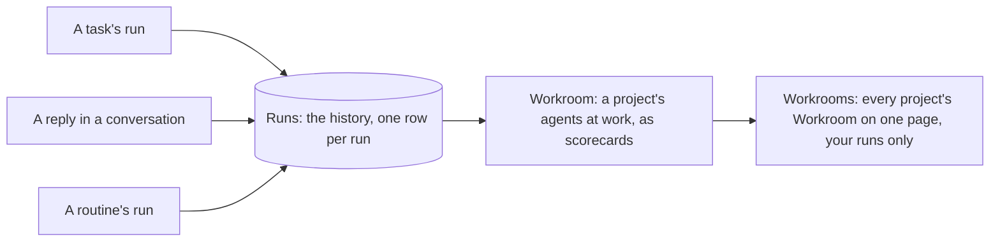

# Runs and the Workroom

Tasks plan; **runs carry the plan out**. A **run** is one go of an agent until it hands back: a task's run, a reply in a
conversation, or a routine's run ([sessions](../agents/sessions.md#a-run)). What an agent is doing with a task now is the
task's **execution state**, set by the system from its latest run: **Not started · Waiting · Running · Needs you · Failed ·
Finished** ([task.md](./task.md)). Three screens show runs, each for a different job.

| Place | Job | Where |
|---|---|---|
| **Workroom** | A project's agents at work, now: who is running, what waits, what needs a person | A project's menu, in *Agents at work* |
| **Workrooms** | Every project's Workroom on one page, for your runs only | The rail |
| **Runs** | The history, at both levels: a project's, and the person's own across projects | A project's menu, and `/runs` |

"Room" is used for nothing else in the product.

## The execution state and the ring

The execution state is worked out in one place, `executionStateOf` in `core/src/tasks/executionState.ts`, in this order: a
pending ask is **Needs you**; a run going is **Running**; a task in its agent's line is **Waiting**; then the latest run's
outcome (failed, finished), else **Not started**. A person's Stop leaves a task Not started, as if it had never been
started. A run ending never changes the task state.

An agent's avatar shows the run wherever a task has an assigned agent: Waiting is a thin dotted ring; Running a turning
ring; Needs you a full ring with a dot; Failed a full ring with a !; Not started and Finished no ring. On cards and rows the
ring replaces any run marker, and its words show on hover.

**Needs the person** is one rule, shared by hq, the site and every screen: a task asking for an okay or an answer, a failed
run of an open task, or a routine run asking or failed. A run stopped at its time or turn limit, or whose person lost access,
asks too. An epic is never counted, a failed run of a Done task or one taken back into line waits for nobody, and a reply in
a conversation asks in that conversation, so it is not counted here.

## The Workroom

A project's **Workroom** (`?tool=workroom`) is its live view. Its header has *Start all agents…* and *Stop every run…*
(admins only), each asking first, and counts: Needs you, Running, Waiting, Finished today and Spent today. Below, **one
scorecard per agent**:

- the band: the agent's ringed avatar as its status, its name and role, and counts for Needs you, Ready, In line and Runs
  today, with **Start** and **Stop** ([automation.md](./automation.md#the-explicit-acts)), each greyed with why when it
  cannot be used;
- **Now**: the run going, with how long it has gone, its number and who started it;
- **In line**, in the project's rank order, with why each waits;
- **Finished today**, and **Needs you** as bars at the foot, each with its action (Review, Answer, Run again).

Dragging cards reorders the agents, kept for the project. A Workroom never carries a run's content
([ADR-0077](../../adr/adr-0077-within-a-boundary-a-running-chat-is-visible-its-content-is-not.md)): a reply in a
conversation is named by its conversation's title only for the person whose conversation it is, and otherwise reads "A
reply in a conversation". Today is the viewer's local midnight, as their browser sends it, and a Workroom counts the newest
500 runs of its sessions.

**Workrooms** (`/workrooms`) reads only the viewer's own runs (started by them or on their behalf) in the projects they are a
member of, plus their own space, grouped by project in each project's order. Start is greyed there ("Start from the
project's Workroom"); Stop and Stop every run stop the viewer's own runs, in projects where they may work.

## The Runs history

*Runs* lists runs of three **kinds**: a task's run, a reply in a conversation, and a routine's run. It has tabs by state with
their counts (Needs you · Running · Waiting · Finished), search, and filters for Kind, Agent, Started by (or Project, on the
person's own), Whose, When and Sort, twenty to a page. Counts, sort and paging come from the newest 500 runs of the scope,
read once from each site; past that the pager says "of 500+".

- **Running** is a run going now. **Waiting** is a run the site has not started yet; a task waiting in its agent's line has
  no run yet, so the Workroom shows it. **Needs you** is a run that asks, or failed while its task still waits for someone,
  and a reply's request not yet answered. **Finished** is everything else; an older failed run keeps its Failed ring there.
- **Who started a run** is kept with the run on the site, so each run of a task names its own starter: a person's start names
  that person; a Run at… time reads as a schedule; an agent's start is named only on the task's latest run, otherwise "an
  agent".
- A run's own page shows its state, tool calls, model, site, time against its limit, turn limit, tokens and cost, and the
  runs either side. The site does not record a turn count, so the page shows the limit only. A person's own organisation-wide
  Runs also offers *Stop all* to organisation admins.

## Needs you in one place

What needs the person lives in Runs and the Workroom only, as **Needs you** bars with a way to act, and in the rail's Runs
panel, which groups Needs you · Running · Waiting · Finished today, each agent ringed, with *Open Workrooms ›* in its head and
*All runs ›* at its foot. A request for an okay offers **Review**, which opens the request; a question offers **Answer**.
Your tasks is planned work, and counts no runs.

## Where in the code

| What | Where |
|---|---|
| The execution state, the asks, run kinds | `core/src/tasks/executionState.ts` |
| Workroom reads, rules, stop | `hq/src/projects/workroom/` (`workroomRead.ts`, `workroomRules.ts`, `workroomRuns.ts`, `stopMyRuns.ts`) |
| Start and Stop | `hq/src/projects/agentStartPlan.ts`, `agentStart.ts`, `agentStop.ts` |
| The Runs history | `hq/src/runs/` (`historyRead.ts`, `historyRules.ts`, `runPage.ts`) |
| The Runs panel | `hq/src/shared/components/RunsPanel/` |
| The record on the site | `site/src/server/runtime/runRows.ts` (`AgentRun`, `routineId`) |

## Decisions behind this

[ADR-0174](../../adr/adr-0174-a-tasks-type-and-column-set-its-state.md) (the execution state is separate and
system-set), [ADR-0175](../../adr/adr-0175-work-starts-only-by-an-explicit-act.md) (work starts per agent from the
Workroom), [ADR-0077](../../adr/adr-0077-within-a-boundary-a-running-chat-is-visible-its-content-is-not.md) (a running chat
is visible, its content is not).
