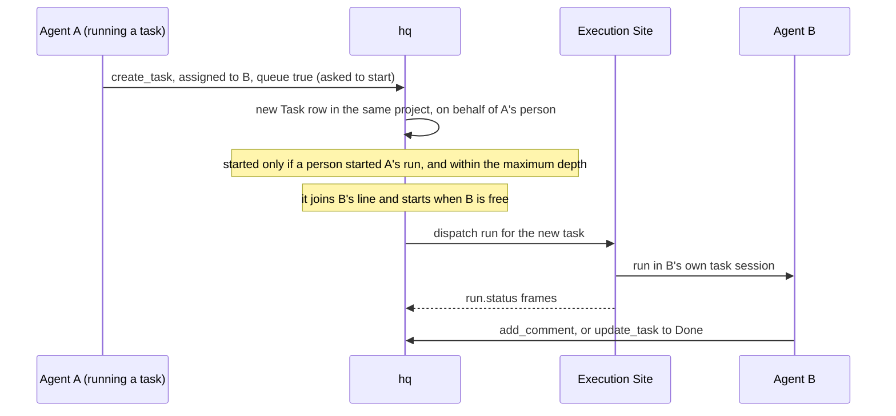

# Sub-task and delegation

**There is no sub-task entity.** A task has no parent, no child list and no table of sub-tasks.
What an agent does when it needs help is create another ordinary task and assign it to another
agent. That is the multi-agent mechanism ([ADR-0020](../../adr/adr-0020-task-delegation-over-spawn-agent.md)).

## How delegation works

- The agent calls `create_task` with a `projectId`, an `assignedAgentId` and optionally a type
  (Task when none), column or state (Backlog when none), description, plan, epic and `queue: true` (`createTaskOp` in
  `hq/src/server/controlplane/taskWriteOps.ts`). The caller must be allowed to act in that project, and
  the assignee must be assigned to it ([ADR-0062](../../adr/adr-0062-people-are-members-agents-are-assigned.md)).
- The new task is a full task ([task.md](./task.md)): its own number, type, column, state, execution state,
  session, run and comments, visible on the board. It is done **on behalf of the person** the
  delegator's run was for, so its approvals go to them.
- **Creating a task never starts it.** A new task waits in Backlog (or the column named) until someone starts it. With
  `queue: true` (asked to start) the task is started as `run_task` would, so it joins its assignee's line and runs when the
  assignee is free ([automation.md](./automation.md#an-agent-starts-a-task)). Each delegated task runs in its assignee's own
  session and container, not inside the delegator's.
- **Delegation is bounded.** An agent may start a task only in a run a person started, and the run it starts cannot start
  another. A start counts one level deeper than the task that run was for, and past the organisation's maximum depth the
  task is still created but not started and waits for a person. The tool's result says so; so does a refusal for a
  connection without *Start work*.
- `run_task` lets an agent start a task directly, under the same gate. It claims the task through the same `TaskRunner` as
  everything else, so the one-running-task-per-agent-and-project rule applies
  ([task-execution-concurrency.md](../agents/task-execution-concurrency.md)). It refuses an epic, an archived task, one with
  no agent, one already running, failed or needing a person, and one with a Run at… time to come.
- Results travel as the task's comments (`add_comment`) and files (`attach_file`). The task records which
  agent, and which of its sessions, started it, so a person can see where delegated work came from; there is
  still no parent link, and an agent that wants to follow up has to name the new task's id itself.

## The checklist field, which is not a sub-task

The `update_task` tool takes no `subtasks` list, and the `Task` model has no column for one (`hq/schema.prisma`).
The older `tick_subtask` tool is deprecated and always returns an error (`tickSubtaskOp`). Treat checklists as not
built.

## Not built

- **Sub-agents inside one run.** Spawning helper agents that share the delegator's workspace was
  removed ([ADR-0020](../../adr/adr-0020-task-delegation-over-spawn-agent.md)) and deferred. An
  agent's own harness may spawn helpers inside its container, but hq does not model, track or
  show them.
- **Parent and child tasks.** There is no parent link, roll-up of a parent from its children, or
  waiting for a child to finish. An earlier design stored sub-tasks as a collection under the
  parent with their own `running`, `done`, `failed` states; it was never built on this schema.
- **Checklists on a task**, see above.

## Where in the code

| What | Where |
|---|---|
| Delegation tools | `hq/src/server/controlplane/taskWriteOps.ts`: `create_task` (`createTaskOp`); `hq/src/server/controlplane/taskOps.ts`: `run_task`, `add_comment` |
| Tool definitions | `hq/src/server/controlplane/toolSchemas.ts` |
| Claim and serialisation | `hq/src/agents/TaskRunner.ts` |
| Deprecated checklist tool | `tickSubtaskOp` in `taskOps.ts` |

## Decisions behind this

[ADR-0020](../../adr/adr-0020-task-delegation-over-spawn-agent.md): task delegation first, sub-agents
deferred. Its routing detail predates the control channel; delegated tasks now reach their agent as
dispatches ([ADR-0050](../../adr/adr-0050-dispatch-and-status-cross-the-control-channel.md)).
