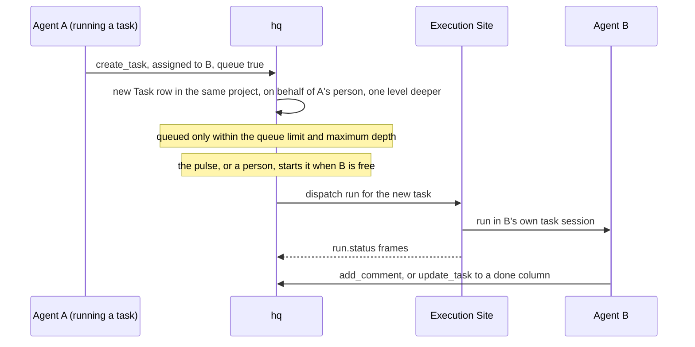

# Sub-task and delegation

**There is no sub-task entity.** A task has no parent, no child list and no table of sub-tasks.
What an agent does when it needs help is create another ordinary task and assign it to another
agent. That is the multi-agent mechanism ([ADR-0020](../../adr/adr-0020-task-delegation-over-spawn-agent.md)).

## How delegation works

- The agent calls `create_task` with a `projectId`, an `assignedAgentId` and optionally a board
  (Project Tasks when none), column, description, plan, epic and `queue: true` (`createTaskOp` in
  `hq/src/server/controlplane/taskWriteOps.ts`). The caller must be allowed to act in that project, and
  the assignee must be assigned to it ([ADR-0062](../../adr/adr-0062-people-are-members-agents-are-assigned.md)).
- The new task is a full task ([task.md](./task.md)): its own number, status, run state,
  session, run and comments, visible on the board. It is done **on behalf of the person** the
  delegator's run was for, so its approvals go to them.
- **Queued work is started by the pulse, not by an agent.** A task created with `queue: true`, or into a
  column that queues, joins its assignee's line and starts when the assignee is free, while the project's
  automation is on ([automation.md](./automation.md)); otherwise it waits for a person to run it.
  Each delegated task runs in its assignee's own session and container, not inside the delegator's.
- **Delegation is bounded.** A task an agent's run queues counts one level deeper than the task that run was
  for, and past the project's maximum depth, or when agents already hold the queue limit's worth of queued
  tasks, the task is still created but not queued and waits for a person. The tool's result says so.
- `run_task` lets an agent start a queued task directly, but only in a run a person started. It claims the
  task through the same `TaskRunner` as everything else, so the one-running-task-per-agent-and-project rule
  applies ([task-execution-concurrency.md](../agents/task-execution-concurrency.md)), and it fails with a
  message when the task is not queued.
- Results travel as the task's comments (`add_comment`) and files (`attach_file`). The task records which
  agent, and which of its sessions, queued it, so a person can see where delegated work came from; there is
  still no parent link, and an agent that wants to follow up has to name the new task's id itself.

## The checklist field, which is not a sub-task

The `update_task` tool accepts a `subtasks` list of `{ title, done }` and the prompt text tells agents
to keep it updated as they work. The `Task` model has no column for it (`hq/schema.prisma`), and
`update_task` (`updateTaskOp` in `hq/src/server/controlplane/taskWriteOps.ts`, which calls
`updateTask` in `hq/src/projects/taskService.ts`) passes the fields it is given straight to the
database update, so a call carrying `subtasks` fails: there is no column to store it in. The older `tick_subtask` tool is deprecated and
always returns an error (`tickSubtaskOp`). Treat checklists as not built.

## Not built

- **Sub-agents inside one run.** Spawning helper agents that share the delegator's workspace was
  removed ([ADR-0020](../../adr/adr-0020-task-delegation-over-spawn-agent.md)) and deferred. An
  agent's own harness may spawn helpers inside its container, but hq does not model, track or
  show them.
- **Parent and child tasks.** There is no parent link, roll-up of a parent from its children, or
  waiting for a child to finish. An earlier design stored sub-tasks as a collection under the
  parent with their own `running`, `done`, `failed` states; it was never built on this schema.
- **Checklists on a task**, see above.

## Where in the code

| What | Where |
|---|---|
| Delegation tools | `hq/src/server/controlplane/taskWriteOps.ts`: `create_task` (`createTaskOp`); `hq/src/server/controlplane/taskOps.ts`: `run_task`, `add_comment` |
| Tool definitions | `hq/src/server/controlplane/toolSchemas.ts` |
| Claim and serialisation | `hq/src/agents/TaskRunner.ts` |
| Deprecated checklist tool | `tickSubtaskOp` in `taskOps.ts` |

## Decisions behind this

[ADR-0020](../../adr/adr-0020-task-delegation-over-spawn-agent.md): task delegation first, sub-agents
deferred. Its routing detail predates the control channel; delegated tasks now reach their agent as
dispatches ([ADR-0050](../../adr/adr-0050-dispatch-and-status-cross-the-control-channel.md)).
