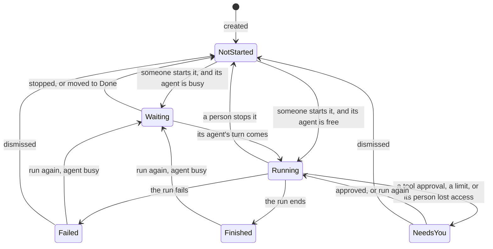

# Task

A task is a unit of planned work in a project, usually given to one agent. **Tasks plan; runs carry the plan out.** A task
carries three kinds of fact, each owned by a different party and never worked out from another
([ADR-0174](../../adr/adr-0174-a-tasks-type-and-column-set-its-state.md)):

| | Task state | Execution state | Custom fields |
|---|---|---|---|
| What it says | Where the work stands: **Backlog · To do · In progress · Done**, the state its column sits in | What an agent is doing with it now: **Not started · Waiting · Running · Needs you · Failed · Finished** | Extra ways to sort the project's tasks, such as Severity |
| Who sets it | A person, or an agent with a tool, by moving the task | **The system only**, from the task's latest run: agents have no tool for it | A person, or an agent |
| Changes what the others say | Nothing. A run ending leaves the task where it is | Nothing | Nothing. A field never sets the task state |

The diagram is the execution state. A task can have many runs over its life; each run's own outcome is on that run
([runs and the Workroom](./runs-and-workroom.md)). [automation.md](./automation.md) says how work is started and
why a task waits.

hq owns tasks. It is the single writer of the execution state; the Execution Site runs the agent and reports back with
status frames over the control channel ([control-channel.md](../../architecture/control-channel.md)). A task run is one
`AgentRun` on the site, inside the task's own session ([ADR-0030](../../adr/adr-0030-task-scoped-agent-sessions.md)).

## Type, column and state

A project has one or more **task types** (Task, Bug, Feature request, and so on). Each type has its own **columns**, and
each column sits in exactly one of the four task states. A task has one type and is in one of its type's columns, so its
state is the state of its column. Moving a card to another column changes the state, and only a column does
([board.md](./board.md)).

- Every project starts with **Task**, whose columns are the four states, and **Epic**, a built-in type that groups other
  tasks. Neither can be deleted; any other type is the project's own and can be archived once no open task uses it.
- **Backlog is the first task state.** A new task starts in Backlog: wanted, not yet committed to. Moving it to To do is
  deciding to do it.
- Setting a task's state directly (not a column) puts it in its type's **default column** for that state. Changing a
  task's type keeps its state.
- Each state has at least one column, and exactly one of them is its default. A column can be moved to another state from
  its menu, with a dialog that names the tasks it changes.
- A task has one **rank**, a place in the project's single order. Every board sorts by it, dragging a card on any board
  changes it, and it is the order an agent's Start takes ready tasks in. It is never shown as a number.

## What a task holds

Defined in `hq/schema.prisma` (model `Task`) and `core/src/tasks/`:

| Field | Meaning |
|---|---|
| `projectId`, `number` | The project and a per-project sequence number. People see `KEY-number`; the pair is unique. |
| `title`, `description`, `priority`, `labels` | Content. Priority is `LOW`, `MEDIUM` or `HIGH`; the default is `MEDIUM`. The description is written in the one Markdown editor every text field uses. |
| `typeId`, `columnId`, `state`, `rank` | Its type, its column of that type, the state that column sits in (written with it), and its place in the project's order. |
| `sprintId` | At most one sprint of the project ([board.md](./board.md#sprints)). |
| field values | For each of the project's single-select custom fields, one option or none (`TaskFieldValue`). |
| `epicId` | The epic it belongs to, a task of the type Epic. An epic belongs to none. |
| `doneAt` | When it entered a Done state; null otherwise. What [automatic archiving](#archiving-finished-tasks) measures from. |
| `assignedAgentId` | The agent that runs it. Null means unassigned. |
| `executionState`, `runStateReason`, `runCount` | The execution state, a short text saying why (a failure, what it waits for, what a person must do), and how many runs have started. |
| `scheduleAt` | A **Run at…** time: when it starts, once. See [automation.md](./automation.md#run-at). |
| `onBehalfOfUserId`, `runOnBehalfOfUserId` | The person the work is done for, and the person a run was started by. See [On behalf of](#on-behalf-of). |
| `planStart`, `planFinish`, `milestoneId` | Its **plan**, the days its work is meant to happen, and an epic's milestone. See [Plan, epics and milestones](#plan-epics-and-milestones). |
| `result` | What the latest run that stated one achieved, written when the run's agent calls `set_result`. A run that states none leaves it as it was; each run's own stated result is kept with the run (`RunResult`). Comments are for collaboration, not the result. |
| a thread | A task has at most one **conversation**, the team's thread about it, started on the task's page; a card marks it on the board. See [a task's conversation](../conversations/conversations.md#a-tasks-conversation). |
| `archived` | Hides a task. The `archive_task` and `delete_task` tools refuse a running task. |
| `attachments`, `comments` | Files (`TaskAttachment`) and the discussion (`TaskComment`). A comment is written by a user or an agent; an agent's carries the `runId` it was written in, and a person's through a connection carries the connection. |

A task has at most one session (`AgentSession.taskId` is unique). It is opened on the first run, reused by later runs,
and archived when a run finishes or fails (`hq/src/agents/taskSessionArchive.ts`). It is shared with the task's project:
the people who work in the project act in it on equal footing ([sessions](../agents/sessions.md#a-tasks-session-is-shared)).

## How a task is created and assigned

- **A person**, in the project's UI (`createTask` in `hq/src/projects/actions.ts`): *New task* in a header starts in
  Backlog; a task added from a board's column starts in that column, at the bottom of the rank.
- **An agent**, with the `create_task` platform tool (`createTaskOp` in `hq/src/server/controlplane/taskWriteOps.ts`),
  which is how an agent delegates work to another agent ([ADR-0020](../../adr/adr-0020-task-delegation-over-spawn-agent.md),
  and [subtask.md](./subtask.md)).
- **A person's own connection** from a tool outside the product ([connections.md](../auth/connections.md)).

Creation goes through `createTask` in `hq/src/projects/taskService.ts`. A task is of the type named, else Task, in the
column or state named, else in its type's Backlog column, and last in the project's order. **Creating a task never starts
it**, whatever its column or agent. An agent may only be assigned if it is assigned to the project
([ADR-0062](../../adr/adr-0062-people-are-members-agents-are-assigned.md)); assigning starts nothing. Creating or
changing a task, assigning it an agent or starting it all need someone who works in the project, a Member or Admin of it;
its Viewers read the task and change nothing ([ADR-0102](../../adr/adr-0102-viewer-is-a-project-role.md)).

## On behalf of

Every task is done **on behalf of a person**
([ADR-0089](../../adr/adr-0089-every-task-runs-on-behalf-of-a-person.md)), recorded in `Task.onBehalfOfUserId`:

| How the task came about | On behalf of |
|---|---|
| A person created it | That person |
| An agent created it during a run | The person that run was on behalf of, followed up the chain, so it is always a person |
| A task with a Run at… time | The person who set the time, or who asked the agent that did |
| A workforce template confirmed | The person who confirmed it |

A task also records **who last started it** (a person, or an agent and its session, and the connection used if any), so any
automated work reads back to the person responsible.

**Each run has its own person** ([ADR-0095](../../adr/adr-0095-a-run-is-on-behalf-of-whoever-started-it.md)). A run a
person starts, with Run, Run again, an agent's Start or Start all agents, or a message into the task's session, is on their
behalf, and their access is checked before it starts (`Task.runOnBehalfOfUserId`, and the site's run). A run nobody
started, such as a Run at… time arriving, is on behalf of the task's person. A task an agent creates during a run is on
behalf of that run's person.

- **Approvals go to the run's person.** When a run defers a tool it was not allowed, that person is notified in hq with a
  link to the request, which sits in the task's session. Anyone who may start runs in the project may approve or deny it.
- **Losing access stops the task.** If that person loses access to the project (they are removed from it, made a Viewer
  in it, or removed from the organisation), every unfinished task done on their behalf there is set to Needs you at once
  with a reason that says so, and a running one is stopped, unless the person is being removed or is leaving, where a run
  in progress finishes first and the admin may instead hand their open tasks to another member
  (`hq/src/projects/openTaskHandover.ts`). Making a project private ends nobody's access. A task is never given to
  another person automatically.
- **Reassigning releases it.** A project admin chooses someone else who works in the project (a Member or Admin, not a
  Viewer), from the task's page; the task goes back to Not started, and a person starts it again. That is the only way out
  of the hold: **Run** and **Dismiss** refuse it, because running it again would only stop again.
- Setting a Run at… time makes the work done on behalf of whoever set it, so only the task's person or a project admin may
  ([automation.md](./automation.md#who-can-set-one)).

## Starting a task

A task starts only because someone started it ([ADR-0175](../../adr/adr-0175-work-starts-only-by-an-explicit-act.md)):

1. a person presses **Run** (or **Run again**) on the task, on its page or in a card's ⋯;
2. a person sets **Run at…**, and the time arrives;
3. a person presses an agent's **Start** or **Start all agents** in the project's Workroom, which starts the agent's ready
   tasks in rank order;
4. an agent starts it with its tool, `run_task`, or `create_task` asked to start.

Nothing else starts a task: not its column, its type, its agent being assigned, a switch, a schedule or a limit. A started
task joins its agent's line, and runs when the agent is free. [automation.md](./automation.md) has the rules for each,
what **ready** means, and **Stop**.

## Running: claim, slot, report

`TaskRunner` (`hq/src/agents/TaskRunner.ts`) does three things:

- **Claim.** Becoming Running is one transaction under a database lock on the (agent, project) pair
  (`hq/src/agents/taskSlotClaim.ts`), so a task cannot be started twice however many callers race (Start, a person's
  click, a Run at… time), and two tasks of one agent in one project never run together.
- **One at a time per agent and project, in rank order.** A task asked to start while its agent is running another stays
  Waiting and says it is waiting for that task. When a run ends, the agent's next task in the line starts, in the
  project's rank order. [task-execution-concurrency.md](../agents/task-execution-concurrency.md) has the detail.
- **Dispatch.** A claimed task calls `dispatchTaskRun` (`hq/src/agents/dispatchService.ts`), which builds the run's context
  and sends it to the site that holds the storage the task runs in: the project's, or the person's own for a
  [personal project](../projects/personal-projects.md). It returns when the site acknowledges; it does not wait for the
  run. It refuses a task whose person has lost access.

The site executes the run (`site/src/server/runtime/taskExecution.ts`). It writes no task rows. The run's `run.status`
frames come back to hq, and `taskStatusListener.ts` settles the execution state, one frame at a time per task
(`taskFrameChain.ts`), whatever the agent did to the task during the run:

| Frame | Execution state becomes |
|---|---|
| completed | Finished; the session is archived |
| cancelled by a person | Not started |
| failed | Failed, reason is the error |
| carries a pending tool approval | Needs you, reason "Awaiting tool approval"; an approval comment is added and the person is notified |
| cancelled at a time or turn limit | Needs you, reason names the limit |

A run ending **never moves the task**: a person, or an agent with its tool, moves it to Done. Only the run the task
describes may settle it, so a late or duplicate frame from an earlier run changes nothing. A frame from a site that does
not own the task is dropped. Whatever the outcome, the agent's next task in the project then starts. A failed run does
not hold its agent's line: the failure waits under Needs you and the agent takes its next task.

hq stores the run behind the execution state as a run state (`Task.runState`: none, queued, active, blocked, failed) and
writes the execution state in the same write (`hq/src/projects/executionState.ts`), so lists filter on a stored value.
People never see the run state's words, only the execution state's.

If the site cannot be reached when dispatching, the task goes back to Waiting with the reason "site unreachable — held for
reconnect" and is dispatched again when the site reconnects. A revoked site fails its tasks instead. A project that names
no site fails with a reason saying so (`hq/src/agents/taskExecutionReasons.ts`).

## Agents changing their own task

Through platform tools declared once in `core/src/tasks/agentTools.ts` and served by `hq/src/server/controlplane/`:

- `update_task`: title, description, labels, priority, type, column or state, sprint, epic, agent, custom field values,
  its place in the project's order, its plan and milestone, and archiving. An agent decides a task is done by moving it to
  Done; there is no tool for the execution state. Moving a task starts nothing.
- `change_tasks` does the same change to up to 100 tasks of one project at once.
- `create_task`, `run_task`, `set_task_schedule`, `create_routine` and `update_routine`, described in
  [automation.md](./automation.md) and [routines.md](./routines.md).
- `list_tasks`, `list_boards`, `get_board`, `open_board`, `create_board`, `finish_sprint` and `rename_sprint`
  ([board.md](./board.md#what-agents-can-do)).
- `list_milestones`, `create_milestone`, `update_milestone`, `delete_milestone` for a project's milestones.
- `add_comment`, `attach_file`, `get_task_details`, `fetch_my_queued_tasks`, `archive_task`, `delete_task`.

Tools are checked against the caller's project and role. See [tool-control.md](../../architecture/tools/tool-control.md).
An agent reads times in the timezone of the person it works for, and a run's prompt states that person's local time.

## Moving a task

`moveTask` (`hq/src/projects/taskStateService.ts`, `taskColumnService.ts`) sets the column and the state that follows it,
or a state (landing on the type's default column), or a type, and places the task after or before another in the rank, all
in one write. It **starts nothing and never changes the execution state**, with two exceptions the system applies: moving a
task into Done takes it out of its agent's line (the work is decided), and stopping a run is a separate act. A person who
moves a task needs the role that changes it. Adding a Backlog task to a sprint moves it to To do, on its type's default To
do column.

## Plan, epics and milestones

A task's **plan** is a start date and a finish date: when its work is meant to happen
([ADR-0098](../../adr/adr-0098-a-task-has-a-plan-apart-from-its-schedule.md)). It is kept apart from the task's
**schedule**, its Run at… time, which starts its agent, and from its **work**, the runs that happened, read from the site.
**Nothing that changes a plan, an epic or a milestone starts, stops or queues a run**
(`hq/src/projects/taskPlanService.ts` touches no execution state, start time or column).

- An **epic** is a task of the built-in type Epic that groups other tasks. A task belongs to at most one epic, of its own
  project; an epic belongs to none. An epic is **never run**: Run, Start and Start all agents skip it, and it gets no Run
  at… time. It may have an agent that manages it, talking it through and writing and ordering its tasks. Its **span** is its
  own plan, each end it lacks taken from the span of its tasks' plans. An epic is never planned into a sprint.
- A **milestone** (`Milestone`) is a dated goal in a project. An epic may belong to one; only an epic has one. Deleting a
  milestone keeps its epics; deleting an epic keeps its tasks, in no epic.

People change them through `updateTaskPlan` and the milestone actions (`hq/src/projects/planOperations.ts`), under the
rule that changing a task has: a member of its project, with no run floor, since nothing starts. Agents do through
`update_task`, `create_task` and the milestone tools.

The **timeline** (`getTimeline`, `hq/src/projects/timeline.ts`) lists, for a project and a date range: the tasks with a
plan, a Run at… time or work in the range (never a Backlog task's, which has no time yet, so the project carries its
Backlog count instead), epics with their span, milestones, and the slices of work runs did. The runs are read from the
site in one `run.listPage` starting at the range's end, one round trip however many tasks; when the site cannot be asked the
timeline says so rather than showing no work.

## Archiving finished tasks

A task that has sat in Done with no run pending for longer than the project's setting is archived: still searchable, off
the board. An hourly sweep does it (`hq/src/projects/finishedArchive/archiveSweep.ts`), measuring from `doneAt`. The
setting is off, 1, 7 or 30 days. The org sets the default each project starts with (1 day out of the box), and a project,
or a person for their own space, may choose freely either way: it is a convenience, not a safety limit. Anyone who can
change a task can still archive it by hand.

## Not built

- **Automatic column advance.** Nothing moves a task to the next column when its run finishes. A person or an agent moves
  it.
- **Routing and deferral.** An earlier design had a model call that decided which tasks to run, defer or escalate, There is no such step.
- **Linked tasks** (blocks, waiting on), and custom fields other than single select.

## Where in the code

| What | Where |
|---|---|
| Model, in one place | `core/src/tasks/` (`taskModel.ts`, `boardModel.ts`, `executionState.ts`, `rank.ts`, `agentTools.ts`) |
| Schema | `hq/schema.prisma`: `Task`, `TaskType`, `TypeColumn`, `CustomField`, `TaskFieldValue`, `TaskComment`, `TaskAttachment`, `Milestone` |
| Create, edit | `hq/src/projects/taskService.ts`, `actions.ts` |
| Types, columns, moving | `hq/src/projects/taskTypeService.ts`, `typeColumnService.ts`, `taskColumnService.ts`, `taskStateService.ts`, `taskPlace.ts` |
| Plan, epics, milestones, the timeline | `hq/src/projects/taskPlanService.ts`, `planSpan.ts`, `planOperations.ts`, `timeline.ts` |
| The execution state | `hq/src/projects/executionState.ts`, `hq/src/agents/taskStatusListener.ts` |
| Who a task is for, loss of access, reassigning | `hq/src/projects/taskOnBehalfOf.ts`, `lossOfAccess.ts`, `onBehalfOfOperations.ts` |
| Claim, serialise, dispatch | `hq/src/agents/TaskRunner.ts`, `taskSlotClaim.ts`, `dispatchService.ts` |
| Stop, Dismiss | `hq/src/projects/stopTask.ts`, `agentStop.ts`, `dismissTaskRun.ts` |
| Archiving | `hq/src/projects/finishedArchive/` |
| Tools agents use | `hq/src/server/controlplane/taskOps.ts`, `taskWriteOps.ts`, `planOps.ts` |
| The run on the site | `site/src/server/runtime/taskExecution.ts` |

## Decisions behind this

[ADR-0174](../../adr/adr-0174-a-tasks-type-and-column-set-its-state.md) (a task's type and column set its state),
[ADR-0175](../../adr/adr-0175-work-starts-only-by-an-explicit-act.md) (work starts only by an explicit act),
[ADR-0020](../../adr/adr-0020-task-delegation-over-spawn-agent.md) (delegation by task),
[ADR-0030](../../adr/adr-0030-task-scoped-agent-sessions.md) (one session per task),
[ADR-0050](../../adr/adr-0050-dispatch-and-status-cross-the-control-channel.md) (dispatch and status cross the channel),
[ADR-0062](../../adr/adr-0062-people-are-members-agents-are-assigned.md),
[ADR-0089](../../adr/adr-0089-every-task-runs-on-behalf-of-a-person.md) (on behalf of a person),
[ADR-0091](../../adr/adr-0091-work-agents-cause-is-bounded-by-its-depth.md) (depth),
[ADR-0095](../../adr/adr-0095-a-run-is-on-behalf-of-whoever-started-it.md) (a run's person),
[ADR-0098](../../adr/adr-0098-a-task-has-a-plan-apart-from-its-schedule.md) (a plan apart from the schedule).
