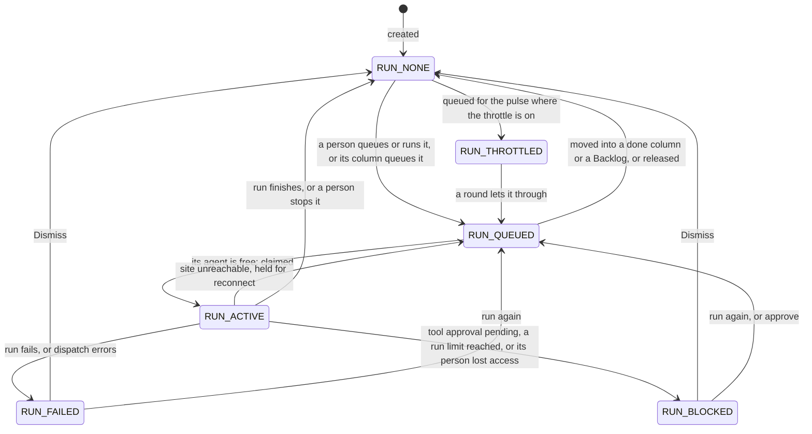

# Task

A task is a unit of work in a project, usually assigned to one agent. It carries two independent facts,
owned by different parties:

| | Task state | Run state |
|---|---|---|
| What it says | Where the work stands: its board `column` (or its board's Backlog) and the state (`status`) that column maps to (`TODO`, `IN_PROGRESS`, `DONE`) | Whether a run of it is pending or going **now**: `RUN_NONE`, `RUN_QUEUED`, `RUN_THROTTLED`, `RUN_ACTIVE`, `RUN_BLOCKED`, `RUN_FAILED` |
| Who sets it | The agent, or a person: the agent decides whether the task is done | **The system only**: agents have no tool for it |

The diagram above is the run state. A task can have many runs over its life; each run's own outcome is on
that run, not in the task's run state. People see the run state as **Queued**, **Throttled**, **Running**,
**Needs you** and **Run failed**; no run pending shows nothing. [automation.md](./automation.md#run-state-and-why-a-task-waits)
describes each value and how a task says why it waits.

hq owns tasks. It is the single writer of the run state; the Execution Site runs the agent and reports back
with status frames over the control channel ([control-channel.md](../../architecture/control-channel.md)).
A task run is one `AgentRun` on the site, inside the task's own session
([ADR-0030](../../adr/adr-0030-task-scoped-agent-sessions.md)).

## What a task holds

Defined in `hq/schema.prisma` (model `Task`):

| Field | Meaning |
|---|---|
| `projectId`, `number` | The project and a per-project sequence number. People see `KEY-number`; the pair is unique. |
| `title`, `description`, `priority`, `labels` | Content. Priority is `LOW`, `MEDIUM` or `HIGH`; the default is `MEDIUM`. |
| `boardId`, `column`, `status`, `sprintId` | Placement and workflow position: always on one board, in a column or its Backlog, and on a sprint board in a sprint or none. See [board.md](./board.md). |
| `doneAt` | When it entered a done column; null otherwise. What [automatic archiving](#archiving-finished-tasks) measures from. |
| `assignedAgentId` | The agent that runs it. Null means unassigned. |
| `runState`, `runStateReason` | The run state, and a short text saying why (a failure, what it waits for, what a person must do). |
| `queueDepth`, `runStartedBy` | How deep in a chain of agent-queued work it was queued, and who asked for a run to start (`person`, `pulse`, `schedule` or `agent`). See [automation.md](./automation.md). |
| `onBehalfOfUserId`, `queuedBy…` | The person the work is done for, and who last queued it. See [On behalf of](#on-behalf-of). |
| `scheduleAt`, `roundAt`, `routineId` | A start time, or the time and routine of a round. See [routines.md](./routines.md). |
| `planStart`, `planFinish` | Its **plan**: the days its work is meant to happen. See [Plan, epics and milestones](#plan-epics-and-milestones). |
| `isEpic`, `epicId`, `milestoneId` | Whether it is an epic, the epic it belongs to, and an epic's milestone. |
| `result` | What the latest run that stated one achieved, written when the run's agent calls `set_result`. A run that states none leaves it as it was; each run's own stated result is kept with the run (`RunResult`). Comments are for collaboration, not the result. |
| a thread | A task has at most one **conversation**, the team's thread about it, started on the task's page; a card marks it on the board. See [a task's conversation](../conversations/conversations.md#a-tasks-conversation). |
| `archived` | Hides a finished task. The `archive_task` and `delete_task` tools refuse a running task. |
| `attachments`, `comments` | Files (`TaskAttachment`) and the discussion (`TaskComment`). A comment is written by a user or an agent; an agent's carries the `runId` it was written in, and a person's through a connection carries the connection. |

A task has at most one session (`AgentSession.taskId` is unique). It is opened on the first run, reused by
later runs, and archived when a run finishes or fails (`hq/src/agents/taskSessionArchive.ts`). It is shared with
the task's project: the people who work in the project act in it on equal footing
([sessions](../agents/sessions.md#a-tasks-session-is-shared)).

Two columns exist but nothing reads or writes them: `deferCount` and `lastWorkedAt`. They were for a routing
step that is not built, see Not built.

## How a task is created and assigned

- **A person**, in the project's UI (`createTask` in `hq/src/projects/actions.ts`).
- **An agent**, with the `create_task` platform tool (`createTaskOp` in
  `hq/src/server/controlplane/taskWriteOps.ts`), which is how an agent delegates work to another agent
  ([ADR-0020](../../adr/adr-0020-task-delegation-over-spawn-agent.md), and [subtask.md](./subtask.md)).
- **A routine**, which creates each round ahead of time ([routines.md](./routines.md)).
- **A person's own connection** from a tool outside the product ([connections.md](../auth/connections.md)).

Creation goes through `createTask` in `hq/src/projects/taskService.ts`. A task is always put on a board: the
one named, or the project's **Project Tasks** when none is ([board.md](./board.md)). It goes into the column
named, or the board's Backlog when none is — or, created asking to be queued with no column named, the board's
first column, since the Backlog starts nothing. It starts with no run pending unless that column or the request
queues it. An agent may only be assigned if it is assigned to the project
([ADR-0062](../../adr/adr-0062-people-are-members-agents-are-assigned.md)). Creating or changing a task, assigning
it an agent or queueing it, all need someone who works in the project — a Member or Admin of it; its Viewers
read the task and change nothing ([ADR-0102](../../adr/adr-0102-viewer-is-a-project-role.md)).

## On behalf of

Every task is done **on behalf of a person**
([ADR-0089](../../adr/adr-0089-every-task-runs-on-behalf-of-a-person.md)), recorded in
`Task.onBehalfOfUserId`:

| How the task came about | On behalf of |
|---|---|
| A person created it | That person |
| An agent created it during a run | The person that run was on behalf of, followed up the chain, so it is always a person |
| A task with a start time, or a routine's round | The person who set the start time or the routine up, or who asked the agent that did |
| A workforce template confirmed | The person who confirmed it |

A task also records **who last queued it** (a person, or an agent and its session, and the connection used
if any), so any automated work reads back to the person responsible.

**Each run has its own person** ([ADR-0095](../../adr/adr-0095-a-run-is-on-behalf-of-whoever-started-it.md)).
A run a person starts — Run, Run again, Run all, or a message into the task's session — is on their behalf, and
their access is checked before it starts (`Task.runOnBehalfOfUserId`, and the site's run). A run nobody started —
a column, a start time, a routine, the project's automation — is on behalf of the task's person. A task an agent
creates during a run is on behalf of that run's person.

- **Approvals go to the run's person.** When a run defers a tool it was not allowed, that person is notified in
  hq with a link to the request, which sits in the task's session. Anyone who may start runs in the project may
  approve or deny it.
- **Losing access blocks the task.** If that person loses access to the project (they are removed from it,
  made a Viewer in it, or removed from the organisation), every unfinished task done on their behalf there is
  blocked at once with a reason that says so, and a running one is stopped — unless the person is being removed or
  is leaving, where a run in progress finishes first and the admin may instead hand their open tasks to another
  member (`hq/src/projects/openTaskHandover.ts`). Making a project private ends nobody's access. A task is never
  given to another person automatically.
- **Reassigning releases it.** A project admin chooses someone else who works in the project (a Member or
  Admin, not a Viewer), from the task's page; the task goes back to no run pending, and a person queues or runs it again. That is the only
  way out of the block: **Run** and **Dismiss** refuse it, because running it again would only be blocked
  again.
- Setting a start time or a routine makes the work done on behalf of whoever set it, so only the task's
  person or a project admin may ([routines.md](./routines.md#who-can-set-one)).

## Becoming queued

A task is queued, and its run state becomes `RUN_QUEUED` (or `RUN_THROTTLED` where the throttle holds it),
when:

1. a person presses **Run**: the task is queued as asked to start, so it starts as soon as its agent is free,
   whatever the boundary's automation;
2. it is created in a column with `autoQueue` on, or moved into one that is not a done column, and it has an
   agent and no start or round time still to come ([board.md](./board.md#columns-that-start-work));
3. a board's column is switched to `autoQueue`, which queues the tasks in it that qualify the same way;
4. an agent creates it with `queue: true`, within the queue limit and maximum depth;
5. a task with a start time, or a routine's round, reaches its time while automation is off.

Queueing for the pulse leaves the task in its agent's line; the pulse starts it. **Run all** on a board or
project (`runBoard`, `runProject`) starts every queued task that has an agent. `run_task` starts a queued
task and nothing else: on a task that is not queued it fails with a message saying so. It is available only
in a run a person started, and the run it starts is the agent's, not the person's, with a turn limit and no
`run_task` of its own.

## Running: claim, slot, report

`TaskRunner` (`hq/src/agents/TaskRunner.ts`) does three things:

- **Claim.** Moving to `RUN_ACTIVE` is one transaction under a database lock on the (agent, project) pair
  (`hq/src/agents/taskSlotClaim.ts`), so a task cannot be started twice however many callers race (the pulse,
  Run all, a person's click, a start time), and two tasks of one agent in one project never run together.
- **One at a time per agent and project.** A task asked to start while its agent is running another stays
  queued and says it is waiting for that task. When a run ends, the agent's next task in the line starts.
  [task-execution-concurrency.md](../agents/task-execution-concurrency.md) has the detail.
- **Dispatch.** A claimed task calls `dispatchTaskRun` (`hq/src/agents/dispatchService.ts`), which builds
  the run's context and sends it to the site that holds the storage the task runs in: the project's, or the
  person's own for a [personal project](../projects/personal-projects.md). It returns when the site
  acknowledges; it does not wait for the run. It refuses a task whose person has lost access.

The site executes the run (`site/src/server/runtime/taskExecution.ts`). It writes no task rows. The run's
`run.status` frames come back to hq, and `taskStatusListener.ts` settles the run state, one frame at a time
per task (`taskFrameChain.ts`), whatever the agent did to the task during the run:

| Frame | Run state becomes |
|---|---|
| completed, or cancelled by a person | `RUN_NONE`, session archived when it completed |
| failed | `RUN_FAILED`, reason is the error |
| carries a pending tool approval | `RUN_BLOCKED` with reason "Awaiting tool approval", an approval comment is added and the person is notified |
| cancelled at a time or turn limit | `RUN_BLOCKED`, reason names the limit |

Only the run the task's run state describes may settle it, so a late or duplicate frame from an earlier run
changes nothing. A frame from a site that does not own the task is dropped. Whatever the outcome, the agent's
next queued task in the project then starts.

If the site cannot be reached when dispatching, the task returns to `RUN_QUEUED` with the reason "site
unreachable — held for reconnect" and is dispatched again when the site reconnects. A revoked site fails its
tasks instead. A project that names no site fails with a reason saying so
(`hq/src/agents/taskExecutionReasons.ts`).

## Agents changing their own task

Through platform tools served by `hq/src/server/controlplane/taskOps.ts` and `taskWriteOps.ts`:

- `update_task`: title, description, labels, priority, board and column (null for the Backlog), and its plan,
  epic and milestone. An agent decides a task is done by moving it to a done column; there is no tool for the
  run state.
- `list_milestones`, `create_milestone`, `update_milestone`, `delete_milestone` for a project's milestones;
  `finish_sprint` and `rename_sprint` for a sprint board's sprints ([board.md](./board.md#sprints)).
- `create_task`, `run_task`, `set_task_schedule`, `create_routine` and `update_routine` as described above.
- `add_comment`, `attach_file`, `get_task_details`, `list_tasks`, `fetch_my_queued_tasks`, `archive_task`,
  `delete_task`.

Tools are checked against the caller's project and role. See
[tool-control.md](../../architecture/tools/tool-control.md). An agent reads times in the timezone of the
person it works for, and a run's prompt states that person's local time.

## Column moves

`moveTaskToColumn` sets the column and the state that follows it, and **never changes the run state**, with two
exceptions the system applies: moving a task into a column that queues automatically queues a run if none is
pending, failed or blocked; and moving it into a done column or a Backlog withdraws a run that is queued or
throttled, because the work has been decided or put aside, but never one already running. Moving a task to
another board puts it in that board's Backlog (`moveTaskToBoard`). A person who moves a task to queue or release work
needs the role that starts a run.

## Plan, epics and milestones

A task's **plan** is a start date and a finish date: when its work is meant to happen
([ADR-0098](../../adr/adr-0098-a-task-has-a-plan-apart-from-its-schedule.md)). It is kept apart from the task's
**schedule** — its start time, or its routine round's time, which starts its agent — and from its **work**, the
runs that happened, read from the site. **Nothing that changes a plan, an epic or a milestone starts, stops or
queues a run** (`hq/src/projects/taskPlanService.ts` touches no run state, start time or column). A routine's
round gets its round's day as its plan by default ([routines.md](./routines.md)).

- An **epic** is a task that groups other tasks. A task belongs to at most one epic, of its own project; an
  epic belongs to none. An epic that still groups tasks cannot be made an ordinary task again until they are
  moved out. Its **span** is its own plan, each end it lacks taken from the span of its tasks' plans.
- A **milestone** (`Milestone`) is a dated goal in a project. An epic may belong to one; only an epic has one.
  Deleting a milestone keeps its epics; deleting an epic keeps its tasks, in no epic.

People change them through `updateTaskPlan` and the milestone actions (`hq/src/projects/planOperations.ts`),
under the rule that changing a task has — a member of its project, with no run floor, since nothing starts.
Agents do through `update_task`, `create_task` and the milestone tools, under the rules of their other task
changes.

The **timeline** (`getTimeline`, `hq/src/projects/timeline.ts`) lists, for a project or one of its boards and a
date range: the tasks with a plan, a start time or work in the range (never a Backlog's — it has no time yet,
so each board carries its Backlog count instead), epics with their span, milestones, the rounds routines will
create, and the slices of work runs did. The runs are read from the site in one `run.listPage` starting at the
range's end — one round trip, however many tasks; when the site cannot be asked the timeline says so rather
than showing no work.

## Archiving finished tasks

A task that has sat in a done column with no run pending for longer than the project's setting is archived:
still searchable, still linked to its routine, off the board. An hourly sweep does it
(`hq/src/projects/finishedArchive/archiveSweep.ts`), measuring from `doneAt`. The setting is off, 1, 7 or 30
days. The org sets the default each project starts with (1 day out of the box), and a project, or a person
for their own space, may choose freely either way: it is a convenience, not a safety limit, so unlike
automation the org's value is only a default. Anyone who can change a task can still archive it by hand.

## Not built

- **Automatic column advance.** Nothing moves a task to the next column when its run finishes. Columns have
  `autoQueue` only; an earlier design also had an automatic-advance flag. A person or an agent moves the task.
- **Routing and deferral.** An earlier design had a model call that decided which queued tasks to run, defer
  or escalate, using `deferCount` and `lastWorkedAt`. There is no such step; the pulse starts each agent's
  line in order.

## Where in the code

| What | Where |
|---|---|
| Schema | `hq/schema.prisma`: `Task`, `TaskComment`, `TaskAttachment`, `Milestone`, enum `TaskRunState` |
| Create, edit, move | `hq/src/projects/taskService.ts`, `actions.ts` |
| Plan, epics, milestones, the timeline | `hq/src/projects/taskPlanService.ts`, `planSpan.ts`, `planOperations.ts`, `timeline.ts` |
| What a move does to the run state | `hq/src/projects/taskRunMoves.ts`, `taskQueueing.ts` |
| Who a task is for, loss of access, reassigning | `hq/src/projects/taskOnBehalfOf.ts`, `lossOfAccess.ts`, `onBehalfOfOperations.ts` |
| Claim, serialise, dispatch | `hq/src/agents/TaskRunner.ts`, `taskSlotClaim.ts`, `dispatchService.ts` |
| Terminal state from the site | `hq/src/agents/taskStatusListener.ts`, `taskSessionArchive.ts` |
| Stop, Dismiss | `hq/src/projects/stopTask.ts`, `dismissTaskRun.ts` |
| Archiving | `hq/src/projects/finishedArchive/` |
| Tools agents use | `hq/src/server/controlplane/taskOps.ts`, `taskWriteOps.ts`, `planOps.ts` |
| The run on the site | `site/src/server/runtime/taskExecution.ts` |

## Decisions behind this

[ADR-0020](../../adr/adr-0020-task-delegation-over-spawn-agent.md) (delegation by task),
[ADR-0030](../../adr/adr-0030-task-scoped-agent-sessions.md) (one session per task),
[ADR-0050](../../adr/adr-0050-dispatch-and-status-cross-the-control-channel.md) (dispatch and status cross the
channel), [ADR-0062](../../adr/adr-0062-people-are-members-agents-are-assigned.md),
[ADR-0087](../../adr/adr-0087-work-starts-on-its-own-only-from-a-boundarys-automation.md) (work starts on its
own only from a boundary's automation),
[ADR-0089](../../adr/adr-0089-every-task-runs-on-behalf-of-a-person.md) (on behalf of a person),
[ADR-0091](../../adr/adr-0091-work-agents-cause-is-bounded-by-its-depth.md) (depth),
[ADR-0097](../../adr/adr-0097-a-board-is-a-lasting-workflow.md) (a task is always on a board),
[ADR-0098](../../adr/adr-0098-a-task-has-a-plan-apart-from-its-schedule.md) (a plan apart from the schedule).
