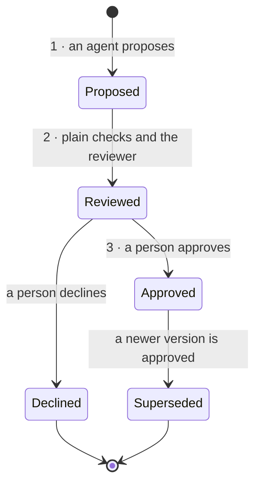

# Workflows

A **workflow** is a named, versioned script kept in a place's library — a project's, or a person's own storage —
that a person approves word for word and that people and agents in that place then run as often as they need. It is
the only thing that uses a secret: **no secret value ever enters an agent's container**
([ADR-0147](../../adr/adr-0147-a-secret-is-used-only-by-a-workflow-a-person-approved-run-by-the-platform.md)). Git and
GitHub work this way too: an agent shares its commits by running the `push` workflow.

GitHub's own workflows (GitHub Actions) are always called **GitHub workflows** here; a workflow can start one.



1. **Proposed.** An agent writes a definition, `workflow.yaml`, and any script files its steps call, in a workspace,
   and calls `propose_workflow`. That freezes a new **version**.
2. **Reviewed.** Rules with no model, the **plain checks**, flag risky patterns, and the **reviewer**, one model call hq
   makes with no tools and no secrets, reads the version and gives a risk level and a few points. Neither approves.
3. **Approved.** A person who may approve reads it and approves that exact version; from then on it can be run any
   number of times, until a newer version is approved.

---

## What a workflow holds

| Part | Meaning |
|---|---|
| Steps | Run in order, each a command or one of the version's own files, each with an optional time limit |
| Secrets, per step | The secrets that step gets, and no other step. A step with none gets none |
| Variables | Plain settings every step gets as environment variables |
| Parameters | Values that change from run to run — a branch, a title — each matched against a pattern or a fixed list, or free text. A value reaches a step as a file, never pasted into a command |
| Hosts | The `host:port` pairs the steps may reach. None means no network at all |
| GitHub permissions | What the run's `GITHUB_TOKEN` may do, required when a step names it |
| Time limit | For the whole run, 10 minutes unless set, at most 6 hours |

## The definition file

An agent writes one file, `workflow.yaml`, in the GitHub Actions style that models already know, plus any script files its
steps call.

```yaml
name: deploy-staging
description: Build, upload and restart the app on staging
hosts: ["registry.npmjs.org:443", "staging.example.com:22"]
variables: [STAGING_HOST, NODE_ENV]     # every step has these as $STAGING_HOST, $NODE_ENV
timeout: 10m
parameters:
  - name: ref
    pattern: '^[A-Za-z0-9_][A-Za-z0-9._/-]{0,99}$'
steps:
  - name: Build
    run: npm ci && npm run build        # no secrets; installs from the version's own lock file
  - name: Upload
    secrets: [STAGING_DEPLOY_KEY]
    run: ./deploy/upload.sh             # the version's deploy/upload.sh, never the workspace's
  - name: Restart the app
    secrets: [STAGING_DEPLOY_KEY]
    run: ./deploy/restart.sh
  - name: Check it answers
    run: curl -fsS "https://$STAGING_HOST/health"
```

| Field | Meaning | Default |
|---|---|---|
| `name`, `description` | What people and agents see | — |
| `steps[]` | Each has a `name`, a `run` (a command, or one of the version's files), optional `secrets: [...]` and `timeout` | — |
| `steps[].secrets` | The secrets this step gets, and no other step | None |
| `variables` | The variables the workflow uses, listed once; every step has them as environment variables | None |
| `parameters` | Each has a `name` and one of `pattern` (the whole value must match), `values` (a fixed list) or `text: true` | None |
| `hosts` | `host:port` pairs the steps may reach | None: no network |
| `github` | GitHub permissions, required when a step names `GITHUB_TOKEN` and refused otherwise; never empty, since GitHub gives a token asked for with none every permission | None |
| `timeout` | The whole run's limit, written like `90s`, `10m` or `1h30m`, at most 6 h | 10 min |
| `files` | Files the version carries beyond those a step's `run` names as `./…`: a script's helpers, a lock file, an `.npmrc` | None |

Unknown fields are refused, not ignored, so a misspelt `secret:` never quietly gives a step nothing. A workflow's name is
lower-case words joined by hyphens, at most 64 characters; a parameter's name is lower-case letters, digits and `_`,
since it becomes a file name. A version holds at most 50 steps and 200 files, 4 MiB a file and 16 MiB in all.

A **version** is all of that frozen and identified by a SHA-256 hash, which also covers the executor image the version
runs on. Changing anything makes a new version, which waits for review and approval while the approved one keeps
running. The format an agent writes is the definition file above, and the *GitHub Operations* skill an agent is given teaches it.

## Who does what

| | Who | Notes |
|---|---|---|
| Write and propose | Agents (and so the people who ask them) | Never approves |
| Approve or decline a version | A project's administrators; for a person's own storage, that person | A person's own approval covers GitHub *contents* and *pull requests* only; anything wider also needs an organisation administrator. Never an agent |
| Switch a workflow on or off | The people who can approve it | Off stops a run in progress, and nobody can start one. On again needs no new approval |
| Run | Anyone who may start runs in the place — members, not viewers — and agents there | An agent's runs of one workflow are limited, 30 an hour unless an administrator changes it |

**Approving from the conversation's card** is offered only when the plain checks say the change is small: no step newly
gets a secret, nothing that holds a secret changes what it runs, no host, permission or parameter pattern changes, and
nothing was flagged. Otherwise the card offers only *Review all of it*, on the workflow's page. What the reviewer says
never decides this
([ADR-0148](../../adr/adr-0148-an-agent-runs-approved-workflows-and-reads-their-masked-output.md)).

**Whose run it is.** A run a person starts is theirs; a run an agent starts is on behalf of the person the agent's own
run is for ([ADR-0095](../../adr/adr-0095-a-run-is-on-behalf-of-whoever-started-it.md)).

## The executor

The **executor** is the part of an Execution Site that carries out an approved version's steps. It is not an agent and
has no model: it runs exactly what was approved. It stands beside the roles of a
[conversation](../conversations/conversations.md#the-lead-workers-and-helpers):

| | What it is | Holds secrets |
|---|---|---|
| Lead | The agent as it talks, in hq | No |
| Worker | The same agent working in one boundary, a harness session on a site | No |
| Helper | A subagent a worker starts through its harness | No |
| **Executor** | The site running a workflow's steps, each in a fresh container of its own | Each step only the secrets it names, for that step |

Each step runs in its own **executor container**, started from the executor image and removed before the next step
starts. It works on a **snapshot** of the workspace, a copy the agent cannot see or change while the run goes, runs
the version's own files rather than the workspace's, and reaches only the approved hosts. When the run ends its
changed files are checked for secret values and written back to the workspace.

## What comes back

| | The agent | A person |
|---|---|---|
| Each step's state and time | Yes | Yes, live |
| Output | The last 200 lines of each step, masked | All of it, masked |
| Files the run changed | Once checked and written back | Yes |

**Masked** means every secret value of the place, and every token minted for it that has not expired, is replaced with
`***` in each common encoding. Masking catches accidents, not intent: a workflow written to leak can encode a value so no
mask finds it, which is what review is for. A run whose output contained a value is marked *printed a secret*, and its
administrators are asked to rotate it. A file changed by a run that holds a value is not written back at all.

A finished run leaves a card in the conversation where it ended; while it runs, it shows in the work bar.

## The starter workflows

When a repository is connected to a workspace, four workflows are proposed at once, so the administrator who connected
it approves them in the same sitting: `push`, `pull`, `open-pull-request` and `set-github-secrets`. Each is reviewed and
approved like any other ([git access](../git/git-access.md#working-with-the-repository)).

## Where it is in hq

**Workflows** is a section of a project, in its *Agents at work* group, and of a person's own space. It lists versions
waiting for approval first, for those who may approve, then every workflow with its switch and Run. A workflow's page
has its steps, its versions, any two of which can be compared, and its runs. Secrets and variables are their own
section ([secrets and variables](secrets-and-variables.md)).

## Where in the code

| What | Where |
|---|---|
| The definition, the hash, parameters, the agent's four tools | `core/src/workflows/` |
| The library, proposing, the plain checks, the reviewer, approving, switching, runs | `hq/src/workflows/` |
| The executor | `site/src/executor/` |

How a run works, step by step, is [workflows in the architecture](../../architecture/workflows.md).

## Decisions behind this

[ADR-0060](../../adr/adr-0060-authority-comes-from-the-boundary.md) ·
[ADR-0095](../../adr/adr-0095-a-run-is-on-behalf-of-whoever-started-it.md) ·
[ADR-0102](../../adr/adr-0102-viewer-is-a-project-role.md) ·
[ADR-0147](../../adr/adr-0147-a-secret-is-used-only-by-a-workflow-a-person-approved-run-by-the-platform.md) ·
[ADR-0148](../../adr/adr-0148-an-agent-runs-approved-workflows-and-reads-their-masked-output.md)
