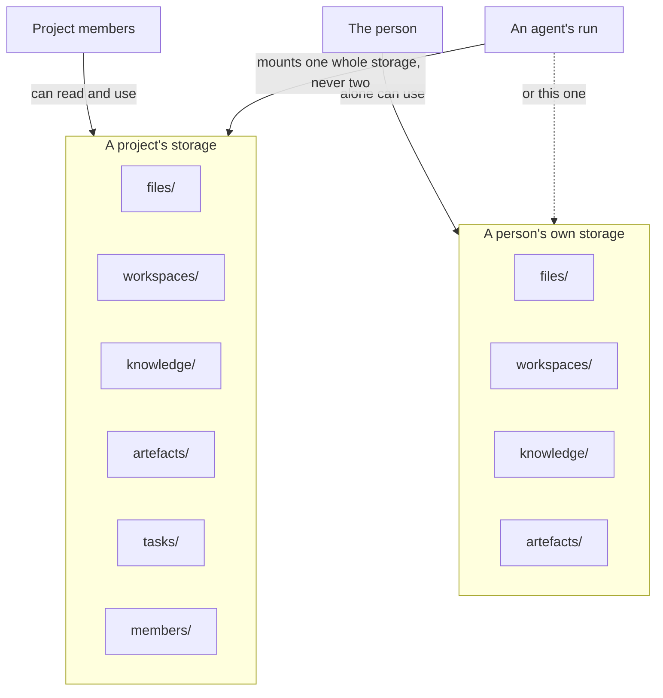

# Storage and Workspaces

Where files live in Agenthix, who can see them, and what an agent sees when it works.

**Storage belongs to a project or to a person, and to nothing else.** Agents, products, programmes and
teams own no storage ([ADR-0061](../../adr/adr-0061-a-product-and-a-programme-group-work-and-own-nothing.md)).
An agent has no folder of its own: it works in whichever project's or person's storage the run is in.
The word used throughout the architecture documents for one owner's storage is a **storage boundary**.
The files themselves sit on an Execution Site, not in hq; see
[Storage and Placement](../../architecture/storage-and-placement.md) for where and how hq reaches them.

---

## What is in a storage

| Folder | What it is for | In |
|---|---|---|
| `files/` | The owner's own documents. A run that names no workspace works here. `AGENTS.md` at its top is the place's instructions for every agent, put into every run's prompt; a new project starts with it and a `ROADMAP.md`. | project, person |
| `files/.agents/` | The place's own adjustments for its agents: `skills/<slug>/` for every agent working here, and `agents/<agent id>/` for one agent's own `instructions.md` and `skills/`. Agents may change them when asked. | project, person |
| `workspaces/` | One named folder per workspace, below. | project, person |
| `knowledge/` | What is known in the place, kept as topic files with an `INDEX.md` that gives each a one-line entry. | project, person |
| `artefacts/` | The throwaway things an agent makes for people in a conversation, one file each, directly in the folder. The agent's reply links to it as `artefacts/<file name>`. | project, person |
| `tasks/` | One working folder per task. A task run works here. | project only |
| `members/` | One area per member, holding their `agenda.md` and drafts. Everyone with access to the project can read it. | project only |

A person's own storage has no `tasks/` or `members/`: a task belongs to a project, and an agenda in
personal storage sits in `files/`. The layout on disk and the code that derives it are in
`site/src/server/storage/paths.ts`; paths are always built from immutable ids, so renaming a project or
workspace never moves a file.

## Workspaces

A **workspace** is a named folder inside a storage, with a row for it in the site's database
(`Workspace` in `site/schema.prisma`). It is not necessarily a git repository: it is a place to keep one
body of work apart from another. A git repository can be attached to it
([Git access](../git/git-access.md)).

- **Create**: any person who may work in the storage can create one (a project Viewer reads and changes nothing) (`createWorkspaceAction`,
  `hq/src/storage/actions.ts`). A person's own workspace is always owned by them.
- **Delete**: removes its row and its placement; the folder and files stay on disk
  (`hq/src/storage/workspaceService.ts`).
- **Tool limit**: a workspace may carry an `allowedTools` list, a guardrail on which tools a run working
  in it may use. `null` means no limit and an empty list means no tools. The list can only narrow what the
  agent already has: a tool not on it is set to never for that run (`hq/src/server/identity/capabilityService.ts`).
  Setting it needs someone who works where the workspace is — a Member or Admin of its project, or the
  person whose own it is (`setWorkspaceAllowedToolsAction`) — and every name is
  checked against the known tools so a typo cannot silently lock everything out
  (`hq/src/storage/allowedToolsService.ts`).

The pages for this are the project's Files and Workspaces pages (`/projects/:key/files`,
`/projects/:key/workspaces`) and the person's own (`/files/:ownerType/:ownerId`, `/workspaces`).

## What hq reads

hq lists and reads a storage's `files/` (each entry with its size and when it last changed), its
`artefacts/` and its `knowledge/`, always by asking the site that holds it, under the same access rule
below (`hq/src/storage/queries.ts`, `ownerFolderQueries.ts`). The Knowledge tool titles each topic from
its line in `INDEX.md`, and otherwise by its file name (`hq/src/storage/knowledgeIndex.ts`). For
`artefacts/` and `knowledge/` the site refuses every link, including one that stays inside, and a folder
that has itself been replaced by a link.

## Who can see what

| Storage | Who may use it |
|---|---|
| A person's own | That person, and nobody else. Not an administrator either. |
| A project's, open or private | Only the people on its member list. Anyone in the organisation may join an open project, and then uses its storage ([ADR-0099](../../adr/adr-0099-an-open-project-is-open-to-join.md)). A member with the Viewer role reads its files and changes nothing ([ADR-0102](../../adr/adr-0102-viewer-is-a-project-role.md)). |

A personal project has no storage of its own: its work happens in its person's own storage.

One rule decides every file listing, file read and run placement: `assertLocationAccess`, which takes whether the person reads or works
(`hq/src/storage/locationAccess.ts`). Inside a project there are no finer walls.
**Access to a storage is access to all of it**
([ADR-0079](../../adr/adr-0079-access-to-a-boundary-is-access-to-all-of-it.md)): a workspace cannot be
hidden from an agent that works in the same project, and a member's `members/` area is readable by the
project. To keep something from other members or from agents, put it in your own storage, or in a project
they are not part of.

## What an agent sees

A run's container mounts one whole storage, at `/projects/<project id>` or `/users/<person id>`, with
every folder above inside it. A workspace created while it runs appears at once. The working folder is
`tasks/<id>` for a task, `workspaces/<id>` for a run in a workspace, and `files/` otherwise. The mount is
writable only if the run's permissions include a tool that writes
(`site/src/agents/runtime/locationResolver.ts`, `containerPrep.ts`).

The agent's prompt names the folders it can see, and carries the place's `AGENTS.md`. It is told to save
each throwaway item it makes for people as one file directly in `artefacts/` and link to it in its reply
as `[title](artefacts/<file name>)`, and to keep distilled facts in `knowledge/` with an `INDEX.md`, and that each knowledge tree is readable only inside its own storage: using a
person's knowledge in a project means copying it there on purpose
(`site/src/agents/promptSectionText.ts`). A run never reaches a second person's or project's storage, and
never reaches the harness's own session files, which sit beside storage in a harness home, not inside it
([Memory](../memory/memory.md)).

## Not in storage

An agent's definition, what agents remember about a person, and files people upload to a task live in hq,
not on a site ([Memory](../memory/memory.md)). How agents' files and artefacts are served back to people
is [File sharing](../file-sharing/file-sharing.md).

## Where in the code

| What | Where |
|---|---|
| Disk layout, derived from ids | `site/src/server/storage/paths.ts` |
| The location a run works in, and its mount | `site/src/agents/runtime/locationResolver.ts` |
| Workspace and attachment rows | `site/schema.prisma` (`Workspace`, `RepoAttachment`) |
| Create, delete, set tool limit | `hq/src/storage/actions.ts`, `workspaceService.ts`, `allowedToolsService.ts` |
| The access rule | `hq/src/storage/locationAccess.ts` |
| A new project's starter documents | `hq/src/storage/filesService.ts` |
| Files listing and reading | `hq/src/storage/queries.ts`, `locationFileStore.ts` |
| Artefacts and knowledge listing and reading | `hq/src/storage/ownerFolderQueries.ts`, `ownerFolderStore.ts`; on the site `site/src/server/storage/ownerFolderMethods.ts` |
| The place's instructions in the prompt | `site/src/agents/placeInstructions.ts` |
| Which site holds a storage | [Storage and Placement](../../architecture/storage-and-placement.md) |

## Decisions behind this

[ADR-0039](../../adr/adr-0039-files-and-workspaces.md) (ids, derived paths) ·
[ADR-0061](../../adr/adr-0061-a-product-and-a-programme-group-work-and-own-nothing.md) (only projects and
people own storage) · [ADR-0074](../../adr/adr-0074-a-container-is-keyed-on-its-boundary-and-its-runner.md)
(a container mounts one storage) ·
[ADR-0079](../../adr/adr-0079-access-to-a-boundary-is-access-to-all-of-it.md) (all of it, with a workspace
tool limit as a guardrail)
