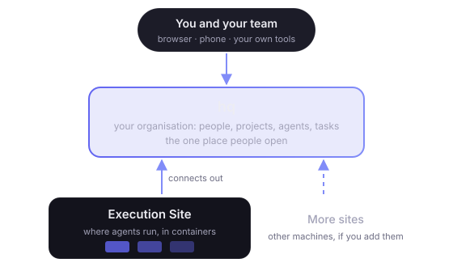

Agenthix has two parts you use: **HQ** and its **Execution Sites**. Two more look after the machines they run on: the
**host service** and the **Fleet Console**. One install sets up all four, on one machine.

## HQ

**HQ** is your organisation's home in Agenthix: its people, projects, agents, boards and tasks, and who may do what.
It is the only part people open, in a browser. Each organisation has its own HQ, which you run yourself.

HQ is also where you talk to an agent. A conversation is kept in HQ, and the agent answers from there at once; when it
has longer work to do, such as reading through a project, it hands that to a site and tells you when it is done.

## Execution Sites

An **Execution Site** — a *site* for short — is where agents do their work. They run in containers on the site: a
container belongs to one project, or to one person's own space, and holds its files, and the agents working there
share it. A site has no web page of its own: it connects out to HQ, and HQ sends it work.

Every install is HQ and one site together on the same machine, already connected. You can add more sites on other
machines later, for example to run agents closer to your code or on a bigger machine.

## Looking after the machines

Every machine also runs the **host service**, a small program that installs, runs, upgrades and backs up HQ and the
site there. HQ cannot do any of that itself, on purpose.

The **fleet** is HQ and its sites, with the machines they run on. It is looked after in the **Fleet Console**, by the
people who hold the **fleet admin** role: an extra role on an HQ account, separate from being an organisation admin.
From the Fleet Console, fleet admins add sites, plan upgrades and watch backups.

The Fleet Console is kept apart from HQ because HQ is the part everyone signs in to, often from the internet: if
someone broke into HQ, they must not get your machines too. So the Fleet Console opens only on its own machine, and
every command it sends to a machine is signed, so a machine can tell it really came from there.
[Run it on a server](../running-agenthix/index.md) explains it all. If you only use Agenthix in a browser, you never
need it; if you have just been made a fleet admin, start at
[You've just become a fleet admin](../running-agenthix/new-fleet-admin.md).

## The words you'll meet

- **Organisation, people and teams.** Everyone who can sign in to your HQ, as an **Admin** or a **Member** of the
  organisation. In each project they also have a role there: admin, member or viewer. Teams group people so they can
  join a project together.
- **Projects and your space.** A project is a shared place for one piece of work, with its boards, tasks and files.
  **Your space** is your own private place, outside any project, with the same sections; **Chat** lists its
  conversations. A place's sections are listed in the side bar.
- **Agents.** Each agent is defined once for the organisation. You give it instructions and work, and choose which
  projects it belongs to. Every new HQ comes with a built-in agent, **Kernel**, which helps you use Agenthix.
- **Conversations.** You talk to an agent in a conversation, in your space, a project, or on a task. The conversation
  opens beside the page and stays there as you move around HQ. The agent answers as it goes and starts longer work in
  the background, which shows in a bar above the message box.
- **Tasks and boards.** A task is a piece of planned work with a type, a column and a place in the project's order. A
  board is a saved way of looking at the tasks; it never owns them.
- **Runs and approvals.** An agent works on a task in a **run**, and a person starts it: nothing starts by itself. When it
  wants to do something its permissions don't allow on their own, the run waits for a person to **approve** it. The
  **Workroom** shows a project's agents at work.
- **Routines.** A schedule, an agent and instructions: the agent does the job again and again, on time.

## The Responsible AI Pledge

The **Responsible AI Pledge** is an Agenthix initiative: a movement of people who commit to using AI honestly, under
their oversight, and owning what it does. It is separate from the product, and signing it is free and voluntary. HQ
invites you to it once, on **Home**; with an Agenthix account linked, HQ knows whether you have signed, shows it only to
you in **Settings**, and stops asking once you have. Read it at
[agenthix.com/responsible-ai](https://agenthix.com/responsible-ai).

## Where to go next

- **You're installing Agenthix:** [Install Agenthix](install.md).
- **Someone invited you:** [Joining by invitation](joining-by-invitation.md).
- **You look after the machines it runs on:** [Run it on a server](../running-agenthix/index.md).
- **You've just been made a fleet admin:** [You've just become a fleet admin](../running-agenthix/new-fleet-admin.md).
