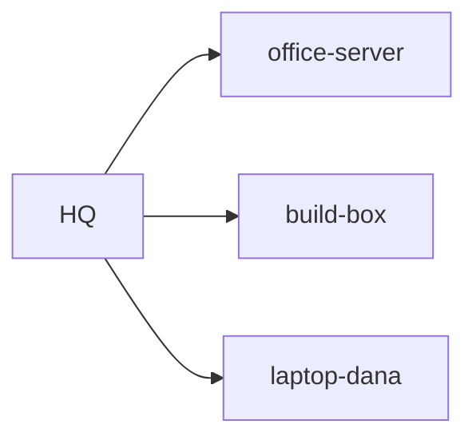

This page is for fleet admins, and anyone who wants the detail behind [Run it on a server](index.md): how sites and
machines are named, how fleet admins are told when a machine stops answering, and how the fleet admin role is given.

## HQ

**HQ** is your organisation's home in Agenthix: its people, projects, agents and tasks, and every screen they use.
There is one HQ for the organisation, and it runs on one machine. HQ keeps the organisation's data, and runs no agents
itself.

## Sites

A **site**, short for Execution Site, is where agents run, and where the files of the projects on it are kept. HQ has
sites: the one installed beside it, and any you add on other machines. A site connects out to HQ, so its machine needs
no open port.

**A site is named after its machine.** A machine runs one site, and the site takes the machine's name, such as
`office-server`. The name is the machine's own network name (its host name, up to the first dot), taken when the host
service first starts on it. Two machines in the fleet cannot share a name: a machine that joins with a name already
taken is turned away, and the Fleet Console says which machine has it. If a site moves to another
machine, or is restored on one, it takes that machine's name from then on, and its projects show the new name.

## When a machine stops answering

Each machine has the setting *Notify the fleet admins if this machine stops answering*. It is ticked when the machine
is added, unless the fleet admin adding it unticks it, and **Notify…** on its page changes it.

- **Ticked:** when the machine has been silent for 10 minutes, the Dashboard shows it as **Not answering**, and HQ
  tells every fleet admin, in HQ's notifications and in the Fleet Console's notices, until it answers again.
- **Unticked:** it shows only as **Not heard from**, and nobody is told. Untick it for a machine that is often
  switched off or asleep, such as a laptop, so the notices keep meaning something.

Nothing is ever done to a machine either way. HQ's own machine is always watched: if it goes quiet, HQ is down. A
machine that was stopped on purpose, such as for maintenance, is not reported.

## The host service

The **host service** is a small program that runs on every machine, one per machine. It installs, runs, upgrades and
backs up HQ and the site there, and it is the only thing that can change them. The Fleet Console asks it to do what a
fleet admin chose; the same service answers the `agenthix` commands typed on the machine, described in
[Commands on a machine](commands.md).

## Fleet admins

The **fleet** is HQ and all its sites, with the machines they run on. A **fleet admin** is a person in HQ who holds
the *fleet admin* role, which lets them open the **Fleet Console**: the screens where the machines are looked after.
From there a fleet admin adds, moves and restores sites, plans maintenance, and looks after backups.

- **The role belongs to an HQ account.** A fleet admin signs in to the Fleet Console with their HQ username and password.
  The Fleet Console keeps no accounts of its own.
- **It is not the organisation admin role.** Giving one does not give the other. Organisation admins look after the
  people and projects in HQ; fleet admins look after the machines.
- **Two kinds of people can give it, or take it away:** a fleet admin, on the Fleet Console's **Fleet admins** page,
  and a machine admin of HQ's machine, with `agenthix hq fleet-admin`. Nobody else can, not even an organisation
  admin. The first account, made when Agenthix is installed, holds it from the start.
- **Everyone is told.** HQ tells every fleet admin and every organisation admin each time the role is given or taken
  away.
- **It can always come back.** If no fleet admin is left, or nobody can sign in, a machine admin of HQ's machine gives
  it back: see [When nobody can sign in](recover-admin.md).

## Agenthix Cloud and remote access

The Fleet Console has places for **Agenthix Cloud**, the hosted service from the makers of Agenthix, and for
**Remote access**: the Fleet Console opened from anywhere for a while, through Cloud, instead of over an SSH tunnel.
Both need the organisation to be connected to Cloud, which you do with **Connect to Agenthix Cloud** on HQ's page, on
the Fleet Console's own machine. Until it is connected, each of these places says so and changes nothing:

- **Dashboard:** a **Cloud** line, **Connect** and the organisation's name **to Cloud**, which opens HQ's page; and a
  **Remote access** total that reads **Off** and says it needs the organisation connected to Cloud.
- **HQ** page: a **Cloud connection** section, with **Connection** reading **Not connected**, and **Connect to Agenthix Cloud**.
  Connecting and disconnecting are done on the Fleet Console's machine only, never through remote access.
- **Remote access** page: **Off**, marked **Cannot be turned on yet**, with the reason.
- **Fleet admins** page: a section for fleet admins on Cloud, which says they are listed once the organisation is
  connected. Cloud's list is only a suggestion: nobody becomes a fleet admin here until a fleet admin here, or a machine
  admin of HQ's machine, gives the role.
- **Your account:** your authenticator code, which is not set up, and your own Cloud sign-in, which reads **Not linked**.

Nothing here is needed to run Agenthix: the fleet works the same without it. The commands that go with these places,
`agenthix cloud connect`, `agenthix cloud disconnect`, `agenthix console remote` and `agenthix console reset-code`, are
in [Commands on a machine](commands.md#agenthix-cloud-and-remote-access): connecting and disconnecting from HQ's
machine, turning remote access off at once, and starting a fleet admin's authenticator code over.

## Machine admins

A **machine admin** is whoever looks after a machine itself: anyone who can use Docker, the tool that runs Agenthix's
parts, on that machine, sitting at it or over SSH. It is not an account in Agenthix: it comes from the machine
itself. A machine admin types the `agenthix` commands on that machine. When a site is added, moved or restored, the
fleet admin gives a one-time code to the machine admin of the new machine, who types it there.

A machine admin of HQ's machine can give anyone the fleet admin role, so give Docker access on HQ's machine only to
people you would trust with every machine in the fleet.

## Where each thing is

| Thing | Where it runs | Looked after from |
|---|---|---|
| **HQ** | HQ's machine | The **HQ** page in the Fleet Console, and `agenthix hq …` commands on that machine |
| **A site** | Its own machine | Its page in the Fleet Console's menu, and `agenthix site …` commands on that machine |
| **The host service** | Every machine, one each | `agenthix …` commands on that machine, described in [Commands on a machine](commands.md) |
| **The Fleet Console** | HQ's machine, unless it was moved to another with `agenthix hq console-code` | Fleet admins, in a browser on that machine |
