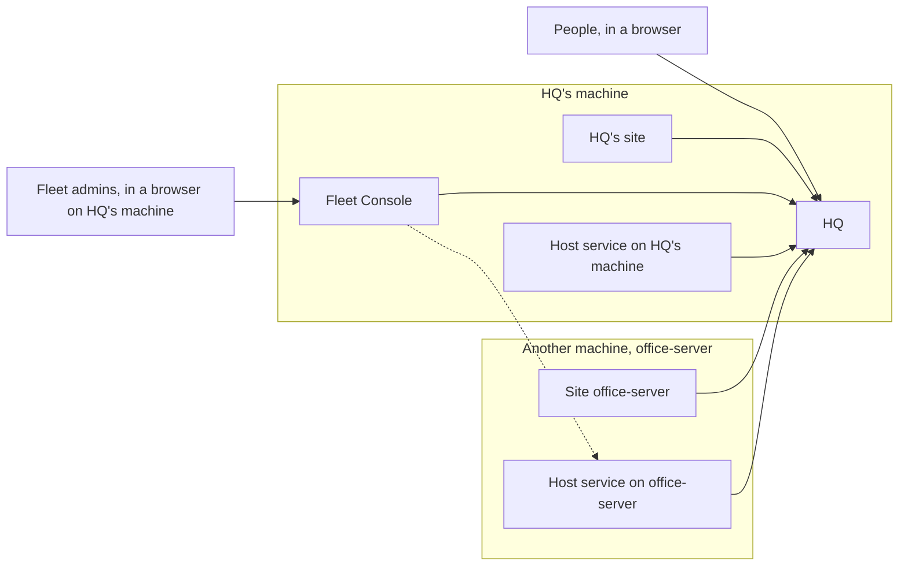

This section is for **fleet admins**, who look after the machines Agenthix runs on, and for **machine admins**, who
type commands on those machines; both are explained below. If you only use Agenthix in a browser, you don't need it:
[How Agenthix works](../getting-started/how-agenthix-works.md) is all you need. If you have just been made a fleet
admin, start at [You've just become a fleet admin](new-fleet-admin.md).

## What runs where



Each solid arrow starts at the part that opens the connection, and every part opens its own connection to HQ. So
nothing ever connects to a site, a host service or the Fleet Console from the network, and HQ's machine is the only
one that needs a port open to the network. The dotted arrow is the path of a command from the Fleet Console to a
machine: it travels through HQ, which passes it on.

- **HQ** is your organisation's home in Agenthix: its people, projects, agents and tasks, and every screen they use.
  There is one HQ for the organisation, on one machine. It keeps the organisation's data and runs no agents itself.
- **A site**, short for *Execution Site*, is where agents run, and where the files of the projects on it are kept.
  Every install has one site, beside HQ on HQ's machine. You can add more on other machines. A machine carries at most
  one site, and the site is named after its machine, such as `office-server`.
- **The host service** is a small program that runs on every machine, one per machine. It installs, runs, upgrades
  and backs up HQ and the site on its machine, and it is the only thing that can change them: HQ cannot, on purpose.
  It also answers the `agenthix` commands typed on that machine.
- **The Fleet Console** is where the machines are looked after, all in one place: adding sites, planning upgrades,
  watching backups. It runs on HQ's machine unless it was moved to another, and is opened in a browser on the machine
  it runs on.
- **The fleet** is HQ and all its sites, with the machines they run on.

## Who does what

- **People in your organisation work in HQ.** An **organisation admin** looks after its people, projects and agents.
  They can see in HQ whether each site is working, and why not, but they cannot change a machine.
- **Fleet admins look after the fleet, in the Fleet Console.** *Fleet admin* is a role on an HQ account, separate from
  organisation admin: a fleet admin signs in to the Fleet Console with their HQ username and password. The first
  account, made when Agenthix is installed, holds both roles. After that, the fleet admin role is given only by a
  fleet admin, on the Fleet Console's **Fleet admins** page, or by a machine admin of HQ's machine. An organisation
  admin cannot give it.
- **A machine admin** is whoever looks after a machine itself: anyone who can use Docker on it, sitting at it or over
  SSH. *Docker* is the tool that runs each part of Agenthix in its own container, a packaged program kept apart from
  the rest of the machine. A machine admin is not an account in Agenthix. They type the `agenthix` commands on that
  machine, and a fleet admin works with them when a machine joins the fleet.

One person may be all three, and in a small organisation often is.

Because a machine admin of HQ's machine can give anyone the fleet admin role, give Docker access on HQ's machine
only to people you would trust with every machine in the fleet.

## Why the Fleet Console is kept apart from HQ

HQ is opened by everyone in your organisation, and often from the internet, so it is the part most exposed to
attack. The Fleet Console can upgrade, move and erase what runs on your machines. Keeping the two apart means that
whoever gets into HQ does not get your machines too.

- **An HQ account alone can never take over a machine.** Not an organisation admin's, and not someone who has taken
  over HQ itself. HQ shows whether each site is working; it has no control over any machine.
- **Every command to a machine is signed by the Fleet Console, and checked by the machine itself.** A signature is a
  mark only the Fleet Console's secret key can make, which anyone holding its matching public key can check. When a
  machine joins the fleet, it and the Fleet Console each keep the other's public key. HQ passes each command on
  *sealed*, encrypted so that only that machine can read it: HQ cannot read a command, change it or make one up. A
  machine refuses a command the Fleet Console did not sign, and anything that is not one of its own short list of jobs:
  there is no command that runs a program of someone's choosing, or reads its files.
- **The Fleet Console is reached only on its own machine.** It answers only at `http://127.0.0.1:7801` there, or at the other port the machine admin chose.
  `127.0.0.1` is the address a machine uses to reach itself, so nothing on the network can open it. From another
  computer, a fleet admin opens an SSH tunnel to that machine, which needs an account on it.
- **The fleet admin role is never handed out quietly.** Every time it is given or taken away, HQ tells every fleet
  admin and every organisation admin.

So someone who took over HQ could give an account the fleet admin role, and everyone would be told, but still could
not open the Fleet Console or make a command a machine would follow.

## Open the Fleet Console

1. On the machine the Fleet Console runs on, HQ's machine unless it was moved, open `http://127.0.0.1:7801` in a
   browser. It is not HQ's address: HQ has its own, which people use.

   From another computer, you need an account on that machine that can sign in over SSH; the machine admin of HQ's
   machine, usually whoever installed Agenthix, can give you one. Open a tunnel with it, then open the same address
   on your own computer:

   ```sh
   ssh -L 7801:127.0.0.1:7801 <you>@<hq machine>
   ```

   The tunnel carries `127.0.0.1:7801` on your computer to the same address on HQ's machine, for as long as the
   command runs.

2. Sign in with the username and password of an HQ account that holds the fleet admin role.

Its menu has **Dashboard** and **HQ** at the top, then each site by name, then **Maintenance**, **Backups**,
**Activity**, **Fleet admins**, **Remote access** and **Help**. **Help** shows the pages of this section.

Signing in needs HQ: the Fleet Console asks HQ to check your username and password, and reaches the other machines
through HQ. While HQ is not answering, the sign-in page says so, and what is left to do is done with commands on HQ's
machine: start with `agenthix status`, and if HQ has to come back from a backup, see
[Backups and restoring](backups-and-restoring.md#restore-hq).

## Commands on a machine

Every `agenthix` command is typed on the machine it is about, and runs in its host service:

```sh
docker exec -it agenthix-host agenthix <command>
```

Most have a screen in the Fleet Console too. The commands are for a machine you are at, a script, or when the Fleet
Console cannot be reached.

## Where to go next

For fleet admins, in the order you are likely to need them:

- [You've just become a fleet admin](new-fleet-admin.md): what you look after, and your first visit.
- [HQ, sites and fleet admins](hq-sites-and-fleet-admins.md): how sites are named, being told when one stops, and the fleet admin role.
- [Backups and restoring](backups-and-restoring.md): the nightly backup, where copies go, and bringing a lost site back.
- [Maintenance and upgrades](back-up-and-upgrade.md): upgrade, move or suspend now or later, and what people see.
- [Add, move or remove a site](add-a-site.md): run agents on another machine, and move or take it out later.
- [Live previews on a site](live-previews-on-a-site.md) (not available yet): switch them on, set the limit and idle stop, watch capacity, give apps an address.
- [When nobody can sign in](recover-admin.md): get back in, and get the fleet admin role back.

For machine admins, and whoever sets up HQ's machine:

- [Address and front door](domain-and-https.md): the address people use, and HTTPS. Live previews are not available yet.
- [Commands on a machine](commands.md): every `agenthix` command.
- [Take Agenthix off a machine](uninstall.md): remove everything it put there, with one command.

For organisation admins, in HQ:

- [Logs and diagnostics](diagnostics.md): see in HQ what is wrong, and gather what someone needs to help.
