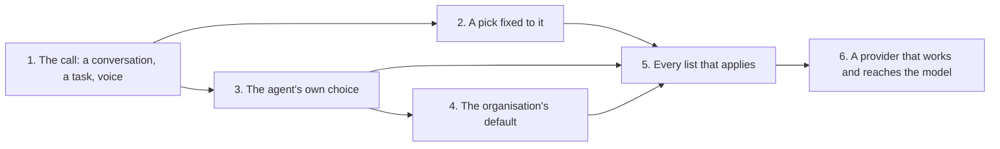

Every time an agent thinks, speaks or listens, **HQ**, your organisation's home in Agenthix, picks the model or voice
from one place. This page is how an organisation admin steers that choice, and how everyone else can narrow it for
themselves. The [providers](providers.md) it draws on are added separately.

## How a choice is made

1. Something needs a model, or a voice: a conversation's reply, a task's run, someone speaking.
2. A person may have picked a model for a conversation, from the **plus** in its message box, or a task or routine may
   name one. A pick is used as it is or not at all: HQ never swaps it silently. If it cannot run, the conversation
   says why and who can fix it.
3. Otherwise the agent's own choice applies, if an admin gave it one.
4. Otherwise the organisation's default.
5. Whatever was chosen must also pass every list that applies: the organisation's, the agent's, the project's and the
   person's (see [Which models may run](#which-models-may-run)).
6. A provider that **Works** and reaches the model serves it. If the chosen model's own provider is down, a default
   moves to the same model through another provider first, then to the next layer, then to any model that may run, and
   HQ says once what it did not use.

## The organisation's defaults

An organisation admin opens **Manage**, then **Models** under **Models and billing**.

Four settings say what every agent uses unless it has its own. Each row shows the choice in one line, such as a model
**via Anthropic**, and **Change**.

| Setting | What it chooses |
|---|---|
| **Conversation** | Where a new conversation starts |
| **Workers** | The model for work an agent hands off |
| **Voice** | The voice agents speak with |
| **Listening** | The model that hears people |

**Conversation** and **Workers** open the model list every place a model is chosen uses: a search box, **Maker**,
**Provider** and **Price** filters, and the models grouped by maker. A provider that is not working is greyed out, and a
chosen model whose provider has stopped is marked **not working**. On an agent's page the list starts with **Default**,
the organisation's choice; choosing it follows the organisation again.

Voice is **Inworld TTS 2**, the only speech model voice supports. **Voice** opens a list of the provider's voices to
choose by ear: filter by language, accent, gender, age, use or tag, tap a voice to hear it, then **Use** it. The
organisation always has a voice, so it can be changed and not cleared. **Listening** is one of AssemblyAI's three live
models, each shown with its languages and price per hour of audio: **Universal-3 Pro** (32 languages, the most
accurate), **Universal-Streaming** (English only) and **Universal-Streaming Multilingual** (6 languages).

Setup chooses the ones its providers can fill when it finishes (see [Set up your HQ](../getting-started/setup-hq.md#6-check-everything)), and
the rest when a provider is added later.

## An agent's own models and voice

Any default can be set differently for one agent. An organisation admin opens **Manage**, then **Agents**, selects
**Manage** beside the agent and finds **Models and voice**. It shows the same four rows, each marked as the
organisation's or the agent's own.

- **Give *agent* its own** on a row opens the picker, and the choice is the agent's from then on.
- **Follow *organisation*** hands it back: the row follows the organisation's default again, and changes when it does.

A row left as the organisation's changes with the organisation's. Under it, **Which models *agent* may use** is the
agent's own list, below.

## Which models may run

A list says which models may run. Four places can hold one:

| List | Who sets it | Where |
|---|---|---|
| The organisation's | An organisation admin | **Manage › Models**, under **Which models may run** |
| An agent's | An organisation admin | The agent's page in **Manage › Agents**, under **Models and voice** |
| A project's | A project admin, in a shared project | The project's **Settings**, under **Models** |
| A person's | That person | **Settings**, under **Which models may run for you** |

Every list that applies narrows the set, and none widens it: a model runs only when each of them lets it. A personal
project has no list of its own; its owner's applies. Most organisations never open the organisation's list: it reads
**Any model your providers reach**. Select **Edit** to open the editor, where every change is saved at once.

A list is in one of two modes:

- **Any model, except these** (the first choice in the editor): every model may run except what is under **Never**.
  New models are allowed as they appear.
- **Only these**: only what is under **Only** may run, and **Never** still removes exceptions from it. New models stay
  off until a name or a pattern covers them.

Under **Only** and **Never** each entry is a model or a pattern, with how many models it covers:

| Entry | Matches |
|---|---|
| `anthropic/claude-sonnet-5` | That model |
| `deepseek/*` | Every model by that maker |
| `*-pro`, `anthropic/claude-*` | A family: `*` stands for anything |

Patterns match a model's maker and name, never its provider, so a list keeps up with new models without naming who
serves them. Case is ignored, and a version written `5.1` is read as `5-1`. A ban beats an allow.

The entries show as chips; **✕** on one removes it. **＋ Add models** opens the model list, the same one every place a
model is chosen uses: search it, or narrow it by **Maker**, **Provider** and **Price**, and tick each model to add. A
model the list already covers reads **Added**. When what you type covers several models, the first row offers it as a
pattern (**Add the pattern `deepseek/*`**, with how many models it covers); typing a `*` yourself always offers it,
for a maker no provider reaches yet. **Add 2 models** at the foot adds what is ticked. A model added by name stays on
the list as it is: if prices change later, the list does not.

## Your Claude subscription

A person can sign in with their own Claude account under **Settings**, in **Your Claude subscription**, as a provider
only they can use. It serves Claude models for work in their own place: **Your space** and their personal projects, and
nowhere else. It never serves a shared project, and never the replies HQ itself writes in a conversation.

1. Select **Sign in with Claude**, then **Open Claude to sign in**.
2. Sign in to Claude, copy the code it gives you, paste it into **Code from Claude** and select **Finish**.

**Sign out** removes it. A Claude subscription is personal: it is your own account, in your name, used through Claude's
own runtime. See Anthropic's [Consumer Terms of Service](https://www.anthropic.com/legal/consumer-terms) and Claude
Code's [legal and compliance page](https://code.claude.com/docs/en/legal-and-compliance). Runs on it cost nothing per
call, and the [usage report](billing-and-usage.md) lists them as **Included in subscriptions**.

## Web search for OpenCode agents

An organisation admin opens **Manage**, then **Settings**, and under **Access to models and tools** selects **Web
search**. **Web search (Exa)** takes the organisation's Exa key, for agents that run on OpenCode. Paste it and select
**Save key**; **Remove key** takes it away. Claude models search on Anthropic's own service and do not use it.

## If agents say they can't answer

**Home** shows **Agents can't answer you yet: no model is working** when nothing works for you. For an organisation
admin its link goes to **Manage organisation › Providers**; anyone else is told an organisation admin can set one up.
When one call cannot run, the conversation names what is missing and who adds it: usually a provider to add or fix, a
default to choose under **Models**, or a list that leaves no model.
