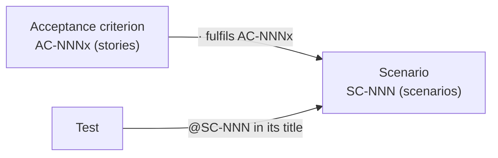

# The QA model

> **Shared and versioned.** This file is the same in every repository that uses this QA model, and it changes
> only as a new version (`qa-model-version` above). Do not edit it here. Everything specific to this repository
> — its modules, commands, test tiers and paths — is in [`qa-strategy.md`](qa-strategy.md).

## The contract

What the product promises is written down in two contracts, both committed in `docs/qa/`. Together they are
the specification that tests and audits measure against.

| | **Stories** — `stories/<module>.md` | **Scenarios** — `scenarios/<module>.md` |
|---|---|---|
| Audience | Business readers | Engineers |
| Says | What a person needs and why | What the product does, one behaviour per line |
| Unit | A **user story** (`US-NNN`): "As a ⟨role⟩, I want ⟨goal⟩, so that ⟨reason⟩", with **acceptance criteria** (`AC-NNNx`) — each one verifiable | A **scenario** (`SC-NNN`): one line, an action and its expected outcome |
| Holds no | Implementation detail | Untestable or internal-only statements |

- **Ids are stable.** An id is never reused or renumbered. A story or scenario that no longer holds is marked
  *retired* with the date and reason, and keeps its id. Each file records the next free id (`next-us`, `next-sc`)
  in its front matter.
- **Scenario ids are unique across every scenarios file**, not per file, because a test cites a scenario by its
  id alone.
- **A contract states what is promised, not whether the product keeps it today.** A promise not yet met is work
  still to do, listed as such, not deleted.
- **Infrastructure with no human actor** (a health check, internal plumbing) is not a story. It may be a scenario
  when its behaviour is testable and matters.

## The links between them

- **A scenario that serves an acceptance criterion says so** at the end of its line: `· fulfils AC-001a`. That
  link is how story coverage is read, never re-derived from the code.
- **A test names the scenario it covers with an `@SC-NNN` tag in its title** — one tag per scenario it covers.
  It is the only link between a test and a scenario, so scenario coverage is found by searching the tests for
  the tags. The exact syntax per test framework, and where tests live, are in `qa-strategy.md`.
- A tag that names no existing scenario is a broken reference, and an audit reports it.

## Test levels

| Level | Checks | Needs |
|---|---|---|
| **Unit** | One module's logic in isolation; collaborators replaced where they are slow or external | Nothing running |
| **Integration** | A module against its real dependencies — its database, its file system | The test database |
| **End-to-end** | A behaviour across the running system, the way a person or another system uses it | The applications running |

A repository may split a level further (for example, a tier that runs two applications together); its
`qa-strategy.md` names each tier and its command.

## When the contract is written

- **While work is built, its phases write tests first and run them — and nothing else.** No stories or
  scenarios are written, no tags added, during the phases: the behaviour is still moving.
- **At the close of a unit of work that changed behaviour, the unit writes the contract** for what it built or
  changed — the stories and scenarios, from the finished code — and **tags the tests that cover them**.

## Audits

An audit measures the product against the contract:

| Check | Question | Reads |
|---|---|---|
| **Accuracy** | Does the contract match what the code does? | The product code |
| **Coverage** | Is every acceptance criterion served by a scenario, and every scenario by a test? | The `fulfils` links and `@SC` tags |
| **Regression** | Do the checks pass? | The test suites' results |

- **A full audit is required before every release**, and optional at a unit's close.
- Contract entries a unit wrote for its own work are checked by the next audit like any other.
- **Every finding ends in a fix or an issue.** A straightforward fix is made in the audit, with a test that
  covers it. Anything else becomes an issue on the repository that holds the code, naming the audit as its
  source; one that is critical — broken behaviour or a security risk — blocks the release until it is closed.
  There is no separate list of known problems: the issue queue is the list.

## Glossary

- **Contract** — the stories and scenarios together: what the product promises.
- **Coverage** — whether each promise is linked to something that checks it.
- **Accuracy** — whether each promise describes what the code actually does.
- **Domain map** — a module divided into feature areas (`domains/<module>.md`), so a large module's contract can
  be checked area by area in a stable order.

## Changes

| Version | Change |
|---|---|
| 1.0.0 | First version: the two contracts, their links, test levels, when the contract is written, audits |
