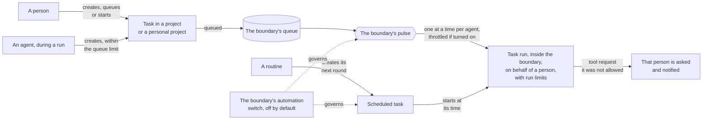
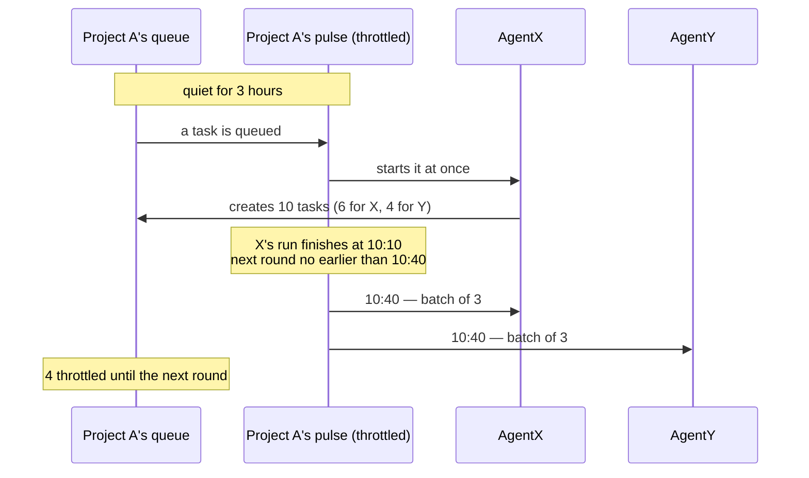

# Design Spec · Agents act on their own schedule, within a boundary

**Drafted** on 2026-10-02 from the design session held with the owner that day, for the owner's review. How it is
built is in [`plan.md`](plan.md).

## Why this exists

Agents are meant to keep work moving without a person pressing **Run**. Today they cannot, and if they could,
nothing would stop an unattended run from going too far.

**Queued work never starts.** A task becomes queued when a stage queues it automatically, when an agent creates it
as queued, or when a workforce template is confirmed — and nothing then starts it. Nothing in hq looks for queued
tasks: not at boot, not on a timer. The design left that to the agent heartbeat, which cannot do it.

**The agent heartbeat has nothing to belong to.** It was built when an agent was an actor with authority of its own
(ADR-0025 §6). Authority now comes from the boundary a run happens in — a project or a person's own space (ADR-0060)
— and an agent holds none. A heartbeat run has no boundary, so:

- every task tool except reading the queue refuses it, because its capability names no project — it can see queued
  tasks and start none of them;
- no project or personal agent settings (ADR-0072) apply to it, so it runs at the agent's own autonomy and tool
  ceiling, and an unrestricted agent's heartbeat is granted every built-in tool;
- it needs exceptions found nowhere else: its own container, a `/scratch` working folder, its own queue key and its
  own harness home.

**Unattended runs have no limits.** No limit exists on turns, tool calls, tokens or spend — per run, per project or
per day. An agent can create and assign tasks without limit. The only time limit is a 30-minute timer for task runs,
held in hq's memory and lost when hq restarts. A tool request an agent was not allowed becomes a comment on the task
that no one is told about, and the only way to pause is *stop agent*, which turns its heartbeat off for good.

### What this design does



- **The agent heartbeat is removed.** An agent no longer wakes itself up (§1).
- **A project or a person can turn on automation**: a pulse that starts the queued tasks in that boundary as their
  agents come free, optionally throttled, and schedules. It is hq code, not an agent run (§2).
- **Work agents cause is bounded by its depth**: a task an agent's run queues counts one deeper than that run, and
  past the boundary's maximum depth it waits for a person (§2).
- **A task can be scheduled to start at a time, and a routine keeps the next round of repeating work ready** as a
  scheduled task; finished tasks are archived automatically (§3).
- **Every person has a personal project** for their own tasks, whose runs are theirs (§4).
- **Every task runs on behalf of a person**, who answers its approvals (§5).
- **Queued tasks start reliably** — the fixes in §6.
- **Every run is limited in time, and a run no person started also in turns** (§7).

## Terms

| Term | Meaning |
|---|---|
| **Boundary** | Where a run's authority comes from (ADR-0060): a project, or a person's own space |
| **Automation** | A boundary's switch, off by default, that turns on both its pulse and its schedules. Turning it off is the boundary's pause. The org can turn it off for every boundary |
| **Pulse** | The part of a boundary's automation that starts its queued tasks. Never called a heartbeat: it is a scheduled mechanism, not something alive |
| **Throttle** | An optional part of the pulse, off by default: it starts queued tasks only in batches, with an interval between them |
| **Scheduler** | The one loop in hq that, at the top of every minute, starts every pulse and scheduled task that is due |
| **Batch** | With the throttle on, the tasks one round of the pulse lets through for one agent |
| **Depth** | How many agent runs led to a task being queued: 0 when a person queued it, one more than the run that queued it otherwise |
| **Queue limit** | How many tasks agents may hold queued in one boundary |
| **Scheduled task** | A task set to start once, at a given time |
| **Routine** | A schedule and a task template that keeps its next round — a scheduled task — created ahead of time |
| **Round** | One task a routine created |
| **Personal project** | A project that always exists for each person, whose runs belong to that person's own space |
| **On behalf of** | The person a task's work is done for; the person who answers its approvals |

## 1. The agent heartbeat is removed

An agent has no schedule of its own. Everything that gave it one goes, with no data carried forward (nothing has
been released):

- **Agent settings:** `Agent.heartbeatEnabled` and `Agent.heartbeatInterval`, and their places in package settings,
  zip import and export, and the agent's save checks.
- **Package content:** `heartbeat.md` in the agent template and in every library agent, and `heartbeatEnabled` /
  `heartbeatInterval` in library `agent.json` files. A library agent's heartbeat text that describes a standing job
  (the project manager's board review) moves into its instructions; the schedule for that job is now a routine
  a person sets up (§3).
- **hq:** `AgentHeartbeat`, `HeartbeatManager`, the `pulseAgent` action, `dispatchHeartbeatRun`, the heartbeat
  session and its owner chosen from the admins, `getAgentHeartbeatRuns`, and the heartbeat countdown.
- **The control channel:** the `heartbeat` dispatch kind and the `heartbeat` runner kind.
- **site:** `runHeartbeat`, the `heartbeat:<handle>` queue key, the `/scratch` working folder, the heartbeat
  container key and name, `homes/heartbeats/<handle>`, the heartbeat prompt sections and its fixed user message.
- **UI:** the Heartbeat tab, the heartbeat toggle on the agent list, and the heartbeat indicators on the team, org
  and debug pages and the agent tile.
- **The `heartbeat` session type.** Task runs an agent started were labelled with it; they are task sessions like
  any other.
- **Tool text:** `create_task`'s description that a queued task "will be picked up by the heartbeat", and the
  project page's "bypass heartbeat" tooltip.

`stopAgent` keeps stopping the agent's running work. It no longer switches anything off for good — there is
nothing left for it to switch off.

## 2. The pulse

### What it is

A pulse is a **setting on a boundary** — a project, or a personal project (§4) — not an object people create a list
of. It is part of the boundary's **automation**, which is **off by default** and covers both the pulse and the
boundary's schedules (§3). With automation on, the pulse starts the boundary's queued tasks; its settings are:

| Setting | Means | Org value, out of the box |
|---|---|---|
| **Maximum depth** | How deep a chain of agent-queued work may go before a person must queue the next step | 3 |
| **Queue limit** | The most tasks agents in the boundary may hold queued — across the boundary, not per agent | 20 |
| **Throttle** | Whether queued tasks start only in batches, with an interval between rounds | Off |
| **Interval** | With the throttle on: the least time between the end of one round and the start of the next | 30 minutes |
| **Batch size** | With the throttle on: the most tasks one agent is started on per round | 3 |

Automation has one more setting, **agents may set schedules when asked**, off by default (§3).

### The org decides; a boundary can only tighten

An **org admin** sets each value once, in org settings. It is both the value every boundary starts with and the
furthest any boundary may go. A **project admin** for a project, or a **person** for their own space, may move a value
only in the stricter direction:

| Setting | Stricter is | The org sets | A boundary may choose |
|---|---|---|---|
| **Automation** | Off | Whether automation is allowed in the org at all | On or off, only if the org allows it |
| **Maximum depth** | Lower | The highest depth | 0 up to that; at 0 every task an agent queues waits for a person |
| **Queue limit** | Lower | The highest limit | 0 up to that; at 0 every task an agent creates waits for a person |
| **Throttle** | On | Whether every boundary must throttle | On or off, only if the org leaves it optional |
| **Interval** | Longer | The shortest interval, never below the product's floor of 5 minutes | That or longer |
| **Batch size** | Smaller | The largest batch | 1 up to that |
| **Agents may set schedules when asked** | Off | Whether it is allowed in the org at all | On or off, only if the org allows it |

**The org's word is final.** A boundary's own choice is stored as it set it, and the stricter of the two applies at
the moment it is used. If the org tightens a value below what a project chose, the org's value applies and the
project's settings show the project's choice as limited by the org; if the org loosens it again, the project's choice
applies again. Nothing stored is rewritten. An org admin who decides automation is too dangerous turns it off in one
place, and no project admin or person can turn it back on: every pulse and scheduled start in the org stops at once,
as if each boundary had turned its own off (see *Pausing*). The same narrow-only rule governs run limits (§7) and the
agent settings each boundary overrides (ADR-0072).

**The pulse is hq code, not an agent run.** It makes no model call, needs no identity and no container, and costs
nothing when there is nothing queued. It does one thing: start queued tasks.

### What the pulse starts: each agent's queue, one task at a time

With automation on, each agent's queued tasks in the boundary form **one line**, highest priority first, then longest
queued first. When the agent is free in that boundary, the pulse starts the first task in its line; when that run
ends, the next one starts at once. Agents run in parallel and do not compete with each other for priority. The
existing rule that an agent works on one task at a time in a project (§6) is what makes each line sequential.

A task queued while its agent is free starts at once: queueing nudges the scheduler (see *One scheduler*). The site's
own limit on runs at once (§8) caps how many run across the site.

**If running every agent at once turns out to be a problem**, the fallback is a per-boundary limit on how many
agents run at once, the rest waiting their turn. It is not built unless the walkthroughs show it is needed.

### Chains are bounded by depth

Agents can queue work for each other: AgentX's run queues a task for AgentY, whose run queues one for AgentX. Left
alone that loop never ends. **Depth** bounds it — the same idea as a limit on how deep subagents may nest:

- A task a **person** queues or starts — with **Run**, or by asking an agent in a run they started, such as their
  chat — is at **depth 0**. A person expects what they asked for to run.
- A task queued by a run the pulse or a schedule started is **one deeper** than the task that run was for.
- Past the boundary's **maximum depth**, the task is still created or moved, but **not queued**. The agent is told so
  in the tool's result, as with the queue limit, and the task waits for a person; a person queueing it puts it back
  at depth 0.

**Depth is counted on the act of queueing, not on creating a task.** Every way an agent's run can make a task queued
counts — creating it queued, moving it into a column that queues automatically, moving a finished task back into
one, or starting it with `run_task` — so recycling an old task never resets the count.

With the queue limit (how much agents can hold queued at once) and the run limits (how much one run can do, §7), the
depth bounds everything automation can do for one thing a person asked.

### The throttle, when a boundary turns it on

The throttle is for a boundary that wants agents' work to arrive in rounds — to bound cost over time, or to leave a
gap to see what happened and pause. It is off by default; depth, not pace, is what stops a runaway chain. Turned on:

- Each **round** gives each agent a **batch of up to the batch size** from its line; the rest of its queued tasks are
  **throttled** until the next round. The batch runs one task after another, as above.
- **It fires on the leading edge.** A task queued into a boundary whose last round finished at least an interval ago
  starts a round at once. Otherwise the next round starts **when the interval has passed since the last round
  finished** — measured from its end, not its start, so a 40-minute round still leaves the full interval afterwards.
- **A round starts only what was queued when it started**, so tasks queued during a round wait for the next.
- **It survives an hq restart.** When each boundary's last round finished is stored, not held in memory, so a restart
  neither resets the throttle nor starts every boundary at once.

The most a throttled boundary can start per interval is the batch size × the number of agents with queued work.



### One scheduler for every pulse and schedule

hq runs **one scheduler**, not a timer per boundary or per task. Every pulse and every scheduled task stores **when it
is next due**; at the top of every minute the scheduler asks the database what is due and starts it. Queueing a task
also nudges the scheduler at once, so a task whose agent is free starts immediately rather than at the next minute.

| | One scheduler | A timer per pulse or schedule |
|---|---|---|
| State | In the database; a restart, edit, pause or loss of access changes a stored time and nothing else | In memory; every change must find and reset its timer, or a run fires that should not, or one is missed |
| Cost | One indexed query a minute, whatever the number of boundaries and schedules | One timer per item, rebuilt at every boot |
| Timing | To the minute, aligned to the top of the minute | To the second, which no schedule here needs |

Each start is **claimed with an atomic database update**, so overlapping ticks — or hq ever running as more than one
process — start an item once. The scheduler follows the pattern of hq's existing background sweeps.

### The queue limit applies to agents only

When agents in a boundary already hold the queue limit's worth of queued tasks, a task an agent creates is **still
created, but not queued**. The agent is told so in the tool's result, and the task waits for a person to queue it.

A person is never limited: they can queue any task, or start one at once as they can today. The pulse is the
boundary's automation for keeping work moving; it is not the only way work starts.

The depth limits how far agents' work can lead; the queue limit limits how much they can pile up. Together they mean
that stopping a boundary's automation is always one switch, and what is left afterwards is a bounded list.

### Pausing is turning automation off

Turning automation off — in the boundary, or for the whole org — stops new pulses and scheduled starts at once. Runs already started finish; queued tasks stay
queued, in order; a scheduled task that falls due while it is off becomes queued and waits (§3); the settings are kept
for when it is turned back on. Stopping a running task is the existing per-run stop.

### Every pulse is recorded

The pulse is the visible actor. Each time one fires, hq records which boundary it belonged to, when it fired, and
which tasks it started with which agents. The boundary's settings show it:

```
Project A · Automation                 on · depth 3 · throttle every 30 min, batch 3
  Last round   11:00 — started 3 tasks
                 AgentX → Draft release notes
                 AgentX → Update changelog      (after the first)
                 AgentY → Triage new issues
  Next round   no earlier than 11:42 (30 min after the round finished)
  Throttled    7 · agents hold 4 of 20 queued
```

A scheduled start is recorded the same way, against the task and the schedule that started it.

With the task's own record (§5), any piece of automated work traces back: AgentX created this task in run R;
Project A's pulse started it at 11:00; AgentY ran it on behalf of Dana. Responsibility for what a pulse does lies
with whoever configured it — the project's admins, or the person for their own space.

## 3. Scheduled tasks and routines

Two things, kept apart, because what repeats is the work, not a task:

- **A scheduled task** has a time at which it starts — once. Until then it waits. A task never repeats.
- **A routine** is its own thing: a schedule and a template for a task. Its one job is to make sure **its next
  round exists** — an ordinary task, created ahead of time for the routine's next time. What happens to
  a round after it is created is the task's own business, and the person's: the routine does not wait for a round to
  finish, follow it across the board, or clean it up.

### A scheduled task starts at its time

A person who sets 9:00 expects 9:00, so a scheduled task **does not wait for the pulse**. When it falls due, the
scheduler (§2) starts it through the same path as a person pressing **Run**, on behalf of the person who set the
schedule (§5), at depth 0. Only something real delays it, and the task says which:

- its agent is already running a task in that project — it starts when that task finishes (§6);
- the site is at its limit on runs at once — it starts when a run ends (§8).

With the boundary's **automation off**, a task that falls due becomes **queued** instead and waits for a person to
start it, or for automation to be turned back on.

**A column never starts a task early.** Created in, or moved into, a column that queues automatically, a task whose
start time or round time is still to come is not queued; it shows when its time is. Once its time has passed it is an
ordinary task again.

A start time a person sets is a **Run** they asked for later, so the task starts at its time in whichever board
column it is in. A routine's round has no such request behind it, so only its column decides (below).

A start time is stored on the task and evaluated by hq, so it survives a restart. One that fell due while hq was down
starts when hq is back.

### A routine keeps its next round ready

A routine holds:

| | |
|---|---|
| **Schedule** | Every N minutes, hours or days, or at a time on given days of the week, with the same 5-minute floor as the pulse |
| **Template** | The round's title, description, priority, labels and agent — the agent optional — and **where it starts**: a board and column, or the backlog |
| **On behalf of** | The person who set the routine up; every round is done on their behalf (§5) |
| **State** | On or paused |

How it runs:

1. **Turning a routine on creates its first round**: a task from the template, at its starting place, for the
   routine's next time.
2. **When a round's time comes, the routine creates the next one**, scheduled for the time after. There is only ever
   one round waiting to start. A round still going on — running, or in progress on a board for weeks — does not stop
   the next one being created: keeping a cadence is the routine's job, keeping up with it is the person's.
3. **A round obeys its board, like any task.** Until its time, nothing queues it — it shows when its time is. At its
   time it is treated as arriving in its column: a column that queues automatically queues it for the pulse, at
   depth 0; any other column, or the backlog, leaves it for a person. The routine starts nothing itself.
4. **Every round is linked to its routine.** The routine shows them all, newest first, with each one's state, and
   when the next round will be created. A person may unlink any round; the routine does not care.
5. **Editing the routine updates its waiting round.** Pausing or deleting the routine removes the waiting round;
   turning it back on creates a fresh one. Deleting the waiting round skips that one time — the routine creates the
   round after it. Unlinking the waiting round makes it a plain scheduled task, and the routine creates the round after
   it.
6. **Make this a routine.** A task page offers it next to the task's start time. It creates a routine whose template is
   copied from the task and links the task to it: if the task has a start time still to come, it is the first round;
   otherwise the routine creates its first round at its next time.

A routine is hq data, evaluated by the one scheduler, so it survives a restart. A round whose time passed while hq was
down is created and started once when hq is back, not once per missed time.

**If the person a routine is on behalf of loses access to its project**, its waiting round is blocked like any of
their tasks (§5) and the routine is paused, until a project admin takes it over.

### Who can set a start time or a routine

- **The person the task is done on behalf of, or an admin of its project** — the same people who may reassign it
  (§5), because a start time or a routine makes the work done on behalf of whoever set it. Anyone else asks one of
  them. A routine's own page follows the same rule for editing, pausing and deleting it.
- **An agent, only when a person asked it to**, and only where that person could do it themselves. The agent may set
  a start time or create a routine only in a run a person started directly — their chat, or a task they pressed
  **Run** on — never in a run the pulse or a schedule started. It is off by default: the boundary's automation setting
  **agents may set schedules when asked** turns it on, where the org allows it (§2). It is done on behalf of the
  person who started the run, and records the agent and run that did it (§5).

An agent working unattended can therefore never schedule work, so a schedule cannot be used to get around the depth,
the throttle or the queue limit.

### What the heartbeat did

What the old heartbeat did for a library agent — the project manager's board review every 30 minutes — is now a
routine whose rounds are assigned to that agent. A round may create or reprioritise tasks, within the queue limit and
the depth; the tasks it queues are started by the pulse. **Starting other tasks is always the pulse's job**: no agent
starts other agents' tasks on a schedule.

### Finished tasks are archived automatically

Routines make finished tasks pile up, and so does any busy board. **A task that has sat in a done column with no run
pending for longer than the project's setting is archived** — still searchable, still linked to its routine, off the
board. Anyone who can change a task can still archive it by hand.

| Setting | Org | Project, or a person for their own space |
|---|---|---|
| **Archive finished tasks after** — off, 1 day, 7 days, 30 days | Sets the default every project starts with: 1 day out of the box | Chooses freely, either way |

This is a convenience, not a safety limit, so unlike automation the org's value is only a default: a project's own
choice stands even if the org's changes.

## 4. Personal projects

Scheduled and repeating work needs somewhere to live for a person, not only for a project. Every task today belongs
to a project, so each person gets a **personal project** that always exists — created with their account, never
deleted while it lives, private to them. It reuses the project's pages, boards, tasks and pulse settings, so it adds
no new screens.

**Its runs are the person's, not a project's.** This is the condition that makes it safe, and it is what the heartbeat
got wrong. A run in a personal project:

- resolves to the **person's own boundary**: its storage is the person's own space, so its runner is that person
  (`{kind: 'person'}`), never `{kind: 'project'}`;
- uses that person's credentials, that person's agent settings (ADR-0072's personal overrides) and that person's
  storage;
- is visible only to that person.

A personal project has exactly one member, who cannot add others, leave it or delete it. How it appears in
navigation (for example as **My tasks**) is settled when it is built.

## 5. Every task runs on behalf of a person

A task records the **person it is done on behalf of**:

| How the task came about | On behalf of |
|---|---|
| A person created it | That person |
| An agent created it during a run | The person that run was on behalf of — followed up the chain, so it is always a person |
| A scheduled task, or a routine's round | The person who set the start time or the routine up, or who asked the agent that did |
| A workforce template created it | The person who confirmed the template |

A task also records **who queued it**, and for a scheduled task **who set the schedule** — a person, or an agent and
the run it was in — so the trail in §2 can be read back.

**Approvals go to that person.** When a run defers a tool it was not allowed (the existing manifest flow), the
person it ran on behalf of is asked, and gets a **notification** in hq that links to the request, as well as the
comment on the task. Anyone who could approve before still can.

**If that person loses access to the project,** every task done on their behalf in it is **blocked at once**, with a
reason that says so, until a project admin assigns someone else to it. It is never routed to another person
automatically.

## 6. Queued tasks start reliably

- **The scheduler is the only automatic starter.** Every path that makes a task queued leaves it for the boundary's
  pulse: a stage that queues automatically, an agent creating a queued task, a workforce template. A scheduled task,
  including a routine's round, starts at its time (§3). A person's **Run**, **Run all** and **Run board**, and approving a request,
  start at once as today. A task held because its site was unreachable keeps being started when the site reconnects.
- **Claiming is atomic**. The rule that an agent works on one task at a time in a project is enforced by the
  database, not by a check followed by a separate write. Two pulses, or a pulse and a person, racing for the same
  agent and project cannot both win; the loser stays queued.
- **`run_task` says what happened**. Called on a task that is not queued, it fails with a message saying so,
  instead of returning success and doing nothing. An agent may call it only in a run a person started, for a task in
  the run's own boundary. The task is at depth 0, as the person asked for it (§2), but the run it starts is not one a
  person started: the turn limit applies to it (§7) and it cannot call `run_task` itself. One press of **Run** can
  never start an unbounded chain of runs that each count as the person's.
- **Task runs are task sessions.** The `heartbeat` label on runs an agent started goes with §1.

### A task's state and its run state are separate

A task carries two states, owned by different parties:

| | Task state | Run state |
|---|---|---|
| What it says | Where the work stands: its board column (`stage`), and the `status` that column maps to — every board's last column is done | Whether a run of it is pending or going **now** |
| Who sets it | The agent, or a person — the agent decides whether the task is done | **The system only** |

A task can have many runs over its life; each run's own outcome is recorded on that run, in its history, not in the
task's run state. So the run state has six values, each named `RUN_…` so it can never be read as a task's state, and
shown to people with a plain label, the same word wherever it appears:

| Value | Label | Means |
|---|---|---|
| `RUN_NONE` | *(none shown)* | No run pending. Where every run that finishes, or is stopped, leaves the task |
| `RUN_QUEUED` | Queued | In its agent's line: it starts when the agent is free — or, with automation off, when a person starts it |
| `RUN_THROTTLED` | Throttled | Only with the throttle on: queued, but outside this round's batch; it waits for the next round |
| `RUN_ACTIVE` | Running | A run is going — including one its site has accepted and holds until a run slot is free, which it says |
| `RUN_BLOCKED` | Needs you | A person must act: approve a tool request, look at a run stopped at its limit, or reassign a task whose person lost access |
| `RUN_FAILED` | Run failed | The last run failed; a person looks at why. Surfaced like a blocked run |

The rules that follow:

- **Agents never set the run state.** They have no tool for it; they move the task between columns and comment.
- **Moving a task between columns never changes its run state**, with two exceptions the system applies: moving it
  into a column that queues automatically queues a run if none is pending, failed or blocked; and moving it into a
  done column withdraws a run that is queued or throttled — the work has been decided — but never one already running.
- **When a run ends, the task's run state is settled by the system** — `RUN_NONE` if it finished or was stopped,
  `RUN_FAILED` if it failed, `RUN_BLOCKED` if it ended on a limit or a tool request — **and the agent's next queued
  task in the project starts**, whatever the agent did to the task during the run.
- **Each queued or throttled task says why it has not started** where it is shown — its place in its agent's line,
  the next round's time, or automation being off — so a task that sits queued never looks like a fault. A run its
  site holds for a free run slot shows Running and says it is waiting for one. A boundary with the throttle on shows the current round on its board.
- **Moving a task into a done column records that it was closed** in the dashboard's activity, whoever moved it.
- **A person clears a failed or blocked run** by running the task again, or dismissing it back to `RUN_NONE`;
  approving a tool request still re-runs as today.

## 7. Run limits

Two limits, both new as configurable limits:

| Limit | Applies to | Enforced by |
|---|---|---|
| **Time limit** — a run is stopped after this long | Every run: chats, task runs a person starts, task runs the pulse or a schedule starts | The site, so it holds when hq restarts |
| **Turn limit** — a run is stopped after this many round trips with the model | Runs no person started: those the pulse or a schedule starts | The site |

Runs a person starts keep only the time limit, because a person is there to stop them; a turn limit is for runs no
one is watching, where a loop burns turns before it burns time.

**Defaults are org-wide; a project or a person can only tighten them**, the same narrow-only rule as the agent
settings each boundary already overrides. A run stopped by a limit ends with a reason that names the limit, and a
task whose run was stopped is blocked with that reason rather than retried.

The 30-minute timer held in hq's memory is replaced by the site's time limit.

## 8. The site's limit on runs at once

Each site runs at most `AGENT_MAX_CONCURRENT_RUNS` runs at once (5 by default). The limit protects the machine and is
kept (ADR-0075). Its default of 5 predates this repository and was never measured. With pulses, it becomes the real
limit on throughput, shared by every boundary on the site — one busy project can delay another's pulse.

This milestone measures what one run uses in memory and CPU, sets the default from that, and documents in the
deployment guide how to size it for a machine.

## 9. Credentials

A run the pulse or a schedule starts uses the boundary's own credential, exactly as any other run in that boundary does —
subscriptions included. There is no separate key for automated work.

Whether a model vendor's subscription terms allow unattended runs on a subscription is an open legal question for
Anthropic's terms in particular. It belongs to the subscription redesign, which waits on the model vendor's written confirmation
and which the owner has scheduled last; this milestone
does not try to settle it.

## 10. A person's own connections to hq

hq's `/mcp` endpoint lets a tool outside the product — a person's own Claude Code, or any client that speaks MCP —
read and change work in hq. Until now it accepted one org-wide key, created by an admin, that belonged to no person
and could do anything an org admin can. That does not fit §5: work it created was on behalf of nobody, and what it
did could not be traced to anyone. The org-wide key is **retired**, and every person can create their own
**connections** instead.

- **A connection acts as its person, never as more.** It reaches only the projects that person can, with that
  person's role, through the same rules a person's own chat run is held to. Anything it creates or changes is
  recorded as done by that person, through that connection. An admin connected this way still acts with an admin's
  reach — as themselves.
- **A person may have several**, each named for what uses it — one per tool, or one per project.
- **Each has its own permissions, which only narrow its person's**, in four groups, each on or off:

  | Group | Covers | Default |
  |---|---|---|
  | **Read** | Projects, boards, tasks, comments | On |
  | **Change tasks** | Create, edit, move and comment on tasks | Off |
  | **Start work** | Run a task, set a schedule | Off |
  | **Manage** | Boards, workforce templates, project settings — only where the person's role already allows it | Off |

  A run started through a connection counts as started by a person (§7), so *Start work* is off until the person
  turns it on.
- **Each can be limited to chosen projects**: all of the person's projects, or a list. By default, all.
- **Each expires**, after 90 days by default; the person can renew it. It is listed with its name, permissions,
  projects, last use and expiry, and can be revoked at once. Its token is shown once, when created, and only a hash
  of it is stored.

Signing in through the browser (OAuth), which some MCP clients expect instead of a pasted token, is not built here
(*Out of scope*); it would issue the same kind of connection.

## 11. Decision records and scope

### Decision records

Kept short; this spec holds the design.

- **adr-0087 — work starts on its own only from a boundary's automation, never from an agent.** An agent has no
  schedule of its own; a boundary's automation — its pulse and its schedules — is the only thing that starts work
  automatically, it is not an agent run, and only a person sets it up. Supersedes ADR-0025 §6 (the agent-scoped
  heartbeat) and the heartbeat parts of ADR-0032.
- **adr-0088 — one scheduler in hq starts every automated start.** Due times are stored, ticked at the top of every
  minute, claimed atomically; no timing state held only in memory.
- **adr-0090 — a connection to hq is a person's own.** An outside tool reaches hq only through a connection a person
  created, acting as that person and no more, with its own narrower permissions and an expiry; there is no org-wide
  key.
- **adr-0091 — work agents cause is bounded by its depth, not by its pace.** A task an agent's run queues counts one
  deeper than that run; past the boundary's maximum it waits for a person. The pulse's throttle is optional and off
  by default.
- **adr-0092 — a routine is its own thing that creates tasks.** A task starts at most once; a routine keeps its next
  round ready as a scheduled task and never runs anything itself. Replaces adr-0087's "a routine is a scheduled or
  repeating task".
- **adr-0089 — every task runs on behalf of a person.** That person answers its approvals, and losing access blocks
  the task. Binds every future approval, notification and audit design.

ADR-0030 and ADR-0031 describe sessions and memory around heartbeat runs; each is checked at close and annotated or
superseded for what this removes.

### How it is delivered

[`plan.md`](plan.md) holds the workflow: the removal and the contract land first and leave the build unconfined; the
pulse and the other features are built in parallel lanes, each landing on the branch as one squashed unit, with the
lead watching machine resources. This design is to be proved by that build — where it does not work, the build stops,
the owner decides, and this spec is corrected in place.

### In scope

- A person's own connections to hq, with permissions, projects and expiry; the org-wide MCP key retired (§10).

- Removing the agent heartbeat everywhere (§1).
- Automation: the pulse's settings, each agent's line, the depth limit, the optional leading-edge throttle with
  batches per agent, the queue limit, the one scheduler,
  pausing, the record, and its section in project and personal settings (§2).
- Scheduled tasks that start at their time; routines that keep their next round ready, with their page and
  "make this a routine"; agents setting either when a person asks; archiving finished tasks automatically (§3).
- Personal projects whose runs are the person's (§4).
- On behalf of and queued by on every task; approvals and notifications to that person; blocking on loss of access
  (§5).
- Atomic claiming, `run_task` on a task that is not queued, and the session label (§6).
- The time limit on every run and the turn limit on runs no person started, with org defaults and boundary tightening
  (§7).
- Measuring a run and setting the site's default limit on runs at once (§8).

### Out of scope

- **Signing in to a connection through the browser (OAuth)** — a later piece of work; it issues the same kind of
  connection (§10).

- **Adaptive intervals** — after launch.
- **Agents messaging people** on their own initiative (the second half of
  the work that gave a heartbeat its boundary) — after launch.
- **Spend limits** per run or per day, and approval requests that expire — after launch; spend needs token totals
  priced per model first.
- **A per-boundary limit on agents running at once** — only if the walkthroughs show it is needed (§2).
- **Changing a site's limit on runs at once from hq** — today it is set on the machine. Making it editable in hq belongs
  to the admin portal of the next milestone, which decides whether the host's admin or the org's admin holds it (§8).
- **Overriding "agents may set schedules when asked" per agent or per workspace** — a finer control the owner may want
  later; for now it is one setting per boundary (§3).
- **The subscription terms question** — with the subscription redesign (§9).
