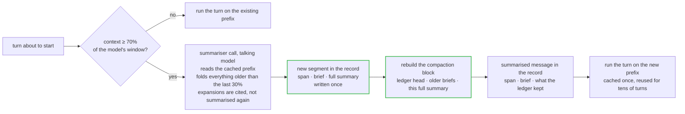

# Compaction in segments

When and how the lead's context is compacted. Spec: *Long conversations*.

Compaction happens at the start of a turn and never inside one; *Summarise now* by the person runs the same steps at once. A segment is never summarised again.
