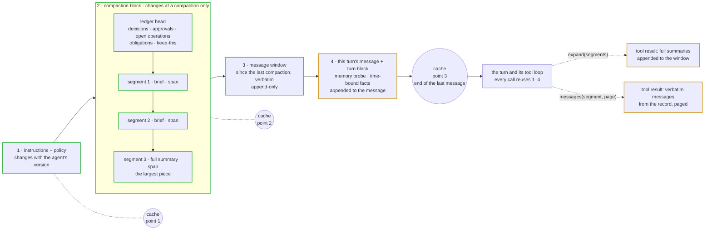

# How a turn's context is assembled

What the lead receives on each turn. Spec: *Long conversations*.

Green never moves between compactions and only grows at the end; orange is new each turn; the third breakpoint sits at the end of it, so the tool loop reuses everything up to and including this turn's message, and next turn it is window history. Three breakpoints where a provider wants them set: a compaction invalidates only what follows point 2, an ordinary turn only what follows point 3. An expansion is appended, never substituted into the block.
