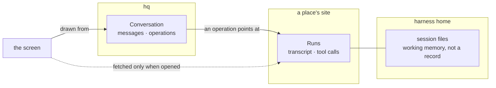

# Where a conversation's record lives

What is stored where once hq answers directly. Spec: *Where a conversation's record lives*.

The screen is built from hq. A run's detail is fetched from the site only when the person opens it. The harness's files are never read as a record; losing them restarts a worker, not the conversation.
