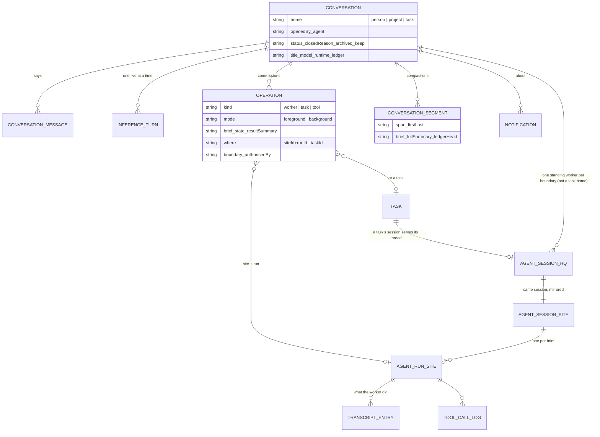

# Data model

One conversation, its records in hq, and the work it points at on a site. Spec: the overview's *Data model*.

Tables in capitals ending `_HQ` live in hq, `_SITE` on the site; `CONVERSATION`, `CONVERSATION_MESSAGE`, `INFERENCE_TURN`, `OPERATION` and `CONVERSATION_SEGMENT` are new in hq, and `NOTIFICATION` gains its link; the site's shape is unchanged. A sub-run has no row in hq: fan-out is the harness's helpers inside a run.
