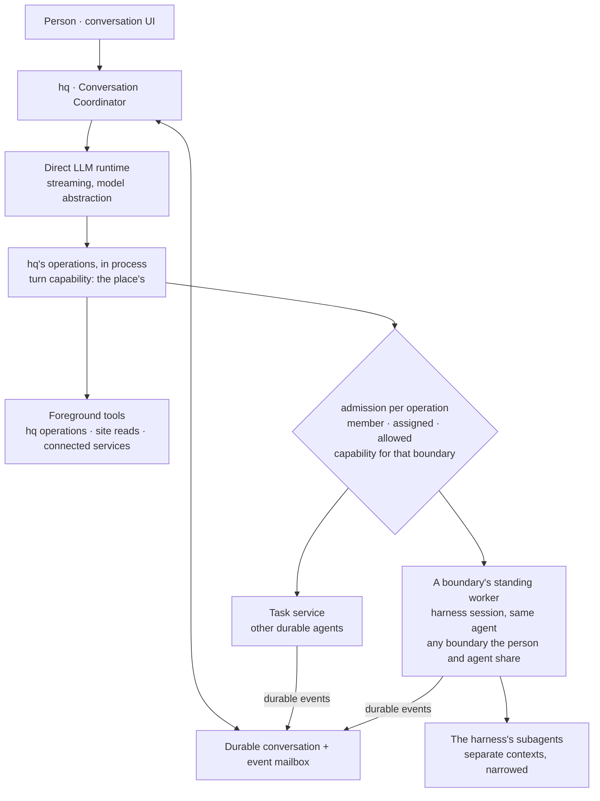

# Logical architecture

How a conversation's pieces fit, from the person to a boundary's harness. Spec: *Logical architecture*.

The coordinator owns admission, ordering, turns, the mailbox and recovery; a boundary's worker owns the work it is briefed with, and its helpers are the harness's own subagents.
