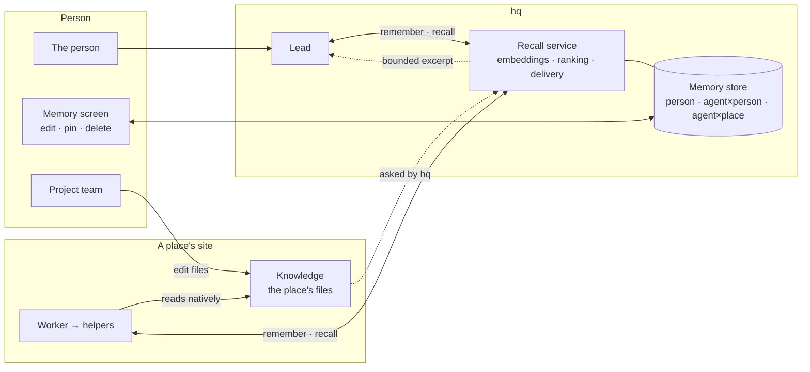

# Memory and knowledge — components

The pieces, and who reads and writes what. Spec: *Memory and knowledge*.

Memory is written only through `remember`; knowledge is edited only in the place; hq asks a site for a knowledge excerpt and keeps nothing.
