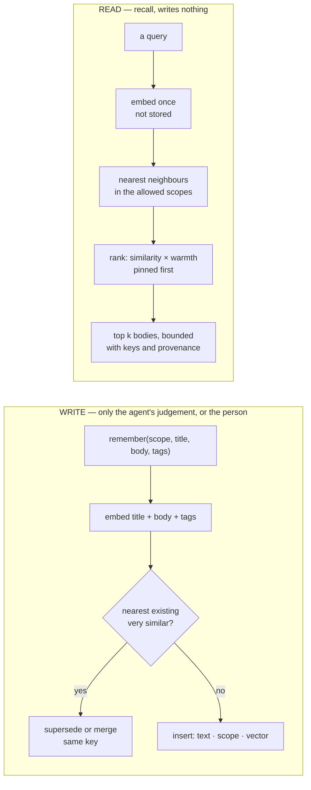

# Memory — write and read

The two pipelines and their triggers. Spec: *Memory and knowledge › Recall by meaning*.

Only the write side stores vectors. The read side embeds a query, uses it once, and writes nothing.
